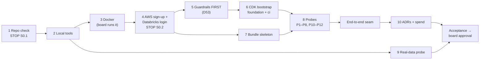

# Phase 0 · Feasibility spike — start here

> Read this page before any Phase 0 task. The plan decides: `docs/plan/PLAN-v4.0-source.md` §5 Phase 0 and §3.4. Where this page and the plan differ, the plan wins. Tell the Documenter (comment on PIP-23).

| | |
|:--|:--|
| **Status** | Started by the board on 2026-10-19 (PIP-11: "Start with the phase 0") |
| **Budget** | 12–16 h, week 1 |
| **Goal** | Show that every piece works on the new AWS account and on Databricks Free Edition **at \$0**, before any later phase depends on it |
| **Next** | Phase 1, Lifesaver launch (L8): the Duel, Real or luck? and the home page go live on AWS |
| **Manager** | VP of Engineering. While the VP is in error (PIP-12), the Chief of staff assigns tasks as interim |

## What we get at the end

- An AWS account on the **Free plan**, with MFA and the \$0 guardrails in place (D53, D54).
- A Free Edition workspace with catalog `ebook_ab_dev`, volume `ops.lakehouse_files`, secret scope `ebook` and a deployable bundle.
- GitHub signing in to both platforms with no long-lived keys (D48).
- Probes P1–P8 and P10–P12 passed, or their fallbacks recorded, with evidence in `docs/evidence/phase0/`.
- ADR-002, -005, -006 and -010 merged.

## The flow



Nothing touches AWS before step 5's guardrails are in place.

## Steps → tasks (status as of 2026-10-19)

| Step (§5 Ph0) | Task | Owner | Board needed? |
|:--|:--|:--|:--|
| — this page | PIP-23 P0-0 | Documenter | — |
| 1 Repo: `.gitignore`, MIT `LICENSE`, `tools/make_plan_md.py`; secret scanning + push protection; landing-page "Ask" placeholders | PIP-24 P0-1 | Backend engineer | **S0.1** before any change |
| 2 Local tools, no sudo: uv + Python 3.12, AWS CLI v2, Databricks CLI, Node LTS, `aws-cdk`, JDK 17 | PIP-25 P0-2 | AWS engineer | — |
| 3 Docker Engine (local Kafka + DynamoDB Local only) | PIP-26 P0-3 | AWS engineer | Board runs the apt lines + usermod |
| 4 AWS sign-up, root MFA, `andres-admin`, `us-east-1` (D38); Databricks login | — | **Board only** | **S0.2** |
| 5 Guardrails: 2 budgets, \$5 action, SNS e-mail topic, allow-list check in CI | PIP-27 P0-4 | AWS engineer | — |
| 6 `cdk bootstrap` + `foundation` and `ci` stacks; OIDC + 3 roles | PIP-28 P0-5 | AWS engineer | — |
| 7 `databricks.yml`: catalog, schemas, volume, secret scope + pepper, hello-world pipeline + Job, CI identity (O34) | PIP-29 P0-6 | Data Engineer (Databricks) | Board creates credentials |
| 8 Probes (table below), in `ebook_ab.tools.probes` + `probes.yml` | PIP-30 P0-7 | Data Engineer + AWS engineer | — |
| 8 End-to-end seam: OIDC → S3 `landing/` → volume → Job by API; refused outside its prefixes | PIP-31 P0-8 | Data Engineer + AWS engineer | — |
| 9 Real data: Upworthy CSV (14,260,949 bytes, 22,666 rows, 4,873 test IDs); Gutenberg RDF (parse 10 records) | PIP-32 P0-9 | Data Scientist | — |
| 10 Spend: S3 requests, AWS cost, Databricks run durations (O31, O35) | PIP-33 P0-10 | Finance controller | — |
| 10 ADR-002, ADR-005, ADR-006, ADR-010 | PIP-34 P0-11 | Architect + Documenter | — |
| Phase 1 design review | PIP-35 P0-12 | Architect | — |
| Acceptance report + approval request | PIP-36 P0-13 | QA → VP → Chief of staff | **Board approves** |

Drafts of the four ADRs and `phase-1-design-review.md` are already in `docs/adr/`. They are not merged yet.

## The probes (§3.4)

| Probe | Checks | If it fails |
|:--|:--|:--|
| P1 | AWS plan + allowed services: Lambda, DynamoDB, Step Functions, EventBridge Scheduler, CloudFront, S3, SNS, Systems Manager (O27) | Upgrade to paid at once (D54 earlier) |
| P2 | Databricks: catalog `ebook_ab_dev`, schemas, volume, groups, secret scope; bundle deploys a pipeline + Job (O2) | Default catalog with schema prefixes |
| P3 | Databricks identity from GitHub: workload identity federation (O34) | SP OAuth secret, then PAT ≤ 90 days (D48) |
| P4 | Files API from a runner: 100 files, rerun uploads 0; Auto Loader reads 100, then 0 | `databricks fs cp` |
| P5 | A dev pipeline beside prod under the one-active-pipeline limit (O3); dev fits the daily quota (O35) | Different hours; dev on a fixture |
| P6 | scipy + statsmodels pinned on serverless notebooks (O6) | Wheel on the volume |
| P7 | UC column mask, tags, grant to `bi_readers` on Gold only, lineage (O7, O8) | Mask at Silver; grants only |
| P8 | GitHub OIDC assumes `gha-pipeline`, writes under `landing/`, refused elsewhere | Fix the trust policy. **Never** fall back to access keys |
| P9 | *Waits for S1.1* (CloudFront flat-rate, function URL + OAC, WAF rule) | API Gateway HTTP API (D49) |
| P10 | DynamoDB provisioned 20 WCU/RCU (index 5): a burst of 300 votes/min is absorbed or throttled, never billed | Lower per-route limits |
| P11 | Step Functions Standard: 5-min Wait + Lambda step; transitions counted | EventBridge Scheduler one-time schedules |
| P12 | Cost: the probes' S3 requests + month-to-date bill in Cost Explorer (O31) | Revisit file sizes and listings |

## Board-only: agents prepare, the board does it

- **S0.1:** OK before any repo change, before secret scanning + push protection, and before the landing-page fix. The landing page stays on GitHub Pages until S1.1.
- **S0.2:** AWS sign-up (Free plan; note whether a card is asked, O27), root MFA, `andres-admin` + CLI key (`--profile ebook`, rotated every 90 days), the Databricks login and `databricks auth login`.
- Running the Docker install lines.
- Creating Databricks credentials. Any payment or plan upgrade (that's S1.1, Phase 1).
- Approving the end of Phase 0.

## Hard limits in this phase

- \$0: no paid AWS service, no cluster, no Databricks paid feature. Cost Explorer must show \$0.00.
- No secrets, account IDs or keys in tasks, comments, code or logs.
- No IP addresses or clear personal data outside Bronze.

## Done when (acceptance, §5 Ph0)

- [ ] The AWS account is on the Free plan, MFA is on, and both budgets and the action are in place
- [ ] P1–P8 and P10–P12 pass, or their fallbacks are recorded
- [ ] A GitHub workflow assumes `gha-pipeline`, lands files in S3, syncs them into the volume, triggers a Job by API, and is refused outside its prefixes
- [ ] The allow-list check fails a test branch that adds an `AWS::Glue::Job` to a production stack
- [ ] The real-data counts match the sources
- [ ] Cost Explorer shows \$0.00 out of pocket

```
aws sts get-caller-identity --profile ebook
aws budgets describe-budgets --account-id <id> --profile ebook | jq '.Budgets | length'   # 2
databricks bundle validate -t dev && databricks bundle deploy -t dev
gh workflow run probes.yml && gh run watch                                              # P3, P4, P8: PASS
uv run python -m ebook_ab.tools.probes local --profile ebook                            # P1, P2, P5-P7, P10-P12
uv run python -m ebook_ab.realdata.check                                                # upworthy rows=22666 tests=4873
```

## Links

- Plan: `docs/plan/PLAN-v4.0-source.md` — §5 Phase 0, §3.4, decisions D38, D48, D49, D53, D54, L8 (§2.9–2.11)
- Team and rules: `docs/plan/Agent-team-Paperclip.md`
- Evidence: `docs/evidence/phase0/` (created by the probe tasks)
- ADRs: `docs/adr/`
- Parent issue: PIP-11 (Plan)
