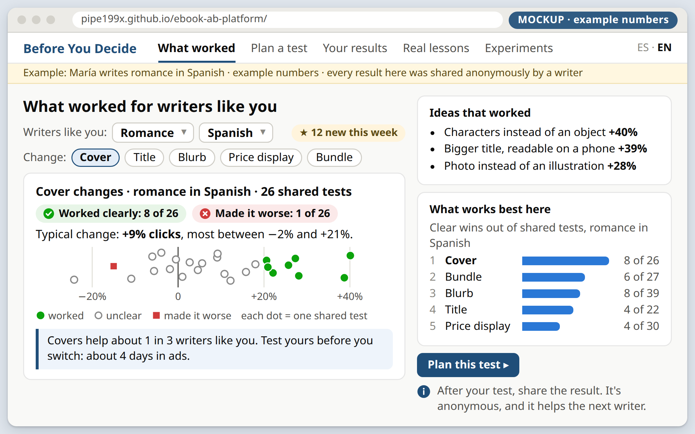
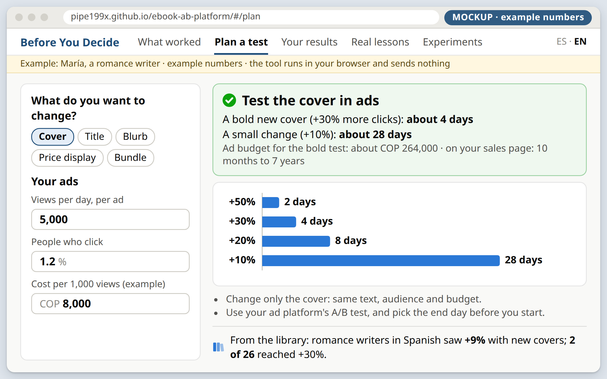
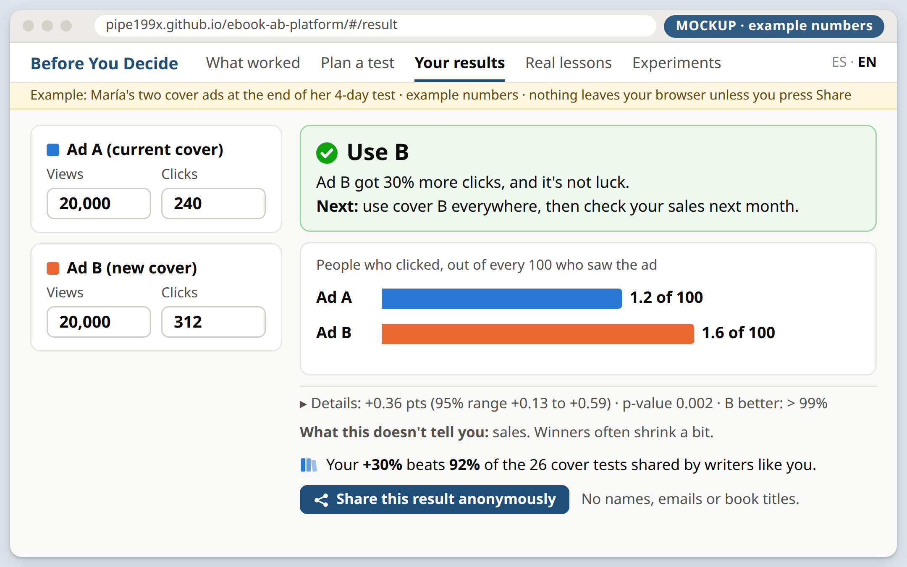
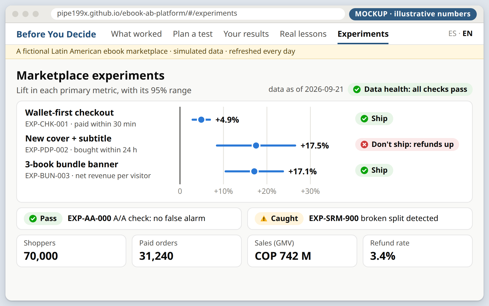

This is an A/B testing platform for a fictional Latin American ebook marketplace, built at $0. Simulated shoppers browse and buy real public-domain titles. Their events flow through Kafka into a Databricks Lakehouse (Bronze, Silver, Gold on Delta), and statistics turn them into a ship / don't-ship decision for each experiment. Around that core sit two pieces for real people: **Antes de decidir · Before You Decide**, a free public tool where writers see what worked for writers like them, plan and read their own ad tests, and share results anonymously; and lessons drawn from 4,873 real A/B tests.

---

## Context

> **What's new in v2.2.** You asked how to make writers come back again and again, like people do with a Word-to-PDF converter. You also noted that ad platforms already say which ad won. v2.2 answers both with **Antes de decidir · Before You Decide** (Q14–Q16, §2.7):
> - a **community library** of what worked for writers like you, by genre, book language and type of change. It is the first page of the website (§3.13);
> - writers can **share a test result anonymously** if they choose. Each shared result makes the library better for the next writer;
> - shared results go to a small **free service on Cloudflare** (Workers + D1 database), then into the lakehouse every night (§3.12);
> - the effort grows from ~127 h to **~146 h (123–168)**, about 7–8 weeks at 20 h/week (§5).

v2.1 made the tool writer-first: plan an ad test, then read the result as "use B", "keep A" or "not sure yet" (Q12–Q13, §2.6). The clickable demo of the final product, `docs/plan/DEMO.html`, already shows the library. Earlier PDFs are kept in `docs/plan/v1/`, `v2.0/` and `v2.1/` for comparison.

**Why v2.** You read plan v1 and sent 8 points (2026-10-15):
- switch the domain to helping ebook sellers sell more;
- make the project useful to real people, with real data where possible;
- the 41 Gold views were only an example;
- job clusters instead of serverless;
- React or Angular instead of Power BI;
- an easier, more visual PDF, ideally interactive, that says what we achieve at the end;
- local vs AWS, why Docker, and which accounts you need.

I answered each point and you chose the recommended option in four new decisions (Q8–Q11, §2.3). v2 rewrites the plan around them.

**What changed from v1**

| Area | v1 | v2 |
|----------------------------|--------------------------------------------------------------------|--------------------------------------------------------------------------------------------------------|
| Domain | Colombian fintech: payments, microcredit, savings | LatAm ebook marketplace. The checkout keeps the payments parts (PSE, wallets, cards, fraud, refunds, chargebacks). |
| Experiments | EXP-PAY-001, EXP-LEND-002, EXP-SAV-003 | EXP-CHK-001 wallet-first checkout, EXP-PDP-002 new cover + subtitle, EXP-BUN-003 3-book bundle |
| Topics | `fintech.*` × 5 | `market.*` × 5 (still 5 × 2 partitions) |
| Gold | 41 MVs | 18 MVs, each with a named consumer |
| Real data | none | Upworthy Research Archive (CC BY 4.0), Project Gutenberg catalog (CC0 metadata) |
| BI | Power BI Desktop + AI/BI | React + TypeScript site on GitHub Pages, including the free seller tool |
| Compute | serverless only | Free Edition serverless in the cloud, plus a local throwaway Spark cluster with job-cluster lifecycle |
| Laptop | needed for every run | A daily end-to-end run on GitHub Actions needs no laptop |
| Repo | fintech-ab-platform | ebook-ab-platform (free on GitHub, checked 2026-10-15) |
| Effort | ~103 h | ~127 h (108–146) in v2.0; **~146 h (123–168) in v2.2**, about 7–8 weeks at 20 h/week |

Everything else carries over with the new names:
- Kafka, Path A vs B and the Phase 0 rule;
- the bridge's commit protocol;
- the Bronze/Silver/Gold design, the statistics and the validity proofs;
- the $0 rule and the STOP points.

**Starting point** (verified 2026-10-15, read-only):
- Same machine facts as v1: Windows 10 + WSL2 Ubuntu 26.04, 7.7 GiB RAM, 8 vCPU, OpenJDK 25, `gh` logged in as Pipe199x.
- The PDF toolchain is now installed in WSL user space: pandoc 3.12.1, Typst 0.15.1, Node 24.22.0, mermaid-cli 12.0.0 with Chrome headless shell.
- `docs/plan/` holds the plan sources. There is still no git repo, no Aiven account and no Cloudflare account.

**Intended outcome:** PDF v2.2 plus the interactive companion page and the clickable demo, rendered offline. You review them, then ask for changes or say "start Phase 0".

---

## 0. Leaving plan mode: render for your review, then STOP

The rule is the same as v1. **Accepting the exit from plan mode authorizes only steps 1–6 below.** It does not approve the plan. You approve it after reading: either ask for changes (I revise and re-render) or say "start Phase 0". Until then: no `git init`, no GitHub repo, no Aiven or Databricks actions.

1. **Regenerate the docs.**
   - `docs/plan/PLAN.md` is this plan verbatim; only the Mermaid blocks become images.
   - The generator moves from my scratchpad into `tools/make_plan_md.py`, so re-renders are reproducible.
   - The v1 PDF moves to `docs/plan/v1/PLAN.pdf` for comparison (v2.1: the v2.0 PDF moves to `docs/plan/v2.0/`; v2.2: the v2.1 PDF moves to `docs/plan/v2.1/`).
2. **Draw the figures** offline, with the tools already installed:
   - Ten Mermaid diagrams in `docs/plan/diagrams/`: big_picture, purchase_journey, small_seller (bar chart), timeline (Gantt), path_a, path_b, bridge_protocol, phase0_rule, job_cluster, site_flow.
   - Four website mockups, `docs/plan/mockups/*.html`, rendered to PNG with the headless Chrome that mermaid-cli installed: Before You Decide (the community library), Plan an ad test, Read your ad results (with the share button), Marketplace experiments. Their numbers are illustrative and labelled as such.
3. **Render the PDF** with the same pandoc → Typst pipeline.
   - Part 1 gets a visual layout: one idea per page, large figures, short text, callout boxes.
   - Part 2 keeps the technical tables, on landscape pages where they are wide.
4. **Build the interactive companion**, `docs/plan/PLAN.html`. It is one self-contained file that needs no internet:
   - a clickable architecture where each box explains itself;
   - a "my traffic" slider that shows how long a test takes;
   - a step-through of one purchase's journey;
   - the phase timeline, the costs and the accounts.

   I also publish it as a **private** claude.ai page so you can open it on your phone. Only you see it unless you share it; tell me if you'd rather I didn't.

   The clickable demo of the final product, `docs/plan/DEMO.html`, is rebuilt the same way and published as a second private page.
5. **Check.**
   - PNG previews give the page count. I look at every Part 1 page and every page with a figure.
   - I click through the HTML in headless Chrome and screenshot each state.
   - I print both Windows paths and the private link.
6. **STOP.**

---

## Part 1 · The story in pictures

Part 1 is the plain-language version: what we build, why, what you get, and who does what. Part 2 holds the technical detail behind every claim.

## A. What we're building

> In one sentence: **a data platform for a fictional Latin American ebook marketplace that tests ideas safely and decides what to keep, plus *Antes de decidir · Before You Decide*, a free tool where real writers learn from each other's tests.**


{width=70%}


- **The problem.** Writers change covers, titles, blurbs and offers all the time. Most can't tell a real improvement from luck, because one writer rarely has enough readers to learn from (section D). An ad platform's A/B test says which of *your* two ads won. It doesn't say what usually works for books like yours.
- **What we build:**
  1. **The marketplace platform.** Simulated shoppers buy real public-domain titles. A real Kafka + Databricks pipeline runs three experiments at marketplace scale, and statistics decide ship or don't ship.
  2. **Antes de decidir · Before You Decide**, a free public tool for writers, in Spanish and English:
     - **before a decision**, a writer sees what worked for writers like them: same genre, same book language, same kind of change (cover, title, blurb, price display or bundle);
     - **to test it**, the tool says how long to run the test in ads and what it costs;
     - **after the test**, it reads the result in plain words (use B, keep A, or not sure yet), and the writer can **share it anonymously**. Each shared result makes the library better for the next writer.
  3. **Lessons from real experiments.** We analyze 4,873 real headline A/B tests and publish what they teach about titles. The same numbers make the tool's expectations realistic while the library is still small.
- **Who benefits:**
  - writers get better decisions for free, and each shared result helps the next writer;
  - marketplace teams get a reference design;
  - you get a portfolio that shows end-to-end data engineering and experimentation skills.

## B. What you'll have at the end

<!-- mockups:start -->









<!-- mockups:end -->

1. **A public website** at `pipe199x.github.io/ebook-ab-platform`:
   - **Before You Decide**, the home page: what worked for writers like you, from results other writers shared;
   - the ad-test tool: *Plan an ad test* and *Read your ad results*, with a button to share the result anonymously;
   - *Real lessons* from 4,873 tests;
   - the *Marketplace experiments* dashboard, with three decisions and their evidence.
2. **A pipeline that runs every day without your laptop.** GitHub Actions simulates one day of shopping, which flows through Kafka into Databricks, and it brings in the results writers shared that day. The pipeline checks quality, the statistics update, and the website refreshes, library included.
3. **A governed lakehouse.** Bronze, Silver and 18 Gold views, with access grants, masked personal data, tags and lineage.
4. **Proof the statistics are right:**
   - the analysis recovers the effects we planted;
   - fake A/B splits produce false alarms at the expected ~5% rate;
   - a broken split is detected.
5. **A local job cluster.** A fresh Spark cluster starts for a run and is deleted afterwards. A performance lab on it shows before/after numbers.
6. **A public repo** with tests and green CI, a runbook, design decisions (ADRs), one-page decision memos, and a README a recruiter can read in 5 minutes.

## C. The journey of one purchase


{width=45%}


- **Kafka** is like a post office. It keeps every letter in order, and several readers can collect the same letters independently.
- **Bronze, Silver, Gold:**
  - Bronze holds the original letters, untouched.
  - Silver holds the checked and cleaned copies, with personal data hidden.
  - Gold holds the summaries people actually read.
- **Rules written before the test** work like a referee who sets the rules before the game. Nobody can move the goalposts after seeing the score.

## D. Why small sellers struggle with A/B tests


{width=100%}


The chart assumes 50/50 split, α = 0.05 two-sided and 80% power. Visitors needed per variant:

| Lift | Per variant | Months at 2,000/month |
|----------------------------------|----------------------------------------------------------------|------------------------------------------------------------------------------------------------------|
| +10% | 80,682 | 80.7 |
| +20% | 21,109 | 21.1 |
| +30% | 9,798 | 9.8 |
| +50% | 3,826 | 3.8 |
| +100% | 1,141 | 1.1 |

- **What this means:** a small seller can't test small tweaks. A "win" after a lucky week is usually noise.
- **What helps:**
  - **test in ads, where traffic is fast.** Two ads that differ only in the cover can show a bold difference (+30% more clicks) in about 4 days at 5,000 views a day per ad. On a sales page with 2,000 visitors a month, the same test takes years;
  - test big changes: offers, bundles, how the price is presented;
  - treat clicks as a fast first signal, then check sales afterwards;
  - start from realistic expectations taken from real tests, so a lucky streak is not trusted;
  - **pool what many writers learned.** One writer's test is small, but hundreds of shared results show which changes usually work for a genre. A marketplace pools traffic the same way.
- **The free tool turns this into plain advice:** what worked for others, what to test, where, for how long, and what the result means.

## E. Who does what, and when

| When | You do | I do |
|------------------------------|--------------------------------------------------------------------------------------------------------|------------------------------------------------------------------|
| Now | Read PDF v2.2, the interactive page and the demo. Ask for changes or say "start Phase 0". | Revise and re-render on request |
| Phase 0 | OK the public repo (S0.1). Run about 6 `sudo` lines for Docker. Log in to Databricks in the browser. Sign up to Aiven, about 10 minutes (S0.2). LinkedIn verification only if needed (S0.3). Sign up to Cloudflare's free plan, about 5 minutes (S0.4). | Repo, tools, probes, evidence, the local-cluster spike |
| End of every phase | Run the commands I give and paste the output | Code, tests and docs. Then I wait for your results. |
| Phase 6 | OK the first public deploy of the website and the sharing service (S6.1) | Website, tool, library, sharing service, data export |
| Phase 7 | OK the repo secrets (Databricks, Cloudflare) and the daily public refresh (S7.1) | Workflows and the daily run |
| End | Review the site, the memos and the report | Final docs and the clean-clone dry run |

> **Accounts.**
> - New:
>   - **Aiven** (free Kafka, no card): https://console.aiven.io/signup;
>   - **Cloudflare** (free plan, for the anonymous sharing service; a card is not expected, and we check at sign-up): https://dash.cloudflare.com/sign-up.
> - Already have: Databricks Free Edition and GitHub (`Pipe199x`).
> - Not needed: AWS, Microsoft/Power BI, Docker Hub, npm, PyPI, Vercel, Supabase.


{width=100%}


## F. What it costs: $0

| What | Cost | Note |
|----------------------------------------------------------------------------|--------------|------------------------------------------------------------------------------------------------------------|
| Databricks Free Edition | $0 | Serverless only, with a daily fair-use quota |
| Aiven Kafka free tier | $0, no card | 5 topics × 2 partitions |
| Cloudflare Workers + D1, free plan | $0 | 100,000 requests a day; 5 GB of storage; holds the anonymous shared results |
| GitHub repo, Actions, Pages | $0 | Public repo, standard runners |
| Docker, Kafka, Spark, Delta, React, Python libraries | $0 | Open source |
| Real data: Upworthy, Gutenberg | $0 | CC BY 4.0 / CC0 metadata |
| **Total** | **$0** | Your Claude plan, laptop and internet are outside the rule |

**What I said no to:**

| Option | Why not |
|--------------------------------------------------------------------|------------------------------------------------------------------------------------------------------------------------------------|
| Real Databricks job clusters | Not available in Free Edition. A paid workspace costs about $40–60/month; the NAT gateway alone is about $33. |
| AWS | The free plan is an expiring trial: 6 months or $100–200 of credits. |
| Power BI | You chose React. Sharing would need Pro at $14/user/month. |
| Confluent Cloud, Databricks trial | Their credits expire. |
| Supabase free, as the main store for shared results | Free projects pause after about a week of low activity. It stays the fallback (D23). |

---

## Part 2 · Technical plan

Sections 1–9 below are the nine contents you asked for in the original brief.

## 1. Executive summary and scope

### 1.1 Summary
A simulator built on Faker `es_CO` and confluent-kafka plays **70,000 synthetic shoppers** over 92 simulated days (2026-06-22 → 2026-09-21). They shop a fictional Latin American ebook marketplace whose catalog is **real**: about 2,000 public-domain titles from Project Gutenberg's offline catalog (CC0 metadata), with demand weighted by real 30-day download counts.

Three concurrent experiments run on top. The simulator injects **known true effects** and scheduled faults:
- **EXP-CHK-001**, wallet-first checkout;
- **EXP-PDP-002**, new cover + subtitle;
- **EXP-BUN-003**, a 3-book bundle banner.

Events go to 5 Kafka topics (2 partitions each). The topics are identical locally (Docker, KRaft), on Aiven's free tier, and in CI service containers. They reach Databricks Free Edition in one of two ways:
- **Path B:** `lakehouse-bridge`, a real consumer group that lands idempotently named files in a Unity Catalog volume for Auto Loader. It is always built.
- **Path A:** Spark's Kafka source, added only if Phase 0 proves serverless can reach Aiven.

One triggered Lakeflow Spark Declarative Pipeline builds everything:
- Bronze: raw streaming tables, including three file sources for real data (catalog, Upworthy, writers' shared results);
- Silver: typed, deduplicated and quarantined streaming tables, plus an SCD2 users table with hashed and masked PII;
- Gold: 18 metadata-driven materialized views.

Notebooks then:
1. check validity (SRM, A/A, invariants);
2. run the pre-registered tests (z-test, Welch/bootstrap, CUPED, Holm/BH, fixed horizon);
3. write `gold.experiment_results` and one-page memos;
4. prove themselves against the injected truth.

A real-data notebook fits a random-effects model to 4,873 real Upworthy headline tests. It publishes the lessons and a realistic prior.

The public React site on GitHub Pages shows the experiments and hosts **Antes de decidir · Before You Decide**, the free tool for writers:
- its home page is a **community library** of what worked for writers like you, built from results that writers shared anonymously;
- its ad-test assistant (plan a test, read a result) runs entirely in the browser;
- a writer can share a result. Only then does anything leave the browser: one small anonymous record, sent to our own endpoint (a Cloudflare Worker that stores it in a free D1 database).

GitHub Actions exports small Gold summaries to JSON after each run, and imports the day's shared results into the lakehouse, where notebook `13_community_summary` rebuilds the library. A Lakeflow Job orchestrates the runs, Declarative Automation Bundles deploy them, and a daily GitHub Actions run drives the whole loop without the laptop.

A **local throwaway Spark cluster** (Docker: 1 master + 2 workers, created per run and deleted after it) gives the job-cluster experience at $0. It hosts the Spark UI performance lab.

### 1.2 In scope
- Brief items 1–10, adapted to the new domain:
  - the producer and contracts;
  - both consumer groups;
  - Bronze, Silver, Gold;
  - analysis and proofs;
  - the plain Structured Streaming track;
  - performance and observability;
  - orchestration and CI/CD;
  - compliance.
- Deliverables 0–6.
- New:
  - the public website and the writer tool;
  - the real-data track;
  - the local job cluster;
  - the laptop-free daily run;
  - Before You Decide: the community library and opt-in anonymous sharing (Q14–Q16).

### 1.3 Out of scope

| Item | Why |
|--------------------------------------------------------------------------------|------------------------------------------------------------------------------------------------------------------------|
| Real customers and real PII | Synthetic data only. Free Edition also reserves the right to train on workspace data. |
| Sending a writer's numbers anywhere without their OK | The tool computes in the browser. Only a result the writer chooses to share is sent, and it holds no personal data (D24). |
| Writer accounts, logins, free-text comments | Anonymous sharing needs none of them. Free text invites personal data and spam (D25). |
| A live, real-time library | The library refreshes every night with the daily run. The site stays static (D12). |
| Storing IP addresses | The rate limit uses a hash that changes every day and is deleted after a day (D25). |
| Mixing simulated results into the real library | The demo uses simulated results. The real site shows only real shared results (D26). |
| Showing different prices to different people | Ethically and legally sensitive (D20). We test how the price is presented, not the price. |
| Real Databricks job clusters, AWS | Not $0 (§4.1). Replaced by the local job cluster. |
| Power BI | Replaced by the React site (Q10). |
| Sequential testing (mSPRT) | Fixed horizon (Q6). The cumulative-lift view is labeled "monitoring only". |
| Avro + Schema Registry, Kafka Connect, MirrorMaker 2 | ADR-004. Connect and MM2 are not on Aiven's free tier. |
| Book texts and real cover images | We use only CC0 metadata. Covers in the UI are generated SVGs. |
| AI/BI dashboards | Optional stretch, 1–2 h. The React site is the BI layer. |
| SLAs, HA, multi-region, ML models | Portfolio scope. |
| Test guides for newsletters, own sales pages and big stores | Not chosen in Q13: the writers in scope promote with ads. The tool's math still works for any two-version test. |

### 1.4 Additions and deviations from the brief
None of these is silent. Each is explained.

| ID | Change | Reason |
|----------|--------------------------------------------------------------------------------------------------------------|--------------------------------------------------------------------------------|
| A1 | The topics are named `market.*` instead of `fintech.*`. Still exactly 5 topics × 2 partitions. | The domain changed (Q8). |
| A2 | Validation fixtures `EXP-AA-000` (A/A) and `EXP-SRM-900`, which drops 5% of treatment exposure logs. | The A/A and SRM proofs run on real pipeline data. |
| A3 | Landing path `topic/epoch/partition/firstOffset-lastOffset.jsonl.gz`. | Offsets restart when Aiven powers off or a CI Kafka is created per run. The epoch keeps file names unique. |
| A4 | Bronze adds `source_epoch`, `_ingest_path` and `_source_file` on both paths. | Keeps the schema identical across paths and the lineage auditable. |
| A5 | `schema_version` lives on the envelope. v2 adds an optional `network_type` from 2026-07-20. | Lets `from_json` parse each version cleanly. |
| A6 | `gold.experiment_results` and `gold.real_prior` are Delta **tables** written by notebooks, not MVs. | A notebook can't write an MV. |
| A7 | One volume, `ops.lakehouse_files`, with folders `landing/`, `landing_real/`, `checkpoints/`, `artifacts/`. | Holds landing files, checkpoints and artifacts. |
| A8 | Gold has 18 views instead of 41, and every view names its consumer. | Your point 1. |
| A9 | Two file-based Bronze sources (catalog, Upworthy) sit beside the 5 Kafka sources. | Real data arrives as files, not streams (Q9). |
| A10 | Phases are renumbered 0–9: the website is Phase 6, job cluster + performance is Phase 8, docs are Phase 9. | New scope. |
| A11 | Catalogs `ebook_ab` / `ebook_ab_dev`; Python package `ebook_ab`; job and pipeline names use the `ebook_` prefix. | The domain changed. |
| A12 | The "job cluster" requirement is met by a local throwaway Spark cluster, plus a never-deployed `job_clusters` bundle target. | Free Edition is serverless only (§4). |
| A13 | Bayesian readouts with an empirical prior appear only in the public tool. Platform decisions stay frequentist, fixed-horizon and pre-registered. | Q6 still holds for the platform. Small sellers need decision-oriented answers. |
| A14 | The daily schedule lives in GitHub Actions, which triggers the Lakeflow Job `ebook_daily` by API. The bundle also keeps a **paused** 06:30 Bogotá schedule as a fallback. The pipeline stays triggered, never continuous. | Data must be produced and landed before the job runs, and that happens in the GitHub run. |
| A15 | A third file-based Bronze source, `community_raw`, filled by a daily export from D1 to `landing_real/community/`. | Shared results arrive through a web endpoint, not Kafka. Files keep one ingestion pattern for outside data (A9). |
| A16 | `gold.community_summary` is a Delta **table** written by notebook `13_community_summary`. The 18 Gold MVs are unchanged. | The random-effects summary runs in Python, like A6. |
| A17 | A small edge service in `edge/`: a Cloudflare Worker + D1, outside Databricks and GitHub. | A static site can't receive data, and a Databricks App needs sign-in and stops after 24 h (§4.1). |

---

## 2. Decisions log

### 2.1 Round 1 (plan v1 interview, 2026-10-15)

| # | Question | Options offered (recommended first) | Your answer | Consequence in v2 |
|--------|--------------------------------------------|------------------------------------------------------|--------------------------------|--------------------------------------------------------------|
| Q1 | Which accounts do you already have? | Databricks Free Edition · LinkedIn-verified · Aiven account · Aiven free Kafka running | **Databricks Free Edition** only | Phase 0 has STOP points for the Aiven sign-up and, if needed, LinkedIn verification. |
| Q2 | Hours per week? | ~10 h (Rec.) · ~5 h · ~20 h | **~20 h/week** | ~146 h in v2.2 → about 7–8 weeks. |
| Q3 | Repo name? | fintech-ab-platform (Rec.) · fintech-ab-lakehouse · colombia-fintech-experimentation | **fintech-ab-platform** | **Changed to `ebook-ab-platform`** because the domain changed (D17). Veto it at review if you prefer the old name. |
| Q4 | Plan language? | English (Rec.) · Spanish · English + Spanish summary | **English** | Docs in English. The public site is Spanish + English. |
| Q5 | Docker runtime? | Docker Engine in WSL2 (Rec.) · Docker Desktop | **Docker Engine in WSL2** | Runs Kafka and the local Spark cluster. |
| Q6 | Peeking policy? | Fixed horizon only (Rec.) · Add mSPRT interim looks | **Fixed horizon only** | One readout per experiment at its cutoff. |
| Q7 | Injected truth story? | Mixed outcomes (Rec.) · All three ship · Mixed with a true null | **Mixed outcomes** | Expected verdicts: CHK ship; PDP **don't ship** (buyers up, refunds way up); BUN ship. |

### 2.2 Your 8 points on v1, and what changed

| # | Your point | What changed |
|--------|--------------------------------------------------------------------|----------------------------------------------------------------------------------------------------------------------------|
| 0 | Ebook sellers instead of fintech? | The domain is now a marketplace with a payments checkout (Q8). The small-traffic caveat is built in: the marketplace pools traffic, and the tool explains the caveat to sellers. |
| 1 | 41 views were only an example | Gold has 18 views, each with a named consumer (A8). |
| 2 | Real monetary impact; real data? | A free seller tool, real-data lessons, and the simulation kept as proof (Q9). |
| 3 | Job clusters instead of serverless | Impossible on Free Edition under the $0 rule. Replaced by the local throwaway cluster plus a `job_clusters` config (Q11, ADR-006). |
| 4 | Easy, visual, interactive; what we achieve | Part 1 tells the story in pictures. Section B lists what you'll have at the end. The interactive companion page adds the rest. |
| 5 | React or Angular, not Power BI | React + TypeScript on GitHub Pages (Q10). Power BI is removed. |
| 6 | Local or AWS? | The design was already hybrid. AWS is rejected (§4.1). A laptop-free daily run on GitHub Actions replaces it (D19). |
| 7 | Why Docker? | Same Kafka locally and in CI, plus the local Spark cluster. Kept (Q5). |
| 8 | Which accounts? | Aiven is new. v2.2 adds Cloudflare's free plan for the sharing service (Part 1, E). |

### 2.3 Round 2 (2026-10-15)

| # | Question | Options offered (recommended first) | Your answer | Consequence |
|--------|--------------------------------------------|------------------------------------------------------|--------------------------------|--------------------------------------------------------------|
| Q8 | Which domain should the platform serve? | Ebook marketplace + payments (Rec.) · Ebook sellers, content only · Keep the Colombian fintech | **Ebook marketplace + payments** | The checkout keeps payment methods, fraud, refunds and chargebacks as guardrails. |
| Q9 | How should the project create real-world impact? | Tool + real data + simulation (Rec.) · Tool + simulation, no real data · Simulation only | **Tool + real data + simulation** | §3.12 (real data) and §3.13 (tool). |
| Q10 | Which frontend stack and hosting? | React + TS on GitHub Pages (Rec.) · Angular on GitHub Pages · React as a Databricks App | **React + TS on GitHub Pages** | A static site. CI exports JSON. No tokens in the browser. |
| Q11 | Job clusters: keep $0 or pay? | $0: local job cluster (Rec.) · Pay for real job clusters · $0: serverless only | **$0: local job cluster** | §3.14 and ADR-006. |

### 2.4 Verified instead of asked (2026-10-15)
- **GitHub:**
  - `Pipe199x`.
  - Repo names `ebook-ab-platform`, `ebook-ab-lakehouse` and `creator-ab-platform` are all free.
  - Action versions: checkout v7.0.1, setup-node v7.1.0, setup-uv v10.3.0, configure-pages v6.0.0, upload-pages-artifact v5.0.0, deploy-pages v5.0.1, databricks/setup-cli v1.21.0 (Databricks CLI v1.21.0 was released 2026-10-14).
- **npm** (latest; versions re-pinned at Phase 6 start): react 19.3.1, vite 8.3.4, typescript 7.0.2, @vitejs/plugin-react 6.1.2, echarts 6.1.0, i18next 26.4.5, react-i18next 17.0.17, vitest 5.0.5, @testing-library/react 16.3.3.
- **Spark image:** `apache/spark:4.2.0-scala2.13-java21-python3-ubuntu` exists (updated 2026-07-16).
- **delta-spark:** 4.4.1 (2026-10-05) requires `pyspark>=4.0.1,<=4.2.0`. Note that the Delta docs' compatibility table still lists only Spark 4.0/4.1, for 4.3.x and older.
- **Brand name:** one candidate brand name ("Librora") is already an app, so the marketplace stays **unnamed** (D18).

### 2.5 Lead decisions (my calls; override them at review)

| ID | Decision | Rationale |
|----------|--------------------------------------------------------------------------------------------------------------|--------------------------------------------------------------------------------|
| D1 | The repo lives at `D:\abtesting`. Heavy local data lives on WSL ext4: Docker volumes and `~/ebook-data`. | Windows tools need Windows paths; Linux I/O stays on ext4 ([WSL docs](https://learn.microsoft.com/en-us/windows/wsl/filesystems)). |
| D2 | Python **3.12** via `uv`, with one lockfile. | Matches serverless environment v6 (Python 3.12.3). |
| D3 | Local PySpark **4.2.0** with delta-spark **4.4.1**. The Spark cluster image ships Java 21; host tests use OpenJDK 25 (Spark 4.2 supports 17/21/25). | One Spark version everywhere. |
| D4 | Kafka **4.2** everywhere (`apache/kafka:4.2.2`; `kafka_version=4.2` on Aiven). | No version drift. |
| D5 | The Path B flow is always on. It carries the daily run, local Kafka and the kill test. A Path A Kafka flow is added only if Phase 0 passes. | Bronze is identical either way; epochs keep coordinates distinct. |
| D6 | JSON + JSON Schema (draft 2020-12) contracts in Git. | ADR-004. |
| D7 | Primary metrics are user-level. Ratio metrics use the delta method. | Users are the randomization unit. |
| D8 | N = **70,000** shoppers over 92 days. | Sized by EXP-PDP-002, the binding constraint (§3.19). |
| D9 | Producer settings: idempotence, `acks=all`, zstd, a 50 KiB/s token bucket, `throttle_cb`. Kafka timestamps are **send time**. | Aiven limits; retention safety. |
| D10 | Silver dedup is a 1 h watermark on `event_ts` + `dropDuplicatesWithinWatermark(["event_id"])`. | 2× the maximum injected lateness. |
| D11 | Keyed SHA-256 hashes (a pepper in the secret scope) make the join keys. UC masks hide display columns. Gold has no PII. | Ley 1581 minimization. |
| D12 | The **React site is static**: Gold → JSON in CI → GitHub Pages. No Databricks token ever reaches a browser. | $0, public, secure. A Databricks App needs sign-in and stops after 24 h. |
| D13 | Primary: two-sided α = 0.05. Secondaries: Holm. Segments: BH q = 0.10. Guardrails: one-sided α = 0.05. | Unchanged. |
| D14 | Catalogs `ebook_ab_dev` / `ebook_ab`, chosen by a bundle variable. Fallback: `workspace`. | |
| D15 | The job failure email is `${workspace.current_user.userName}`. | Keeps your address out of the repo. |
| D16 | MIT license, `.env` git-ignored, secret scanning + push protection on. | |
| D17 | The repo is `ebook-ab-platform`, which replaces `fintech-ab-platform`. | The domain changed. Name checked as free. |
| D18 | No brand name: the site calls it "a fictional Latin American ebook marketplace" and shows a banner. | Avoids clashing with real brands. |
| D19 | The daily laptop-free run uses an **ephemeral Kafka service container** in GitHub Actions, with one epoch per run, plus the bridge. Aiven is used for the cloud backfill and demos. | Aiven's free tier powers off when idle, and its docs mention power-on only from the console. A CI Kafka always works. |
| D20 | Experiment ethics: no individual price differences, no fake urgency or scarcity, presentation-only changes, invariants that prove prices are identical across arms. | Fairness and consumer trust (see O12). |
| D21 | Real data comes from the Upworthy **exploratory** sample only; the confirmatory sample is reserved for registered reports. We use Gutenberg **metadata** only. | Follows each source's guidance and license. |
| D22 | The public site sets no cookies, has no analytics and makes no third-party requests. Tool math runs in the browser. **Amended by D24** for the opt-in share. | Privacy by design. |
| D23 | Shared results are stored with a **Cloudflare Worker + D1** on the free plan. Fallbacks: Supabase free; then moderated submissions through GitHub. | $0 with no expiring credits. D1 has no pause for low activity (Supabase free projects pause after about a week), and 100,000 requests a day is far above our need. The GitHub fallback would force writers to have an account. |
| D24 | The only request that leaves a visitor's browser is the **opt-in Share**: one POST to our own endpoint, after the writer reviews every field and presses Share. Still no cookies, no analytics, no third-party scripts. | Keeps D22's promise, with one visible, voluntary exception. |
| D25 | Anti-abuse without accounts: JSON Schema validation, fixed lists (genre, book language, change type, idea tags), number ranges, clicks ≤ views, fair tests only (views ratio < 1.5), duplicate payloads rejected, a cap of 5 shares per visitor a day, outlier flags, and robust statistics (median, middle half, minimum cell size). The cap uses a daily-salted hash of the IP address that is never stored for more than a day. | Spam and poisoning are the main risks of open sharing (R34). No free text, so nothing personal can be typed in. |
| D26 | Cold start: the real site shows **only real shared results**. A genre × book language × change with fewer than 5 results shows "Not enough results yet: be one of the first", plus the general lessons from the 4,873 real headline tests. Simulated data never enters the real library; the demo stays simulated and labelled. | Honesty. A library padded with invented results would mislead the writers it is meant to help (R35). |
| D27 | The library is published as **open data (CC BY 4.0)** in `library.json`: counts, summaries, idea tags and rounded lifts. Raw shared records (views, clicks, dates, IDs) are never published. A writer gets a receipt code after sharing and can withdraw the result with it. | Gives back to the community. Summaries protect writers in small groups (R37). The receipt builds trust. |

### 2.6 Round 3 (plan v2.1, 2026-10-15)
You asked what an ebook writer would actually do with the tool.

| # | Question | Options offered (recommended first) | Your answer | Consequence |
|--------|--------------------------------------------|------------------------------------------------------|--------------------------------|--------------------------------------------------------------|
| Q12 | How should the product be clearer for a writer? | Writer-first redesign (Rec.) · Add one writer's walkthrough only · The explanation is enough | **Writer-first redesign** | The seller tool becomes a guided assistant: what to change, where, for how long, and a plain verdict (§3.13). The demo separates "for writers" from "behind the scenes". |
| Q13 | Where do the writers in mind sell or promote? | Ads · Email newsletter · Own sales page · Big stores (multi-select) | **Ads** | The tool plans and reads **ad tests**. An optional sales-page comparison shows why testing there is slow. Other channels are out of scope (§1.3). |

### 2.7 Round 4 (plan v2.2, 2026-10-15)
You made two points:
- writers must come back again and again, like people do with a Word-to-PDF converter;
- ad platforms such as Meta already say which of two ads won, so where is the magic?

My answer: one writer's numbers are too small to learn much from, but many writers' results together are enough. An ad platform sees one advertiser's two ads; this tool pools what many small writers learned, by genre, book language and type of change. Writers come back **before each decision** to see what worked for others, and **after each test** to share their result.

| # | Question | Options offered (recommended first) | Your answer | Consequence |
|--------|--------------------------------------------|------------------------------------------------------|--------------------------------|--------------------------------------------------------------|
| Q14 | Which hooks should bring writers back? (multi-select) | Before you decide + journal (Rec.) · Real or luck? quick check (Rec.) · Community library (Rec.) · Weekly check-in | **Community library** | The library becomes the home page of the writer tool (§3.13). The journal, the quick check and the weekly check-in are not built. |
| Q15 | Should writers be able to share results anonymously? | Yes, opt-in and anonymous (Rec.) · No, everything stays in the browser | **Yes, opt-in and anonymous** | A free storage service is needed: Cloudflare Workers + D1 (D23). Privacy, abuse and cold-start rules: D24–D27. |
| Q16 | What should the writer app be called? | Antes de decidir · Before You Decide (Rec.) · ¿Real o suerte? · Real or Luck? · Brújula del escritor · Writer's Compass | **Antes de decidir · Before You Decide** | The name is the habit: open it before any decision. It names the site's writer pages and the demo app. |

---

## 3. Architecture
The diagrams are rendered from the Mermaid sources in `docs/plan/diagrams/`.

### 3.1 Path A (direct). Added only if the Phase 0 probes pass.

{width=100%}


### 3.2 Path B (guaranteed $0). Always on.

{width=100%}

Real-data files (the Upworthy CSV, the Gutenberg catalog, and the daily export of writers' shared results) go through the Files API to `landing_real/`, then Auto Loader picks them up into the file-based Bronze tables (§3.12).

<!-- landscape:on -->

### 3.3 lakehouse-bridge commit protocol: why at-least-once plus idempotent names gives zero Bronze duplicates

{width=78%}

**Argument.** Each Kafka coordinate (topic, epoch, partition, offset) lives in exactly one file path, and ranges never overlap. The bridge can crash at three points:
- **Before upload:** nothing exists yet, so the batch is re-read.
- **After upload, before commit:** on restart, reconcile-on-assign seeks past the uploaded range.
- **During or after commit:** normal operation.

A re-upload produces the same path with identical bytes. Auto Loader processes each path once ([Auto Loader FAQ](https://docs.databricks.com/aws/en/ingestion/cloud-object-storage/auto-loader/faq): with `allowOverwrites=false`, "files are processed exactly once").

**Proof in Phase 2.** Run `--crash-after-upload 3`, restart, and expect 0 duplicate coordinates and 0 offset gaps.

### 3.4 Phase 0 decision rule (Path A vs B)

{width=100%}

> **Rule.** Path A's Kafka flow is added if and only if T1–T5 all pass from Free Edition serverless:

| Probe | What it checks |
|--------------|------------------------------------------------------------------------------------------------------------------------------------------------------------------------------------------|
| T1 | DNS resolution of the Aiven host |
| T2 | TCP connect to the SASL_SSL port |
| T3 | TLS handshake against the Aiven CA |
| T4 | `spark.read.format("kafka")` with SCRAM-SHA-256 and a PEM truststore returns the 10 probe rows |
| T5 | The same read inside a pipeline update |

The docs disagree on what LinkedIn verification unlocks. The AWS limitations page (updated 2026-09-29) says only that some limits rise and limited serverless GPU becomes available. So we test before and after verification.

Evidence goes to `docs/evidence/phase0/` and ADR-002. **Expected outcome: Path B only.** Free Edition restricts outbound traffic to trusted domains, and Kafka uses non-HTTP ports.

<!-- landscape:off -->

### 3.5 Topics, keys, contract

| Topic (2 partitions; retention 72 h on both sides) | Key | Event types |
|--------------------------------------------------------------------|------------------------------------|------------------------------------------------------------------------------------------------|
| `market.storefront.v1` | user_id | session_started, search_performed, product_viewed, bundle_offer_shown, added_to_cart, cart_viewed |
| `market.orders.v1` | user_id | checkout_started, payment_method_selected, payment_authorized, payment_failed, order_paid |
| `market.aftersales.v1` | user_id | book_downloaded, refund_requested, refund_issued, chargeback_opened, chargeback_resolved, marketing_opt_out |
| `market.experiments.v1` | user_id | assignment, exposure (both arms; control logs the counterfactual) |
| `market.ops.v1` | experiment_id or source topic | `kind = alert` or `kind = dlq` (flat record, no envelope) |

**Envelope.** One example; Phase 1 commits one example per topic under `docs/examples/`.
```json
{"envelope_id":"0f6c…","schema_version":2,"producer":{"app":"ebook-ab-simulator","version":"0.1.0","run_id":"bf-01","synthetic":true},
 "sent_at":"2026-10-20T14:03:11.204Z","session_id":"s-7f1e…",
 "user":{"user_id":"u_0012345","city":"Medellín","department_code":"05","segment":"avid_reader","device":"android",
         "preferred_language":"es","document_number":"99xxxxxxxx","phone":"+57 399 xxx xxxx","email":"f.salazar@example.com","marketing_opt_in":true},
 "events":[
  {"event_id":"e-…","event_type":"checkout_started","event_ts":"2026-07-14T23:58:02.120Z","network_type":"4g",
   "experiments":[{"experiment_id":"EXP-CHK-001","variant":"treatment"},{"experiment_id":"EXP-AA-000","variant":"b"}],
   "order":{"order_id":"o-…","items":[{"line_no":1,"book_id":"pg-2000","seller_id":"s-041","price_cop":"24900.00"},
                                      {"line_no":2,"book_id":"pg-1342","seller_id":"s-007","price_cop":"14900.00"}],
            "bundle_id":null,"total_cop":"39800.00","currency":"COP"}},
  {"event_id":"e-…","event_type":"order_paid","event_ts":"2026-07-14T23:58:44.870Z","network_type":"4g","experiments":[…],
   "order":{"order_id":"o-…","payment_method":"wallet","checkout_latency_ms":1850,"risk":{"fraud_flag":false,"score":"0.0312","band":"low"}}}]}
```
Format rules:
- COP amounts are strings, later `try_cast` to DECIMAL(18,2). Timestamps are ISO-8601 UTC with `Z`.
- Nested arrays: `experiments[]` and `order.items[]`.
- Synthetic identifiers use reserved-looking ranges (O9). Book IDs are the real Gutenberg numbers.

**Assignment.** `bucket = int(sha256(f"{experiment_id}:{salt}:{user_id}").hexdigest()[:15], 16) % 100`. Buckets 0–49 are control and 50–99 treatment. The Spark twin is `pmod(CAST(conv(substr(sha2(concat_ws(':',exp,salt,user_id),256),1,15),16,10) AS BIGINT),100)`. Parity is unit-tested.

**Exposure triggers:**
- CHK: checkout opened.
- PDP: first view of a product page in the test set (the 200 most-viewed titles).
- BUN: bundle-slot evaluation on a product or cart page. Control logs `counterfactual=true`.
- AA-000: product page view.
- SRM-900: checkout opened.

### 3.6 Datasets by layer (one pipeline)

**Bronze** (streaming tables, no parsing)
- Kafka sources: `storefront_raw`, `orders_raw`, `aftersales_raw`, `experiments_raw`, `ops_raw`.
  - Columns: `key, value, topic, partition, offset, kafka_timestamp, source_epoch, _ingest_path ('A'|'B'), _source_file, _ingested_at`.
- File sources via Auto Loader from `landing_real/`: `catalog_raw` (Gutenberg RDF extract as JSONL), `upworthy_raw` (the CSV as-is) and `community_raw` (the daily D1 export of shared results as JSONL, A15).
- Table property `pipelines.reset.allowed=false` ([pipeline updates](https://docs.databricks.com/aws/en/ldp/updates)).

**Silver** (streaming tables)
- Events: `storefront_events`, `order_events` (keeps `items` as an array), `aftersales_events`, `experiment_events`.
- Child tables: `order_items` (order_id, line_no), `event_experiments` (event_id, experiment_id).
- Dimensions:
  - `books`: title, author, language, subjects, download weight, seller, price;
  - `users_scd2`: the AUTO CDC SCD2 target.
- Real data:
  - `real_headline_packages`: typed Upworthy rows, with the `problem` flag kept;
  - `community_results`: validated shared results, one row per `result_id`, with a `flag` (ok, outlier, duplicate). It is an AUTO CDC target (SCD type 1), so a withdrawal deletes its row.
- Ops and quality: `ops_alerts`, `ops_dlq`, `quarantine` (coordinates, raw value, `try_parse_json` VARIANT, `reason`).

**Gold:** 18 MVs (§7) plus the private dataset `experiment_registry`. Notebook-written Delta tables beside them: `experiment_results`, `real_prior` (A6) and `community_summary` (A16).

**ops schema:** `pipeline_event_log`, `producer_manifests`, `dq_reconciliation`, `validation_results`, and `simulation_truth` (read only by validation).

### 3.7 Offsets and consumer groups
- **Path A (Spark Kafka source):**
  - Offsets live in the pipeline checkpoint. Spark "doesn't commit any offset" to Kafka.
  - Each query gets a unique `group.id` (prefix `spark-kafka-source`). Use `kafka.group.id` only if ACLs demand it, and then "with caution". Use `groupIdPrefix` for prefix ACLs ([Spark 4.2 Kafka guide](https://spark.apache.org/docs/latest/streaming/structured-streaming-kafka-integration.html); [Databricks options](https://docs.databricks.com/aws/en/connect/streaming/kafka/options)).
  - Lag comes from `backlog_bytes`, or from end offsets minus Bronze `max(offset)`.
- **Path B (`lakehouse-bridge`):**
  - A real group: `enable.auto.commit=false`, `auto.offset.reset=earliest`, cooperative-sticky assignment.
  - Synchronous commit after a durable upload, plus reconcile-on-assign (§3.3).
- **`guardrail-monitor`:**
  - An independent group on the storefront, orders and aftersales topics.
  - Range assignor with 3 members and 2 partitions: one member stays idle. Killing an active member triggers a rebalance.
  - At-least-once: `enable.auto.offset.store=false`, then `store_offsets()` after processing.
  - Hourly event-time windows per experiment × variant compute fraud-flag rate, refund rate, p95 checkout latency and payment failure rate.
  - Output: `kind=alert` records with deterministic `alert_id`, and `kind=dlq` records with raw base64. Per-partition lag is logged every 30 s, with a lag alert.

### 3.8 Ingestion options (justified)

**Path A**

| Option | Value | Why |
|------------------------------------------------|--------------------------------------------|------------------------------------------------------------------------------------------------------------|
| `startingOffsets` | `earliest` | It only matters on the first start; it captures everything still in retention. |
| `maxOffsetsPerTrigger` | 200,000 | Bounded batches that advance event time evenly. A quota stop loses at most one batch. |
| `failOnDataLoss` | `true` | Silently missing orders would bias metrics. Fail loudly, then follow the runbook: reset the checkpoint, bump `epoch`, re-seed. |
| Auth | `SASL_SSL`, SCRAM-SHA-256, `kafkashaded…ScramLoginModule`, PEM truststore in the volume | [Kafka auth docs](https://docs.databricks.com/aws/en/connect/streaming/kafka/authentication); T4 |

**Path B and the real-data files: Auto Loader**

| Option | Value | Why |
|------------------------------------------------|--------------------------------------------|------------------------------------------------------------------------------------------------------------|
| `cloudFiles.format` + explicit schema | `json` (Kafka landing), `csv` (Upworthy), `json` (catalog, community) | Fixed contracts |
| `cloudFiles.schemaEvolutionMode` | `none` | Schemas are fixed. |
| `pathGlobFilter` | `*.jsonl.gz` (landing) | Ignores stray files. |
| `cloudFiles.includeExistingFiles` | `true` | Picks up the backfill. |
| `cloudFiles.allowOverwrites` | `false` | Exactly once per path. |
| `cloudFiles.maxFilesPerTrigger` | 1000 | The backfill lands in one micro-batch, which protects the Silver watermark (R10). |
| File detection | directory listing | Small file counts. |
| `cloudFiles.cleanSource` | `OFF` | Landing files are our replay log. Revisited in Phase 8. |

### 3.9 Silver design
- **Parsing.**
  - `get_json_object(value,'$.schema_version')` routes v1 and v2 to their schemas, followed by `unionByName(allowMissingColumns=True)`.
  - Unknown versions and malformed JSON go to quarantine.
  - `try_cast` / `try_to_timestamp` handle amounts and timestamps (ANSI on).
  - `from_json` is chosen over VARIANT: VARIANT can't be a clustering key or be grouped or compared ([VARIANT vs JSON](https://docs.databricks.com/aws/en/semi-structured/variant-json-diff)). VARIANT is used only in quarantine.
- **Expectations** ([expectations](https://docs.databricks.com/aws/en/ldp/expectations)):

  | Action | Rules | Why |
  |----------------------------|--------------------------------------------------------------------------------------------|--------------------------------------------------------------------------------|
  | `expect_or_fail` | `known_topic`; `no_clear_pii` | Wiring bugs or PII leaks must stop the flow. |
  | `expect_or_drop` | `event_id_not_null`, `valid_event_ts`, `valid_event_type`, `amount_non_negative`, `user_id_not_null` | The complement goes to `silver.quarantine` with a reason. |
  | `expect` (warn) | `latency_in_range` (50–60,000 ms), `not_future_ts`, `late_arrival_le_30m` | Monitored, kept. |
- **Dedup.** 1 h watermark (D10). The backfill lands in one micro-batch, and it is reconciled exactly against the producer manifest.
- **SCD2 users.**
  - `dp.create_streaming_table` with MASK DDL, then `dp.create_auto_cdc_flow(keys=["user_id"], sequence_by=struct("observed_at","topic","offset"), stored_as_scd_type=2, track_history_column_list=["segment","city","department_code","device","preferred_language","marketing_opt_in"])` ([create_auto_cdc_flow](https://docs.databricks.com/aws/en/ldp/developer/ldp-python-ref-apply-changes)).
- **PII.**
  - Keyed `sha2(concat(pepper,':',normalized),256)`. The pepper comes from `secret('ebook','pii_pepper')`, or `dbutils.secrets.get` if needed (O7).
  - Masks use `is_account_group_member('pii_readers')` ([masks](https://docs.databricks.com/aws/en/data-governance/unity-catalog/filters-and-masks/manually-apply)).
  - Column tags `pii`, `ley_1581`, `ley_1266`, `purpose` ([tags](https://docs.databricks.com/aws/en/database-objects/tags)).
- **Books dimension.** Gutenberg fields plus simulated seller and price. Real `downloads` becomes the demand weight; it is never shown as sales.

### 3.10 Gold factory
- All pipeline code uses `from pyspark import pipelines as dp`, never `import dlt` ([Python ref](https://docs.databricks.com/aws/en/ldp/developer/python-ref)).
- `config/gold_views.yml` defines the 18 views. Each entry has: name, domain, grain, sources, **consumer** (required, checked in CI), description, cluster_by, columns, and SQL.
- `pipelines/ebook/gold_factory.py` registers one `@dp.materialized_view` per spec ([materialized_view](https://docs.databricks.com/aws/en/ldp/developer/ldp-python-ref-materialized-view)). Two safeguards:
  - **Late binding:** each closure captures its own spec, and a unit test proves it.
  - **Portable SQL:** Gold SQL stays OSS-Spark-compatible, so CI analyzes every view locally and the local cluster can reuse it.
- **Around the factory:**
  - The governance task issues the grants (`bi_readers`).
  - `tools/gen_data_dictionary.py` generates `docs/data_dictionary.md`, and CI fails if it is stale.
  - Timestamps are converted to Bogotá time in Gold only.

### 3.11 Analysis method (notebooks `10_ab_analysis`, `11_validation`; library `ebook_ab.stats`)
1. **Validity gates**, before any outcome is looked at:
   - SRM χ² (p < 0.001 = invalid);
   - exposure-based population;
   - invariants: identical risk-engine decisions by band (CHK) and identical prices shown (PDP, BUN);
   - A/A on EXP-AA-000.
2. **Tests:**
   - two-proportion z-test (pooled test, unpooled CI, delta-method relative CI);
   - Welch + 10,000-sample user-level bootstrap with a fixed seed, for COP revenue;
   - cluster bootstrap for p95 latency;
   - CUPED with pre-period covariates;
   - delta method for ratios;
   - non-inferiority via one-sided 95% bounds;
   - Holm for secondaries; BH q = 0.10 for segments.
3. **Outputs:** MERGE into `gold.experiment_results` (with `metric_role`, `p_value_adj`, `method`, `data_cutoff_ts`, `analysis_run_id`, `code_version`); memos in `docs/memos/`.
4. **Only then** does `11_validation` load the truth.

**Libraries.** scipy 1.16.3 is preinstalled in env v6; statsmodels is only in the ML base. So the stats library is numpy + scipy, with statsmodels as the CI oracle ([env v6](https://docs.databricks.com/aws/en/release-notes/serverless/environment-version/six)).

**Proofs:**
- (a) Truth falls inside each 95% CI. A 500-seed coverage simulation must land in [0.93, 0.97].
- (b) 1,000 re-salted A/A splits give an FPR in [3.65%, 6.35%] and KS p > 0.01.
- (c) EXP-SRM-900's SRM p < 0.001; clean experiments ≥ 0.001.

Bayesian readouts are used only by the public tool (A13).

### 3.12 Real-data track (Q9)
- **Upworthy Research Archive** ([archive](https://upworthy.natematias.com/), CC BY 4.0):
  - The exploratory sample is `upworthy-archive-exploratory-packages-03.12.2020.csv`: 14,260,949 bytes, 22,666 packages, 4,873 tests ([OSF listing](https://api.osf.io/v2/nodes/jd64p/files/osfstorage/), checked 2026-10-15).
  - Each row is a package: a headline/image bundle shown at random, with `impressions` and `clicks`. The archive holds aggregates only, no individual viewers.
  - We exclude `problem = 1` (tests from 2013-06-25 to 2014-01-10, which the archive discourages).
- **Pipeline:**
  1. Upload the CSV.
  2. `bronze.upworthy_raw` (Auto Loader, CSV).
  3. `silver.real_headline_packages` (typed).
  4. Gold `real_headline_effects`: each package's log-odds ratio vs the test's earliest package, with its standard error (SE).
  5. Gold `real_headline_tests`: a per-test summary.
- **Notebook `12_real_headlines`:**
  1. Fit a random-effects model (DerSimonian–Laird and REML) to get the mean and spread (τ) of true effects.
  2. Report the share of tests with a clear winner after Holm.
  3. Measure the winner's curse: how much the observed best lifts shrink.
  4. Compute the traffic needed to detect typical effects.
  5. Run a sensitivity analysis on impression filters (≥500 / 1,000 / 2,000).
- **Outputs:**
  - `gold.real_prior` (μ, τ, method, filters, n_tests);
  - `docs/reports/headline-tests.md`;
  - the site's *Real lessons* page.
- **Limitation, stated on the site:** these are news-headline click tests, not ebook purchases. The prior is offered as the default only for title, cover and copy tests. Users can switch to a neutral prior.
- **Gutenberg catalog** ([offline catalogs](https://www.gutenberg.org/ebooks/offline_catalogs.html)):
  - Per-book RDF metadata is CC0 and includes 30-day `downloads` (checked on the RDF of ebook #1342, 2026-10-15). Project Gutenberg asks tools to use these files instead of crawling.
  - We download the offline RDF catalog once and select about 2,000 Spanish and English titles by downloads. No book texts, no cover images.
- **Writers' shared results** (Before You Decide; Q14–Q16, D23–D27):
  - **One shared record holds only:** genre (a fixed list of about 10, plus "other"), book language (es, en), change (cover, title, blurb, price display, bundle), an optional idea tag from a fixed list per change (for example "photo cover instead of an illustration"), and views and clicks for ad A and ad B. The Worker adds a random `result_id`, the date received and the schema version. No names, emails, book titles, free text or IP addresses.
  - **Pipeline:**
    1. The share endpoint validates the record and stores it in D1 (§3.13).
    2. The daily run exports the records and withdrawals received since the last export (a `seq` watermark) as JSONL to `landing_real/community/<date>.jsonl.gz` (§3.17).
    3. `bronze.community_raw` (Auto Loader, JSON).
    4. `silver.community_results`: typed, with expectations on the source view: known enums, 100 ≤ views ≤ 10,000,000, clicks ≤ views, a fair views ratio (< 1.5). Failures go to quarantine. Duplicate payloads and outliers (click rate > 50%, or a lift beyond ×4) are flagged and kept out of the summaries. `create_auto_cdc_flow(keys=["result_id"], sequence_by="seq", apply_as_deletes=…)` applies withdrawals as deletes.
  - **Notebook `13_community_summary`**, for each genre × book language × change:
    1. counts: shared tests, clear wins and clear losses (two-proportion z-test, p < 0.05);
    2. the typical change: the median lift and the middle half (25th–75th percentile), plus the share of tests at +30% or more;
    3. a random-effects mean with its 95% range (`ebook_ab.stats.meta`, as for the headline tests), pulled toward the change type's overall mean when a cell is small;
    4. the most common idea tags among clear wins;
    5. a "not enough results yet" mark for cells with fewer than 5 results (D26).

    It writes `gold.community_summary` (A16). The site export turns it into `library.json`.
  - **Expected size:** small. Even 10,000 shared results are about 2 MB in D1, far below the free 5 GB.

### 3.13 Website and free seller tool (Q10, Q14–Q16)

{width=30%}

- **Stack:** Vite + React + TypeScript, Apache ECharts for charts, i18next for Spanish/English, Vitest + Testing Library for tests. All MIT or Apache-2.0.
- **Pages.** The writer pages carry the name **Antes de decidir · Before You Decide**. The marketplace pages are labelled "behind the scenes".
  1. **Before You Decide (home): what worked for writers like you.**
     - Filters: genre and book language. Then "What are you about to change?": cover, title, blurb, price display or bundle.
     - An evidence card: the number of shared tests, clear wins and clear losses, the typical change with its middle half, a dot strip (one dot per shared test: worked, unclear, made it worse), the ideas that worked, and plain advice. Example: "Covers help about 1 in 3 writers like you. Test yours before you switch: about 4 days in ads."
     - "What works best for romance writers in Spanish": the five changes ranked by their share of clear wins.
     - "12 new results this week", and **Plan this test ▸**, which opens the next page with that change picked.
     - Small groups (fewer than 5 results): "Not enough results yet: be one of the first", plus the general lessons from real headline tests (D26).
  2. **Plan an ad test** (tool; it opens on an example writer, with example numbers):
     - inputs: what to change (cover, title, blurb, price display, bundle); views per day for each ad; % who click; optional cost per 1,000 views; optional sales page (visitors a month, % who buy, price);
     - outputs, verdict first: "Test it in ads", with the days needed for a bold (+30%) and a small (+10%) difference;
     - also: the +10/20/30/50% table, the ad budget for the test, the same test on the sales page for comparison, and what a +20% sales lift is worth a month;
     - a fair-test checklist: change one thing; same audience, budget and text; the ad platform's A/B test feature; the end day chosen before starting; the same price in both ads;
     - one line from the library sets honest expectations: "Writers like you saw +9% with covers; 2 of 26 reached +30%."
  3. **Read your ad results** (tool):
     - inputs: views and clicks for ad A and ad B;
     - verdict first: **Use B**, **Keep A**, **Not sure yet** (with the extra days needed at the current pace), **Too close to call** (a tiny difference), or **Not fair yet** when one ad got 50% more views. Ad delivery isn't random unless the platform's A/B feature is used; smaller gaps get a warning line;
     - "Details" (folded): the difference with a 95% range, the p-value, the chance B is better under the realistic or neutral prior, and the expected loss;
     - "What this doesn't tell you": clicks are not sales, so check sales next month; winners shrink when tested again;
     - a comparison with the library: "Your +30% beats 92% of the cover tests shared by writers like you";
     - **Share this result anonymously** (off for "Not fair yet"):
       - a dialog lists every field that will be sent: genre, book language, change, the optional idea tag, and views and clicks per ad. No names, emails or book titles;
       - a short notice says why (to build the public library), where it goes (our Cloudflare database, then the project's lakehouse) and what gets published (only summaries, CC BY 4.0);
       - nothing is sent until the writer presses Share. Then they see a receipt code that withdraws the result later (D27).
  4. **Real lessons:** charts from the Upworthy analysis, with attribution.
  5. **Marketplace experiments** (behind the scenes, with a "fictional marketplace, simulated data" banner):
     - the portfolio (3 experiments + 2 fixtures): readouts, guardrails, SRM, memos;
     - business KPIs: sales, funnel, payment methods, refunds and chargebacks;
     - a data-health badge and "data as of".
  6. **Methods:** assumptions and formulas, **how sharing works** (what is stored, the anti-abuse rules, how the library is computed), and a link to the repo.
- **Share endpoint** (`edge/`, A17, D23–D25):
  - A Cloudflare Worker in TypeScript with two routes: `POST /v1/results` (share) and `POST /v1/withdraw` (receipt code).
  - CORS allows only `https://pipe199x.github.io`. Bodies are limited to 2 KB and validated against `contracts/community/result.schema.json`, the same schema the site and Silver use.
  - D1 tables:
    - `shared_results`: `seq`, `result_id`, `received_date`, the shared fields, a unique `payload_hash`, `withdrawn_at`;
    - `rate_limit`: `day`, `ip_hash`, `n`. Rows from earlier days are deleted on every write.
  - Rate limit: `ip_hash = HMAC(secret, date + IP)`, at most 5 shares a day. The IP itself is never stored, and request logging stays off.
  - Above a free-plan limit, D1 returns errors until 00:00 UTC. The site then says "Sharing is paused for today. Please try again tomorrow."
  - Deployed with `wrangler` (pinned, from `edge/package.json`). Tests run on Cloudflare's local Workers runtime, so they need no account.
- **Stats in TypeScript** (`web/src/stats`, no dependencies):
  - normal CDF and quantile, z-test and CI, sample size and days still needed, a views-ratio check for ads, SRM χ² (marketplace pages);
  - a normal–normal posterior on the log-odds ratio, with closed-form expected loss.
  - Tested against shared vectors in `tests/vectors/*.json`, generated by the Python library with scipy/statsmodels as oracle. The same vectors test both languages.
- **Data:**
  - `ebook_ab.site_export` queries Gold via the Statement Execution API, validates against `contracts/site/*.schema.json`, and writes `web/public/data/*.json`.
  - `library.json` holds, for each genre × book language × change, the counts, the summary numbers, the top idea tags and the rounded lifts for the dot strip. It never holds views, clicks, dates or IDs of single results (D27).
  - A frozen snapshot is committed at Phase 6, so the site always builds.
- **Deploy:**
  - the site: `pages.yml` using configure-pages v6, upload-pages-artifact v5 and deploy-pages v5. Base path `/ebook-ab-platform/`;
  - the share endpoint: `wrangler deploy` from `edge/`, with D1 migrations in `edge/schema.sql`.
- **Quality:**
  - keyboard and contrast checks;
  - a mobile-first layout;
  - a headless-browser test that asserts no request leaves the site's origin, except the Share POST after the writer confirms;
  - endpoint tests: bad payloads are rejected, the 6th share in a day is refused, a repeated payload is stored once, a withdrawal works;
  - a build-size budget (< 5 MB).

### 3.14 Local job cluster (Q11)

{width=100%}

- **Why:** "Free Edition users only have access to serverless compute resources", and "Custom compute configurations are not supported" ([limitations](https://docs.databricks.com/aws/en/getting-started/free-edition-limitations), updated 2026-09-29). Real job clusters need a paid workspace (§4.1).
- **Cluster:** `docker/compose.cluster.yml` has master + 2 workers running `apache/spark:4.2.0-scala2.13-java21-python3-ubuntu`.
  - Each worker has 2 cores and 2 GB.
  - A submit container runs the driver.
  - It shares the Kafka network and uses named volumes for the lakehouse data, the Ivy cache and Spark event logs.
- **Runner:** `uv run python -m ebook_ab.tools.job_cluster run <job>` does:
  1. up;
  2. wait until the workers are ALIVE;
  3. run the job;
  4. collect logs and the event log;
  5. **always** tear down (`--keep` only for debugging).

  It prints the cluster lifecycle the way a Databricks job-cluster run does.
- **Jobs:**
  - `local_pipeline`: an OSS Spark Declarative Pipeline. Bronze reads local Kafka directly, Silver uses explicit filter + quarantine flows, plus 3 Gold views. It reuses `src/ebook_ab/transforms` and the portable Gold SQL.
  - `perf_lab` (§3.16).
- **What OSS doesn't have:** open-source SDP ([Spark 4.2 guide](https://spark.apache.org/docs/latest/declarative-pipelines-programming-guide.html)) documents streaming tables, MVs, temporary views and Kafka sources. It does not document expectations, AUTO CDC or `cluster_by`, and Auto Loader is Databricks-only. So the local twin shares the transforms, not the pipeline file.
  - Delta as the local table format is **unproven** (O11): the Phase 0 spike tests it.
  - Fallback: a plain Structured Streaming app with `foreachBatch` → Delta.
  - Differences go into ADR-006, plus a parity test: same fixture → same Silver counts and keys.
- **Paid-workspace showcase:** `resources/classic/ebook_daily.classic.yml` is a bundle target `classic` that is **never deployed**. Its `job_clusters` / `new_cluster` sets the DBR LTS (verified in Phase 7), the node type, autoscale 1–3, `SPOT_WITH_FALLBACK` with `first_on_demand: 1`, `spark_conf`, a policy and `data_security_mode`. It is validated with `databricks bundle validate -t classic` if Free Edition accepts that (O13); otherwise offline.
- **RAM:** Kafka + cluster ≈ 6 GB of the 7.7 GiB in WSL. Mitigations (R25): run them separately, or raise WSL memory in `%UserProfile%\.wslconfig` (no admin needed).

### 3.15 Plain Structured Streaming track (orders only)
Notebook `30_sss_orders`, run as a scheduled serverless job:
- **Q1:** Auto Loader (or Kafka on Path A) → `bronze.sss_orders_raw`, append-only.
- **Q2:** a Delta stream → `foreachBatch`. Each batch is parsed, exploded, de-duplicated, then MERGEd into `silver.sss_order_events` on `event_id`, inserting only when not matched.
- Both use `trigger(availableNow=True)` ([serverless limits](https://docs.databricks.com/aws/en/compute/serverless/limitations)).
- Replaying a batch inserts 0 rows.
- ADR-003 compares the two approaches on offsets, checkpoints, recovery, data quality and effort.

### 3.16 Observability, performance, Delta
- **Spark UI lab on the local job cluster:**
  - 20M generated product views where one bestseller holds 30% of the views (natural skew in a book store).
  - Measure before/after for a broadcast join (books dimension), a skew fix (AQE skew join or salting) and file sizing.
  - Numbers go into `docs/perf/spark-ui-lab.md`. Spark History Server reads the saved event logs after the cluster is gone.
- **Databricks:**
  - query profile screenshots;
  - event-log SQL for throughput, expectations, backlog and latency ([event log](https://docs.databricks.com/aws/en/ldp/monitor-event-logs));
  - `cloud_files_state` for Auto Loader.
- **Lag:** Path A from offsets and `backlog_bytes`; Path B and the monitor from their logs.
- **Delta** on regular tables (the SSS tables and `experiment_results`; MVs reject OPTIMIZE/VACUUM):
  - OPTIMIZE after `foreachBatch` MERGEs;
  - VACUUM with 168 h retention;
  - time travel to reproduce a memo's exact version;
  - CDF to audit decision changes.

### 3.17 Orchestration and CI/CD
- **Bundle:** `databricks.yml` with targets `dev` (development), `prod` (production; explicit `run_as` + permissions, `/Workspace/Shared/.bundle/…` ([deployment modes](https://docs.databricks.com/aws/en/dev-tools/bundles/deployment-modes))) and `classic` (never deployed, §3.14).
  - Variables: `catalog`, `ingest_path`, `landing_root`.
  - Resources: pipeline, jobs, schemas, volume, secret_scope ([resources](https://docs.databricks.com/aws/en/dev-tools/bundles/resources)).
- **Job `ebook_daily`:**
  - Task order: `pipeline_update` → `governance` → `analysis` ∥ `dq_report` ∥ `community_summary` (≤ 3 concurrent tasks; the limit is 5).
  - `max_concurrent_runs: 1`; failure emails.
  - The GitHub daily run triggers it by API. A paused 06:30 Bogotá schedule in the bundle is the fallback (A14), so runs are never duplicated.
- **Job `sss_orders`:** daily.
- **GitHub Actions** (standard `ubuntu-latest`: 4 CPU, 16 GB RAM, 14 GB SSD for public repos ([runners](https://docs.github.com/en/actions/reference/runners/github-hosted-runners))):
  - `ci.yml`:
    - Python: ruff, unit, stats and contract tests, plus Kafka integration with an `apache/kafka:4.2.2` service container and the bridge kill test;
    - web: `tsc`, Vitest including the shared vectors, build, the no-third-party-requests check;
    - `databricks bundle validate` (skipped on forks).
  - `deploy-dev.yml`: push to `main` runs `bundle deploy -t dev`.
  - `pages.yml`: builds and deploys the site.
  - `daily-e2e.yml` (cron 11:00 UTC = 06:00 Bogotá):
    1. start an ephemeral Kafka service container;
    2. `topics ensure`;
    3. run the simulator in `live` mode for one simulated "today" (about 2,000 active shoppers, shipped variants on);
    4. run the bridge with epoch `gha-<run_id>` until drained;
    5. export the shared results and withdrawals that are new in D1 (Cloudflare API token from repo secrets) to `landing_real/community/`;
    6. trigger `ebook_daily` and wait;
    7. run `site_export`, including `library.json`;
    8. build and deploy Pages.

    Timeout 30 min, a concurrency group, secrets from repo settings.
- **Terms and limits:**
  - Hosted runners may be used for the "production, testing, deployment, or publication" of the project ([terms](https://docs.github.com/en/site-policy/github-terms/github-terms-for-additional-products-and-features)). A short daily end-to-end test that refreshes the published site fits; nothing runs 24/7.
  - Scheduled workflows in public repos are disabled after 60 days without repo activity ([docs](https://docs.github.com/en/actions/how-tos/manage-workflow-runs/disable-and-enable-workflows)). That is documented, with one-click re-enable.

### 3.18 Compliance and ethics by design
- **Ley 1581 de 2012** (personal data):
  - **Minimization:** hashes and masks; Gold carries no PII.
  - **Purpose limitation:** `purpose` tags.
  - **Least privilege:** `bi_readers` sees Gold only; `pii_readers` can unmask.
  - **Audit columns:** Kafka coordinates, epoch, file, `_processed_at`, `_refreshed_at`.
- **Ley 1266 de 2008** (financial habeas data, as amended by Ley 2157 de 2021): payment behavior (failed payments, fraud flags, chargebacks) is tagged `ley_1266`, with bounded, documented retention. Designed as if the law applied.
- **Consumer protection (Ley 1480 de 2011, open question O12):**
  - Refund ("retracto") rules and truthful-information duties shape the PDP guardrail and D20.
  - Both official law sites failed for me today (Senado: connection refused; Función Pública: TLS error), so the specifics wait for Phase 1.
  - Until then, the marketplace's "7-day satisfaction guarantee" is a simulator policy, not a legal claim.
- **Experiment ethics:** D20.
- **Public site:** D22 and D24, plus a "simulated data" banner on the marketplace pages.
- **Shared results** (D24–D27):
  - **Consent:** the share dialog is the notice. It lists every field, says why, where it is stored and what is published, and sends nothing until the writer presses Share.
  - **Anonymity:** the shared fields are not personal data under Ley 1581 (no name, email, ID number, book title or free text). An IP address can be personal data, so the Worker uses it only in memory, as a daily-salted hash for the rate limit, and never stores it.
  - **Withdrawal:** the receipt code removes a result from the next nightly library.
  - **Small groups:** only summaries are published, and only for groups of 5 results or more.
  - **Processors:** Cloudflare (storage) and Databricks Free Edition (processing) are named in the notice. Free Edition may train on workspace data (§1.3); the shared fields hold nothing personal.
- **Licenses:**
  - Upworthy data: CC BY 4.0, with attribution on the site and in the report.
  - Gutenberg metadata: CC0, with no texts or covers.
  - The library (`library.json`): published by the project as open data under CC BY 4.0 (D27).
  - Docker Hub pulls are anonymous: 100 pulls per 6 h per IP ([limits](https://docs.docker.com/docker-hub/usage/pulls/)).
- **Synthetic flag:** every envelope carries `producer.synthetic=true`.

### 3.19 Sizing and throughput

| Experiment | Baseline | MDE | α / power | n per arm | Exposure probability | Users needed |
|--------------------------|--------------------------------------|--------------------------|------------------------------|------------------------------------|----------------------|----------------------|
| EXP-CHK-001 | 70% paid within 30 min | +3.0 pp | 0.05 two-sided / 0.80 | **3,554** | ~0.25 | ~28,430 |
| EXP-PDP-002 | 4.0% purchase within 24 h | +0.6 pp (+15% rel.) | 0.05 / 0.80 | **17,943** | ~0.70 | **~51,270 (binding)** |
| EXP-BUN-003 | COP 2,400 net revenue per exposed user (σ ≈ 9,600) | +15% (COP 360) | 0.05 / 0.80 | **8,373** with CUPED ρ = 0.5 (10,159 at ρ = 0.3; 11,163 without) | ~0.60 | ~27,910 |

- **Formulas.** Proportions: n = [z₀.₉₇₅·√(2p̄q̄) + z₀.₈·√(p₁q₁+p₂q₂)]² / δ². Means: n = 2(z₀.₉₇₅+z₀.₈)²σ²(1−ρ²)/δ².
- **N = 70,000:** 51,266 × 1.35 for safety.
- **Expected exposed per arm:** CHK ~8,750, PDP ~24,500, BUN ~21,000.
- **Power at the expected n:**
  - primaries: CHK 0.99 at the MDE; PDP 0.91 at the MDE;
  - guardrails: CHK fraud 0.88, CHK chargebacks 0.98, PDP refunds ≈ 1.00, BUN any-purchase 0.98, BUN refunds ≈ 1.00.

**Timeline (simulated, America/Bogota):**

| Window | Dates |
|--------------------------------------------------------------------|------------------------------------------------------------------------------------------------------------------------------------|
| Pre-period (CUPED) | 06-22 → 07-05 |
| Enrollment | **07-06 → 08-02** (28 days) |
| Schema v2 switch | 07-20 |
| Cutoff: PDP | 08-10 (24 h purchase + 7-day refund window) |
| Cutoff: BUN | 08-17 (7-day revenue + 7-day refund maturity) |
| Cutoff: CHK (single final readout) | 09-21 (chargebacks mature 45 days after the last order, + 5 days) |
| Live mode | From Phase 7: one simulated "today" per daily run |

**Volume:** about 1.8 M events in about 0.42 M messages. That is ~0.9 GB of raw JSON, or ~0.17 GB on the wire with zstd at ~5×.

**Aiven budget.** The sources disagree on the limit: the docs say 250 + 250 KiB/s, while a changelog says 125 + 125. We design for **125/125**. With 2 consumer groups, egress is 2× ingress, so the producer runs at **50 KiB/s**. The backfill takes about **55–60 min**, with a ceiling of ~2.5 h if compression is only 2×. The local Docker backfill takes about 5–8 min.

---

<!-- landscape:on -->

## 4. Zero-cost bill of materials (all checked 2026-10-15; page update date in brackets)

| Component | Free tier / license | Limits | When a limit is hit | Official source | Paid option rejected | Free fallback |
|--------------------|----------------------------|----------------------------------------------------|------------------------|----------------------------------|--------------------|----------------------|
| Databricks Free Edition | $0, no payment method, non-commercial | **Serverless only** ("Custom compute configurations are not supported"). Outbound internet limited to trusted domains. 1 SQL warehouse (2X-Small). 5 concurrent job tasks. 1 active pipeline per type. Up to 3 Apps, each stopped 24 h after start. | Quota exceeded: compute shut down for the rest of the day | [limitations](https://docs.databricks.com/aws/en/getting-started/free-edition-limitations) [2026-09-29] | Trial (credits expire); paid workspaces | Local Spark; small data; spread heavy runs across days |
| Serverless compute (in FE) | Included | `AvailableNow`/`Once` only; no cache, RDD or Spark UI; ANSI; UTC | Unsupported trigger error | [serverless limits](https://docs.databricks.com/aws/en/compute/serverless/limitations) [2026-10-07] | Classic job clusters (§4.1) | Local job cluster |
| Lakeflow SDP, Jobs, UC, volumes | Included | 1,000 datasets per pipeline | Second active pipeline blocked (O3) | [pipeline limits](https://docs.databricks.com/aws/en/ldp/limitations) [2026-10-09] | n/a | One pipeline; one target at a time |
| Databricks CLI v1.21.0 + Bundles | Databricks License | n/a | n/a | [bundles](https://docs.databricks.com/aws/en/dev-tools/bundles/) [2026-09-11]; CLI release 2026-10-14 | n/a | SDK/REST scripts |
| Aiven Kafka free tier | $0, **no credit card**, not a trial | 5 topics × 2 partitions; 250 + 250 KiB/s; fixed retention (≤72 h); powers off when there is "no ongoing Kafka activity", with power-on from the console; topic data deleted on shutdown | Throttling; data loss when idle | [free tier](https://aiven.io/docs/products/kafka/free-tier/kafka-free-tier) [2026-08-18]; [create](https://aiven.io/docs/products/kafka/free-tier/create-free-tier-kafka-service) [2026-09-09]; [advanced params](https://aiven.io/docs/products/kafka/reference/advanced-params-free-tier) [2026-05-18] | Aiven paid; Confluent Cloud | Local Kafka; CI Kafka (D19) |
| Apache Kafka 4.2.2 image (KRaft) | Apache-2.0 | RAM | Lower the heap | [downloads](https://kafka.apache.org/community/downloads/) | n/a | n/a |
| Docker Engine (Ubuntu 26.04) | Apache-2.0 | Anonymous Hub pulls: 100 per 6 h per IP | Wait or retry | [install](https://docs.docker.com/engine/install/ubuntu/); [pull limits](https://docs.docker.com/docker-hub/usage/pulls/) | Docker Desktop paid tiers | Docker Desktop personal |
| `apache/spark:4.2.0-scala2.13-java21-python3-ubuntu` | Apache-2.0 | Laptop RAM | Fewer/smaller workers | [Docker Hub tags](https://hub.docker.com/r/apache/spark/tags) [tag 2026-07-16] | Databricks classic compute | `local[*]` PySpark |
| delta-spark 4.4.1 | Apache-2.0 | Needs pyspark ≥ 4.0.1, ≤ 4.2.0 | n/a | [PyPI](https://pypi.org/project/delta-spark/) [2026-10-05] | n/a | Parquet tables in the local twin (O11) |
| uv 0.13.1 + CPython 3.12 | Apache-2.0/MIT; PSF | n/a | n/a | github.com/astral-sh/uv | n/a | `python3-venv` (sudo) |
| Python libraries | confluent-kafka 2.16.0, Faker (es_CO), scipy, statsmodels (CI), pytest, databricks-sdk 0.153.0, jsonschema, PyYAML, pyspark 4.2.0, ruff: all OSI licenses | PyPI from serverless unconfirmed (O6) | Vendored stats | [env v6](https://docs.databricks.com/aws/en/release-notes/serverless/environment-version/six) [2026-09-15] | n/a | numpy + scipy only |
| Frontend | React 19.3.1, Vite 8.3.4, @vitejs/plugin-react 6.1.2, Vitest 5.0.5, Testing Library 16.3.3, i18next 26.4.5 / react-i18next 17.0.17 (MIT); TypeScript 7.0.2, ECharts 6.1.0 (Apache-2.0) | n/a | n/a | npm registry [2026-10-15] | Power BI Pro ($14/user/month) | Last 5.x TypeScript if a plugin breaks |
| GitHub public repo + Actions (standard runners) | Free for public repos | ubuntu-latest: 4 CPU / 16 GB / 14 GB SSD. Scheduled workflows disabled after 60 days without activity. Hosted runners only for the project's production, testing, deployment or publication. | Re-enable the schedule | [plans](https://docs.github.com/en/get-started/learning-about-github/githubs-plans); [runners](https://docs.github.com/en/actions/reference/runners/github-hosted-runners); [terms](https://docs.github.com/en/site-policy/github-terms/github-terms-for-additional-products-and-features) | Larger runners | Self-hosted runner in WSL |
| GitHub Pages | Free in public repos | Site ≤ 1 GB; soft 100 GB/month bandwidth; deploys time out at 10 min; not for running an online business | Optimize assets | [Pages limits](https://docs.github.com/en/pages/getting-started-with-github-pages/github-pages-limits) | Paid hosting | `npm run preview` locally |
| Cloudflare Workers + D1 (share endpoint) | Workers Free plan: "By default, users have access to the Workers Free plan". The docs don't say whether sign-up asks for a card (O16). | Workers: 100,000 requests/day, 10 ms CPU per request. D1: 5 million rows read and 100,000 rows written per day, 5 GB in total, 500 MB per database, 10 databases, 50 queries per request. | Daily limits: D1 errors until 00:00 UTC. Storage limit: delete before new writes. | [Workers pricing](https://developers.cloudflare.com/workers/platform/pricing/) [2026-10-02]; [D1 pricing](https://developers.cloudflare.com/d1/platform/pricing/) and [D1 limits](https://developers.cloudflare.com/d1/platform/limits/) [2026-04-21] | Workers Paid plan | Supabase free (2 projects, 500 MB each; [paused](https://supabase.com/docs/guides/platform/free-project-pausing) after low activity over 7 days); then moderated submissions via GitHub |
| wrangler (Cloudflare's CLI, in `edge/`) | MIT or Apache-2.0 | n/a | n/a | npm registry (version pinned at Phase 0) | n/a | The Cloudflare dashboard |
| GitHub secret scanning | Free for public repos | n/a | n/a | [secret scanning](https://docs.github.com/en/code-security/secret-scanning/introduction/about-secret-scanning) | Secret Protection (private repos) | `detect-secrets` hook |
| Upworthy Research Archive | **CC BY 4.0** | Exploratory CSV 14.3 MB; confirmatory sample reserved | n/a | [archive](https://upworthy.natematias.com/); [OSF](https://osf.io/jd64p/) | n/a | Skip the real-data track |
| Project Gutenberg metadata | **CC0** per record; titles public domain in the USA | Use the offline catalogs, not crawling | n/a | [offline catalogs](https://www.gutenberg.org/ebooks/offline_catalogs.html); RDF of #1342 | n/a | Synthetic titles |
| Docs toolchain | pandoc 3.12.1 (GPL-2.0+), Typst 0.15.1 (Apache-2.0), mermaid-cli 12.0.0 (MIT), Node 24.22.0, Chrome headless shell | Offline after install | n/a | releases pages | Online converters (forbidden) | WeasyPrint |

### 4.1 Rejected paid or expiring options

| Option | Facts (checked 2026-10-15) | What we lose without it |
|--------------------------------|----------------------------------------------------------------------------------------------------------------|--------------------------------------------------------|
| Databricks job clusters (classic compute) | Not in Free Edition. A paid workspace bills DBUs (about $0.15/DBU for classic jobs on AWS per third-party guides ([DoiT](https://www.doit.com/blog/databricks-pricing/), [OWOX](https://www.owox.com/blog/articles/databricks-pricing.md)); Databricks' own price table didn't load) plus EC2. Customer VPC subnets need a NAT gateway ([Databricks](https://docs.databricks.com/aws/en/security/network/classic/customer-managed-vpc)) at $0.045/h ≈ $33/month ([AWS](https://aws.amazon.com/vpc/pricing/)). Estimate: $40–60/month. | Real autoscaling, spot behavior, cluster policies and DBU tuning. The local cluster + `classic` target cover lifecycle, config and the Spark UI. |
| AWS (free plan) | No payment method for most new customers, but $100 credits + up to $100 more. The plan ends at 6 months or when credits run out. Then the account is suspended and erased after 90 days unless upgraded (the FAQ also says 12 months in one answer) ([FAQ](https://aws.amazon.com/free/free-tier-faqs/); [free tier](https://aws.amazon.com/free/)) | Nothing essential: Databricks and Aiven already run in the cloud. |
| Databricks App for the public site | FE allows 3 Apps; they support React and Angular, but they stop 24 h after start and viewers must sign in with CAN USE ([apps](https://docs.databricks.com/aws/en/dev-tools/databricks-apps/); [auth](https://docs.databricks.com/aws/en/dev-tools/databricks-apps/auth)) | Live queries, and a place to receive shared results. We serve daily snapshots and receive shares on Cloudflare (D23). |
| Power BI Pro / PPU | $14 / $24 per user per month to share | Not needed (React). |
| Confluent Cloud, Databricks trial | Credits expire | n/a |

---

<!-- landscape:off -->

## 5. Phases

**Protocol for every phase.**
- Each phase ends with the exact commands for you, the expected output, a verification query, and a **STOP**. I wait for your results, even in auto mode.
- At the start of each phase I re-verify its free-tier claims and versions.
- `sql/verify/phaseN.sql` runs via `uv run python -m ebook_ab.tools.sql <file>` or in the SQL editor.

> **Effort: ~146 h (123–168) of joint working time, about 7–8 weeks at 20 h/week.** v2.2 adds about 19 h for Before You Decide: the Cloudflare probe (Phase 0), the community pipeline (Phase 5), the library page, sharing and the endpoint (Phase 6), and the daily import (Phase 7).

| Week | Work |
|--------------------|------------------------------------------------------------------------------------------------------------------------------------------------------------------------------------|
| W1 | Phase 0 + start of Phase 1 |
| W2 | Rest of Phase 1 + Phase 2 |
| W3 | Phase 3 + Phase 4 |
| W4 | Phase 5 |
| W5 | Phase 6: website and ad-test tool |
| W6 | Phase 6: library, sharing and the share endpoint |
| W7 | Phase 7 + Phase 8 |
| W8 | Phase 9 + buffer |

### Phase 0: Feasibility spike (9–12 h)
1. **Repo bootstrap:** `git init`, `.gitignore`, MIT LICENSE, `tools/make_plan_md.py`.
   - **STOP S0.1:** your OK before three steps:
     - (a) `gh repo create Pipe199x/ebook-ab-platform --public --source . --push`;
     - (b) turning on secret scanning + push protection;
     - (c) enabling Pages (source: GitHub Actions) with a one-page placeholder, which is public.
2. **Local tools (no sudo):**
   - `uv` → Python 3.12 → `uv sync`;
   - the Databricks CLI v1.21.0 tarball;
   - **you run** `databricks auth login --host <workspace-url> --profile ebook`.
3. **Docker Engine: you run** the apt-repo lines (I paste them) + `usermod`. Optionally raise WSL memory if the spike needs it.
4. **Databricks bootstrap** (`sql/bootstrap/00_catalog_schemas_volumes.sql`):
   - `current_metastore()`;
   - `CREATE CATALOG ebook_ab` / `ebook_ab_dev`, falling back to `workspace`;
   - schemas bronze/silver/gold/ops;
   - volume `ops.lakehouse_files`.
5. **Platform probes:**
   - groups + GRANT;
   - secret scope `ebook`;
   - service principal + OAuth secret, else a PAT for CI;
   - a second pipeline (O3);
   - `%pip install statsmodels` (O6).
6. **Files API probe:** upload 100 JSONL rows to `landing/_probe/`. Auto Loader reads them into `ops.probe_autoloader`.
7. **STOP S0.2, before the Aiven sign-up.** After your OK:
   - you sign up;
   - we create one free Kafka 4.2 service with SASL;
   - create the 5 `market.*` topics × 2 partitions;
   - check the internal topics (O4);
   - create service users if allowed (O5);
   - download the CA cert into `.env` and the secret scope.
8. **Kafka probe from WSL:** 10 SASL_SSL messages sent and received.
9. **Path A probes T1–T5.** **STOP S0.3** if they fail: LinkedIn verification, then re-run.
10. **STOP S0.4, before the Cloudflare sign-up.** After your OK:
    - you sign up to the free plan, about 5 minutes, and we note whether a card is asked (O16). If it is, we stop and switch to the Supabase fallback (D23);
    - `npx wrangler login` in the browser;
    - create the D1 database `antes-de-decidir-dev`;
    - deploy a probe Worker that writes and reads 10 rows, then delete it.
11. **Local job-cluster spike:**
    - bring up the compose cluster (master + 2 workers);
    - `spark-pipelines run` a 3-dataset pipeline that reads local Kafka;
    - try Delta tables with delta-spark 4.4.1 (O11);
    - record the result, or the fallback.
12. **Real-data probe:**
    - Upworthy exploratory CSV: expect 14,260,949 bytes, 22,666 rows and 4,873 test IDs.
    - Gutenberg offline RDF catalog: parse 10 records (title, language, downloads, CC0 marker).
13. **Write** ADR-002, ADR-005 and ADR-006, and refresh the BOM.

**Acceptance:**
- catalog, schemas and volume exist, or the fallback is in place;
- 100 probe rows;
- 10/10 Kafka messages;
- the T1–T5 matrix is recorded;
- 10/10 rows written and read back through the probe Worker, with no card asked;
- the cluster spike result is recorded;
- the Pages placeholder is live;
- real-data counts match the sources;
- O1–O6, O11 and O16 are resolved.

**Verification**
```bash
databricks current-user me -p ebook && databricks volumes list ebook_ab ops -p ebook
uv run python -m ebook_ab.tools.kafka_probe --target aiven             # sent=10 received=10
npx --prefix edge wrangler d1 execute antes-de-decidir-dev --remote --command "SELECT count(*) AS n FROM probe"   # n = 10
uv run python -m ebook_ab.tools.job_cluster run spike                  # cluster up -> 2 workers ALIVE -> job OK -> cluster down
uv run python -m ebook_ab.realdata.check                               # upworthy rows=22666 tests=4873; gutenberg sample ok
```
```sql
SELECT count(*) FROM ebook_ab.ops.probe_autoloader;          -- 100
```

### Phase 1: Simulator + contracts + real catalog (14–18 h)
- **Config:**
  - `topics.yml`;
  - `catalog.yml`: title selection and price model;
  - `simulation.yml`:
    - 70k shoppers;
    - sessions with weekly seasonality and paydays on the 15th/30th (*quincena*);
    - a payment-method mix and success rates per method (invented, documented as assumptions);
    - risk engine, 7-day guarantee, chargeback lag of 10–60 days;
    - faults;
    - the **truth** block;
  - `experiments.yml`.
- **Freeze the pre-registrations:** `docs/prereg/EXP-*.md` + tag `prereg-v1`, *before the first full backfill*.
- **Catalog builder:**
  - Gutenberg RDF → about 2,000 es/en titles, about 150 fictional sellers;
  - prices COP 9,900–39,900;
  - demand ∝ downloads^α;
  - JSONL for `landing_real/catalog/`.
- **Contracts:** envelope v1/v2, every event type per version, ops records, and `contracts/community/result.schema.json` for shared results.
- **Simulator** (`src/ebook_ab/simulator`): backfill and live modes, token bucket + `throttle_cb`, run manifests.
- **Faults:** duplicates 1% (0–120 s), late 2% (1–30 min), malformed 0.5%, the v2 switch on 07-20, the SRM toggle (EXP-SRM-900 only), one malformed burst.
- **Infra and examples:** `docker/compose.yml` (Kafka 4.2.2, KRaft, 72 h), `tools/topics.py`, `docs/examples/<topic>.json`.
- **Tests:**
  - assignment parity + uniformity χ²;
  - fault-rate tolerances;
  - schema validity;
  - catalog parsing;
  - payday seasonality sanity;
  - a local Kafka round trip.
- **Aiven smoke run:** 500 users × 1 day. The full backfill happens in Phase 2.

**Acceptance:**
- the same 5 × 2 layout locally and on Aiven;
- fault rates within ±20%;
- treatment share 0.5 ± 0.01;
- idempotence + `acks=all` in the logs;
- a local 70k backfill finishes and prints the compression ratio and the Aiven ETA.

**Verification**
```bash
docker compose -f docker/compose.yml up -d && uv run python -m ebook_ab.tools.topics ensure --target local
uv run pytest tests/unit tests/contract -q && uv run pytest tests/integration -m kafka -q
uv run python -m ebook_ab.simulator backfill --target local --users 70000 --seed 20260706   # manifest + Aiven ETA
```

### Phase 2: Consumer groups + Bronze (10–14 h)
- **Code:**
  - `src/ebook_ab/bridge` (§3.3, with `--crash-after-upload N` and `--epoch`);
  - `src/ebook_ab/monitor` (§3.7);
  - the bundle skeleton (serverless, triggered, event log to `ops.pipeline_event_log`).
- **Pipeline:** `pipelines/ebook/bronze.py` (Auto Loader flows; Path A Kafka flows behind `ebook.ingest_path`) and `bronze_files.py` (catalog, Upworthy). ADR-001.
- **Runs and demos:**
  - the full Aiven backfill with the bridge consuming in parallel;
  - a ≤15-min continuous-mode demo;
  - the kill test;
  - the monitor demo: 3 members → one idle → kill one → rebalance → alerts and DLQ.

**Acceptance:**
- the 5 Kafka Bronze tables share one schema;
- per (topic, epoch, partition): count = last − first + 1, with 0 duplicates and 0 gaps, including after the kill;
- independent group offsets, the idle member and the rebalance are visible;
- file Bronze counts match the sources.

**Verification**
```bash
databricks bundle deploy -t dev && databricks bundle run -t dev ebook_pipeline
uv run python -m ebook_ab.tools.groups describe --target aiven --group lakehouse-bridge
uv run python -m ebook_ab.tools.groups describe --target aiven --group guardrail-monitor
```
```sql
SELECT topic, source_epoch, `partition`, `offset`, count(*) c FROM ebook_ab_dev.bronze.orders_raw GROUP BY ALL HAVING c > 1;   -- 0 rows
SELECT topic, source_epoch, `partition`, max(`offset`) - min(`offset`) + 1 - count(DISTINCT `offset`) AS gaps
  FROM ebook_ab_dev.bronze.orders_raw GROUP BY ALL;                                                                          -- all 0 (repeat per Kafka Bronze table)
SELECT count(*) FROM ebook_ab_dev.bronze.upworthy_raw;                                                                       -- 22666
```

### Phase 3: Silver (12–16 h)
- Parse/route/explode/dedupe flows; `order_items`, `event_experiments`.
- `books`, `users_scd2`, `real_headline_packages`.
- Quarantine, the mask function, tags.
- Pure transforms in `src/ebook_ab/transforms`, tested with `assertDataFrameEqual`.
- ADR-004.

**Acceptance:** `ops.dq_reconciliation` all PASS:
- exact counts;
- duplicates removed = injected;
- late events kept;
- quarantine counts by reason;
- v2 columns present;
- SCD2: 1 current row per user, contiguous intervals;
- 0 clear PII;
- masks and tags in place.

**Verification**
```sql
SELECT * FROM ebook_ab_dev.ops.dq_reconciliation WHERE status <> 'PASS';                                  -- 0 rows
SELECT user_id FROM ebook_ab_dev.silver.users_scd2 GROUP BY user_id HAVING count_if(__END_AT IS NULL) <> 1; -- 0 rows
SELECT * FROM ebook_ab_dev.information_schema.column_tags WHERE schema_name = 'silver';
```

### Phase 4: Gold, 18 MVs (8–10 h)
- `config/gold_views.yml` (18 entries with consumers), `gold_factory.py`, the private registry.
- The governance task and `docs/data_dictionary.md`.
- Tests: the YAML model, the closure test, local SQL analysis, staleness, and a required consumer.

**Acceptance:**
- 18 MVs: exp 8, mkt 3, pay 2, cat 1, real 2, ops 2;
- every MV has comments and clustering, and is granted to `bi_readers`;
- Gold totals = Silver totals;
- SRM flags EXP-SRM-900 only.

**Verification**
```sql
SELECT split_part(table_name,'_',1) dom, count(*) FROM ebook_ab_dev.information_schema.tables
 WHERE table_schema='gold' AND table_type='MATERIALIZED_VIEW' GROUP BY 1;     -- exp 8, mkt 3, pay 2, cat 1, real 2, ops 2
DESCRIBE DETAIL ebook_ab_dev.gold.mkt_daily_kpis;                              -- clusteringColumns [date_bogota]
```

### Phase 5: Analysis, validation, real-data lessons, community summary (16–21 h)
- **Code:** `ebook_ab.stats`, including `bayes` (normal–normal) and `meta` (random effects), with oracle tests, the coverage simulation and `tests/vectors/*.json`.
- **Notebooks:** `10_ab_analysis`, `11_validation`, `12_real_headlines`, `13_community_summary`.
- **Community pipeline:** `bronze.community_raw` and `silver.community_results` (§3.12), tested on a test-only fixture in the dev catalog. Fixture rows are flagged `synthetic` and never reach the prod library (D26).
- **Outputs:** `experiment_results`, `real_prior`, `community_summary`, 3 memos, `docs/reports/headline-tests.md`.

**Acceptance:**
- decisions follow the pre-registered rules mechanically;
- proofs (a), (b) and (c) pass;
- results are reproducible from a seed + code version;
- the real-data numbers reproduce from Gold, with the sensitivity table;
- on the fixture, `community_summary` matches hand-computed counts and medians, cells under 5 results are marked, and bad rows are in quarantine.

**Verification**
```bash
uv run pytest tests/stats -q
```
```sql
SELECT experiment_id, metric, metric_role, variant, n, estimate, abs_lift, ci_low, ci_high, p_value, decision
  FROM ebook_ab_dev.gold.experiment_results ORDER BY 1,3,2,4;
SELECT check_name, passed FROM ebook_ab_dev.ops.validation_results;          -- all passed
SELECT * FROM ebook_ab_dev.gold.real_prior;                                   -- mu, tau, method, n_tests
SELECT genre, book_language, change, n, wins, losses, median_lift, enough FROM ebook_ab_dev.gold.community_summary;   -- fixture cells
```

### Phase 6: Website, free seller tool, Before You Decide (26–36 h)
- `web/` with the 6 pages (§3.13), ES/EN, including the library home page and the share dialog.
- The TS stats module + vector parity tests.
- `ebook_ab.site_export` + `contracts/site/*.schema.json` (including `library.schema.json`) + a frozen snapshot.
- `edge/`: the share Worker, `schema.sql` for D1, validation, the rate limit, withdrawals, and tests on the local Workers runtime. Then the prod D1 database `antes-de-decidir`.
- `pages.yml`; the privacy check (no third-party requests; only the confirmed Share POST); accessibility checks. ADR-007 (static site + CI export) and ADR-009 (anonymous sharing on Cloudflare).
- **STOP S6.1** before the first public deploy of the real site and the share endpoint.

**Acceptance:**
- Vitest green: closed forms agree with Python within 1e-9;
- the build is < 5 MB;
- the site is live, with 3 business experiments + 2 fixtures;
- the library shows "Not enough results yet" everywhere until real results arrive (no simulated rows);
- a test share from the live site lands in D1, and its receipt code withdraws it;
- the endpoint refuses bad payloads, a 6th share in a day, and a repeated payload;
- the tool works offline after the first load (sharing then waits until the writer is online);
- 0 cross-origin requests other than the confirmed Share POST.

**Verification**
```bash
npm --prefix web ci && npm --prefix web test && npm --prefix web run build
npm --prefix edge ci && npm --prefix edge test
curl -s https://pipe199x.github.io/ebook-ab-platform/data/portfolio.json | jq '.experiments | length'   # 5
curl -s https://pipe199x.github.io/ebook-ab-platform/data/library.json | jq '[.cells[] | select(.enough)] | length'   # 0 at launch: no real results yet
```

### Phase 7: Orchestration, CI/CD, daily run, SSS track, daily library import (14–19 h)
- Jobs `ebook_daily` (with the `community_summary` task) and `sss_orders`; the `classic` target (never deployed).
- `ci.yml`, `deploy-dev.yml`, `daily-e2e.yml` with the D1 export step (§3.17).
- `notebooks/30_sss_orders`, ADR-003, and the prod deploy (if O3 forbids two pipelines, `bundle destroy -t dev` first).
- **STOP S7.1** before adding repo secrets (Databricks; a Cloudflare API token limited to reading D1) and enabling the daily schedule.

**Acceptance:**
- the end-to-end job is green;
- a forced failure sends the email;
- ≤5 concurrent tasks;
- the SSS replay inserts 0 rows;
- CI is green on a PR, and a push to `main` deploys dev;
- the daily run is green, and the site shows "data as of" today;
- a test share reaches `silver.community_results` in the next daily run, and its withdrawal removes it the run after;
- the O13 result is recorded.

**Verification**
```bash
databricks bundle validate -t prod && databricks bundle deploy -t prod && databricks bundle run -t prod ebook_daily
gh workflow run daily-e2e.yml && gh run watch
curl -s https://pipe199x.github.io/ebook-ab-platform/data/freshness.json | jq .data_as_of   # today
```
```sql
DESCRIBE HISTORY ebook_ab.silver.sss_order_events;           -- replay run: numTargetRowsInserted = 0
SELECT count(*) FROM ebook_ab.silver.community_results;      -- 1 after the test share; 0 after its withdrawal
```

### Phase 8: Local job cluster, performance lab, Delta ops (8–12 h)
- The `job_cluster` runner (§3.14) and `pipelines_local/` with the parity test.
- `perf/spark_ui_lab`: before/after numbers, screenshots, History Server.
- `notebooks/40_delta_ops`: OPTIMIZE, VACUUM 168 h, time travel, CDF.

**Acceptance:**
- the lifecycle is logged (created → terminated; no leftover containers);
- every optimization improves a metric (wall time, shuffle bytes, or max/median task ratio);
- local Silver counts = Databricks Silver counts on the shared fixture;
- each Delta feature has one demo with output.

**Verification**
```bash
uv run python -m ebook_ab.tools.job_cluster run perf_lab --rows 20000000   # open http://localhost:4040 while it runs
docker ps -a --filter name=jc- --format '{{.Names}}'                        # empty after the run
```

### Phase 9: Docs and report (6–10 h)
- The README: problem, impact, architecture, the $0 table, how to run, results, screenshots of the site, pipeline graph, Spark UI and query profile.
- The runbook, the final ADR-001…009, the data dictionary, the memos, the headline-tests report.
- The plan re-rendered with a changelog. An optional short write-up for LinkedIn or a blog.

**Acceptance:** a clean-clone dry run of the runbook reaches a readout and a site build, and every link resolves (checked in CI).

---

<!-- landscape:on -->

## 6. Risk register

| ID | Risk | L | I | Mitigation | Phase |
|----------|--------------------------------------------------------------|----------|--------|--------------------------------------------------------------------------------------------|------------------|
| R1 | Free Edition blocks Aiven (Path A) | H | M | Path B is always on; LinkedIn retest; ADR-002 | 0 |
| R2 | Daily quota stops compute mid-work | M | M | Triggered runs, small data, heavy runs split across days, bounded batches | All |
| R3 | Aiven powers off when idle and deletes topic data | H | M | Bronze + landing files are the record; the daily run uses CI Kafka (D19); re-seed runbook | 2, 7 |
| R4 | Aiven throughput throttling | M | L | 50 KiB/s, zstd, `throttle_cb`, live ETA | 1–2 |
| R5 | Internal topics consume the 5-topic quota | M | M | Disable the schema registry; else a documented merge plan | 0 |
| R6 | One active pipeline per type blocks dev + prod | M | M | Phase 0 probe; one target at a time | 0, 7 |
| R7 | Can't create a catalog, groups or a secret scope | M | M | `workspace` catalog; user grants; documented fallbacks | 0 |
| R8 | No service principal for CI | M | L | PAT in GitHub secrets, ≤90 days, rotation note | 0, 7 |
| R9 | PyPI blocked on serverless | M | L | numpy + scipy stats; statsmodels in CI only | 5 |
| R10 | Backfill ordering lets the watermark drop rows | M | H | One-micro-batch backfill; exact reconciliation | 3 |
| R11 | Full refresh loses Bronze | M | H | `pipelines.reset.allowed=false`; landing files kept | 2 |
| R12 | Clear PII in Bronze | H (by design) | M | Owner-only Bronze; hash at Silver; `no_clear_pii` fails the flow | 3 |
| R13 | Secrets leak into the public repo | L | H | `.env` ignored, detect-secrets, push protection, review | All |
| R14 | Statistical malpractice | M | H | Prereg tag before data, fixed horizon, SRM gate, Holm/BH, truth loaded last | 1, 5 |
| R15 | Seed luck (truth outside one CI) | M | L | Pre-registered seed + coverage simulation | 5 |
| R16 | Lagging chargebacks bias the CHK guardrail | M | H | Matured orders only; maturity share per arm; single final readout on 09-21 | 5 |
| R17 | Kafka timestamps in simulated time → instant deletion | M | H | Send time always; unit test | 1 |
| R18 | Free tiers change | M | M | Re-verify at each phase | All |
| R19 | WSL 9P slowness | M | L | Heavy data on ext4 | 1, 8 |
| R20 | Free Edition deletes an inactive account | L | M | Weekly use; rebuildable from IaC | All |
| R21 | Synthetic IDs collide with real people | M | M | Reserved-looking ranges, `example.com`, hashing (O9) | 1 |
| R22 | Chrome headless issues in WSL | L | L | Worked for v1; `--no-sandbox`; Windows fallback | docs |
| R23 | Continuous demo burns quota | M | L | ≤15 min | 2 |
| R24 | OSS SDP lacks expectations / AUTO CDC; local Delta unproven | M | M | Shared transforms; explicit filters; spike + fallback; ADR-006; parity test | 0, 8 |
| R25 | Not enough RAM for Kafka + Spark cluster | M | M | Run separately; small executors; `.wslconfig` memory | 0, 8 |
| R26 | Headline-click effects ≠ ebook purchase effects | H | M | Prior scoped to title/cover/copy tests; neutral-prior switch; sensitivity table; never used for platform decisions | 5, 6 |
| R27 | Site mistaken for a real company or real sales | L | M | No brand name; banner + footer; synthetic flag | 6 |
| R28 | Writers over-trust the tool | M | M | Verdict-first wording, "not sure yet" with the days still needed, the uneven-views check, "what this doesn't tell you" | 6 |
| R29 | Scheduled workflows auto-disable after 60 days of inactivity | H (after the project) | L | Documented; one-click re-enable; the site keeps its last data | 7 |
| R30 | Copyright on texts or covers | L | M | CC0 metadata only; generated SVG covers | 1, 6 |
| R31 | GitHub Actions usage terms | L | M | A short daily e2e test + publication only; nothing 24/7 | 7 |
| R32 | Frontend tool churn (TypeScript 7 / Vite 8) | M | L | Pin versions; fall back to the last 5.x TypeScript | 6 |
| R33 | Ad tests mislead: delivery favors one ad, or clicks don't turn into sales | M | M | Tell writers to use the platform's A/B test feature with equal budgets; "Not fair yet" when views are very uneven; clicks treated as a first signal, sales checked next month | 6 |
| R34 | Spam or poisoned shares skew the library | M | H | D25: schema, fixed lists, ranges, fair tests only, duplicate rejection, 5 shares per visitor a day, outlier flags, median and middle half, minimum cell size; quarantine counts on the data-health badge | 5, 6 |
| R35 | Cold start: few writers share, so the library stays empty | H | M | Honest empty state (D26); general lessons from real headline tests meanwhile; a share button right after every verdict; you and early writers seed it with real tests; the tool stays useful without the library | 6, 9 |
| R36 | Cloudflare's free plan changes or asks for a card | L | M | Checked at S0.4 (O16) and at each phase start; the endpoint is a small Worker with one schema, so the Supabase fallback is a short port (D23) | 0, 6 |
| R37 | A writer in a small group is recognized from the library | L | M | No personal fields; summaries only for groups of 5 or more; rounded lifts; raw records never published (D27) | 5, 6 |

---

## 7. Gold catalog: draft of the 18 materialized views
All views live in `<catalog>.gold`, have SELECT granted to `bi_readers`, carry no PII, and use Bogotá dates. Every view names its consumer.

| # | View | Grain | Sources | Purpose | Consumer | cluster_by |
|------|------------------------------|--------------------------|------------------------------------|--------------------------------------------------|----------------------------|------------------------|
| 1 | exp_exposures | experiment × user | silver.experiment_events | First assignment and exposure, variant, bucket, timestamps | Analysis | experiment_id, first_exposure_date |
| 2 | exp_srm_daily | experiment × as_of_date | exp_exposures, registry | Cumulative exposed users per arm vs design; χ²; flag at p < 0.001 | Site: experiment cards; analysis gate | experiment_id, as_of_date |
| 3 | exp_invariants | experiment × check × stratum | exp_exposures, Silver order and storefront events | CHK: risk-band decline parity. PDP/BUN: prices shown identical. Pre-period balance. | Analysis | experiment_id |
| 4 | exp_user_metrics_chk | user (CHK exposed) | exp_exposures, silver.order_events, aftersales | First checkout paid within 30 min, method, latency, fraud flag, matured-chargeback flag, revenue | Analysis | variant, first_exposure_date |
| 5 | exp_user_metrics_pdp | user (PDP exposed) | exp_exposures, storefront, order, aftersales | Purchase within 24 h, add-to-cart, refund within 7 days, net purchase | Analysis | variant, first_exposure_date |
| 6 | exp_user_metrics_bun | user (BUN exposed) | exp_exposures, order, aftersales, pre-period revenue | 7-day net revenue, any purchase, refunds, books per order, CUPED covariate | Analysis | variant, first_exposure_date |
| 7 | exp_guardrails_daily | experiment × variant × date × metric | exp_user_metrics_*, silver.ops_alerts | Guardrail values plus monitor alert counts | Site: guardrail charts | experiment_id, metric_date |
| 8 | exp_portfolio | experiment | exp_srm_daily, exp_guardrails_daily, registry, experiment_results | Status, days running, n vs required, SRM, latest decision | Site: portfolio page | experiment_id |
| 9 | mkt_daily_kpis | date | storefront, order, aftersales events | Visitors, buyers, orders, GMV, net revenue, refund rate | Site: business page | date_bogota |
| 10 | mkt_funnel_daily | date × step × device | storefront, order events | Product view → cart → checkout → paid | Site: funnel chart | date_bogota, step |
| 11 | mkt_refunds_daily | date × reason | aftersales events | Refunds, rate, top reasons | Site; PDP memo | date_bogota |
| 12 | pay_method_daily | date × method | order events | Share, success rate, p95 latency per payment method | Site: payments panel | date_bogota, method |
| 13 | pay_risk_daily | date × method | order, aftersales events | Fraud flags, matured chargebacks, amounts | Site: payments panel; risk | date_bogota, method |
| 14 | cat_top_books_weekly | week × book | silver.books, storefront, order events | Views, buyers, conversion, refunds per real title | Site: bestsellers; perf-lab skew check | week_start, book_id |
| 15 | real_headline_tests | test | silver.real_headline_packages | Packages, impressions, CTR range, best-vs-reference log-OR and SE | Site: real lessons | test_week |
| 16 | real_headline_effects | test × package | silver.real_headline_packages | Per-package log-OR vs reference, SE, z | Analysis (prior fit); site histogram | test_week |
| 17 | ops_dq_summary | run × check | ops.dq_reconciliation, ops.validation_results | Pass/fail per check | Site: data-health badge | run_date |
| 18 | ops_data_freshness | dataset | event log, Silver/Gold max timestamps | Last update and lag per dataset | Site footer: "data as of" | dataset |

---

## 8. Pre-registration drafts
These are frozen as `docs/prereg/*.md` with tag `prereg-v1` before the full backfill. The simulator's truth block is deliberately **not** referenced here.

**Common rules:**
- Randomization unit: `user_id`, by deterministic salted hash, 50/50.
- Exposure-based analysis: metric windows start at first exposure.
- SRM gate: χ² p < 0.001 invalidates the readout.
- An A/A sanity check via EXP-AA-000.
- Fixed horizon: one analysis after the cutoff.
- Seed 20260706.
- No price differences between arms.

| Field | EXP-CHK-001 Wallet-first checkout | EXP-PDP-002 New cover + subtitle | EXP-BUN-003 3-book bundle banner |
|--------------------|------------------------------------------------------------|------------------------------------------------------------|------------------------------------------------------------|
| Hypothesis | Showing local wallets and PSE first, with one tap for saved wallets, raises checkout completion without more fraud, more chargebacks or slower checkout. **The risk engine is identical across arms.** | Redesigned cover thumbnails and benefit-led subtitles for the 200 most-viewed titles raise product-page conversion without raising refunds. | A "pick any 3 books, save 25%" banner raises net revenue per visitor without raising refunds or lowering purchase incidence. |
| Trigger / exposure | Checkout opened | First view of a test-set product page | Bundle-slot evaluation on a product or cart page (control logs the counterfactual) |
| Primary metric | Share of exposed users whose first post-exposure checkout ends paid within 30 min | Share of exposed users who buy the viewed title within 24 h | Net revenue (COP, net of refunds) per exposed user within 7 days. Welch + bootstrap CI; **CUPED on pre-period revenue is the pre-registered estimator.** |
| Secondary (Holm) | Payment-method mix; order-level success ratio (delta method); net revenue per exposed user | Add-to-cart within 24 h; net purchase rate (bought and not refunded within 7 days) | Orders per user; books per order; bundle take-up (descriptive) |
| Guardrails | Fraud-flag rate on paid orders, NI margin +0.50 pp (power 0.88). Chargeback rate on orders ≥ 45 days old, NI +0.50 pp (power 0.98). p95 checkout latency, NI +100 ms (cluster bootstrap). | Refund within 7 days per exposed user, NI margin +0.25 pp (one-sided α = 0.05; power ≈ 1.00) | Refund within 7 days per exposed user, NI +0.25 pp. Any-purchase rate, NI −1.0 pp (power 0.98). |
| Invariants | Decline rate by risk band equal across arms (χ² per band, Holm); pre-period checkout starts balanced | Same price shown in both arms; pre-period product views balanced | Same book prices in both arms; pre-period revenue balanced |
| Baseline / MDE | 70% / +3.0 pp | 4.0% / +0.6 pp (+15% rel.) | COP 2,400 / +15% (COP 360) |
| α / power / n per arm | 0.05 two-sided / 0.80 / **3,554** | 0.05 / 0.80 / **17,943** | 0.05 / 0.80 / **8,373** (ρ = 0.5; 11,163 without CUPED) |
| Duration | Enrollment 2026-07-06 → 08-02. **Single final readout after 09-21**, when chargebacks mature. | Same enrollment; cutoff 08-10 | Same enrollment; cutoff 08-17 |
| CUPED covariate | Pre-period revenue (secondary) | Pre-period purchases | Pre-period revenue |
| Decision rule | **Ship** if SRM is OK, invariants hold, primary p < 0.05 with lift > 0, and all guardrails are non-inferior. | **Ship** if SRM is OK, primary p < 0.05 with lift > 0, and the refund guardrail is non-inferior. Else don't ship / iterate. | **Ship** if SRM is OK, primary p < 0.05 with lift > 0, and both guardrails are non-inferior. |
| Threats | Novelty; payment-provider outages; fraud is rare | "Clickbait" covers raise refunds; covers also appear in search lists (randomized by user, so each user sees one variant everywhere) | Cannibalization of single-book sales (captured by net revenue); discount anchoring |

---

<!-- landscape:off -->

## 9. Assumptions and open questions

**Assumptions**
- A1 The Free Edition workspace is on AWS; the region comes from `current_metastore()`.
- A2 Aiven throughput is designed for 125/125 KiB/s.
- A3 You can run `sudo` in WSL for Docker.
- A4 Your laptop is on during the cloud backfill and demos. The daily run doesn't need it.
- A5 About 0.9 GB of raw data fits Free Edition's fair use.
- A6 The daily quota is unpublished, so we measure it.
- A7 dev and prod read the same landing folder.
- A8 A 4-week fixed horizon is acceptable.
- A9 WSL can spare about 6 GB for Kafka + the Spark cluster (else raise `.wslconfig` memory).
- A10 Payment-method shares, success rates, refund and chargeback rates are **invented but plausible**, documented in `simulation.yml`. They are not real market statistics.
- A11 Writers will share results if sharing is anonymous, takes one click, and shows exactly what is sent. This is unproven until real writers use the site (O18).

**Open questions** (each resolved by a named probe)

| ID | Question | Resolved by |
|------------|--------------------------------------------------------------------------------------------------------------------------------------------|------------------------------------------------|
| O1 | Does Path A work, with or without LinkedIn verification? | T1–T5 |
| O2 | Can we create catalogs, groups for grants, secret scopes, and service principals with OAuth secrets? | Phase 0 probes |
| O3 | Does "one active pipeline per type" block creating a second pipeline, or only running it concurrently? | Phase 0 |
| O4 | Do Karapace's internal topics count against the 5-topic limit? | Phase 0 |
| O5 | How many Aiven users/ACLs are allowed? Is SASL off by default? | Phase 0 |
| O6 | Is PyPI reachable from serverless? | Phase 0 |
| O7 | Does `secret()` work inside pipeline expressions without leaking? | Phase 3 |
| O8 | Do column masks work on AUTO CDC SCD2 targets? | Phase 3 |
| O9 | Are the synthetic `99…` document and `+57 399…` phone ranges unassigned? | Phase 1 |
| O10 | Does the PEM truststore work with the shaded Kafka client (Path A)? | T4 |
| O11 | Can open-source SDP write Delta tables on the local cluster (delta-spark 4.4.1)? | Phase 0 spike |
| O12 | What do Ley 1480 de 2011 (retracto, truthful information) and its exceptions say for digital content? Both official sites were unreachable on 2026-10-15. | Phase 1 |
| O13 | Does `databricks bundle validate -t classic` (job_clusters) run against Free Edition? | Phase 7 |
| O14 | How long can a free Aiven service be idle, and can the API power it on? (The docs no longer give a fixed period.) | Phase 0–2 observation |
| O15 | How large are headline-click effects compared with purchase effects? | Phase 5 sensitivity analysis; stated as a limitation |
| O16 | Does Cloudflare's free plan sign-up ask for a card? (The official pages don't say.) | S0.4 sign-up |
| O17 | Are D1's free daily limits enough for the share endpoint and the nightly export? (Expected: far below them.) | Phase 0 probe; Phase 7 daily-run logs |
| O18 | How many writers will share results, and how fast? | After launch (Phase 6 onward); tracked by the "new results this week" count |

---

## Appendix A. Repo tree (target)
```
D:\abtesting  (github.com/Pipe199x/ebook-ab-platform, public, MIT)
├── README.md  LICENSE  databricks.yml  pyproject.toml  uv.lock  .python-version  .env.example  .gitignore  .pre-commit-config.yaml
├── .github/workflows/{ci.yml, deploy-dev.yml, pages.yml, daily-e2e.yml}
├── config/{topics.yml, catalog.yml, simulation.yml, experiments.yml, gold_views.yml}
├── contracts/{envelope.v1|v2, storefront/*, orders/*, aftersales/*, experiments/*, ops/*, site/*, community/result}.schema.json
├── src/ebook_ab/
│   ├── common/       config, assignment hash, kafka config, time utils, logging
│   ├── catalog/      Gutenberg RDF parser, title selection, price model
│   ├── simulator/    population, sessions, payments, risk, refunds, effects, faults, ratelimit, cli (backfill|live)
│   ├── bridge/       consumer loop, reconcile, writers (Files API | local dir)
│   ├── monitor/      guardrail windows, alerts, DLQ, lag
│   ├── transforms/   shared by Databricks and the local cluster
│   ├── gold/         YAML spec model, DDL builder, data dictionary
│   ├── stats/        ztest, welch, bootstrap, cuped, delta, multiplicity, srm, power, bayes, meta
│   ├── realdata/     Upworthy + Gutenberg loaders and checks; the D1 export of shared results
│   ├── site_export/  Gold → JSON (schema-validated), including library.json
│   └── tools/        topics, groups, kafka_probe, volume_probe, sql runner, manifest, job_cluster
├── pipelines/ebook/{bronze.py, bronze_files.py, silver_*.py, silver_users_scd2.py, silver_community.py, gold_factory.py, ops_registry.py}
├── pipelines_local/{spark-pipeline.yml, bronze.py, silver.py, gold.py}
├── notebooks/{00_phase0_probes, 10_ab_analysis, 11_validation, 12_real_headlines, 13_community_summary, 20_dq_report, 30_sss_orders, 40_delta_ops}.py
├── edge/             Cloudflare share endpoint: src/worker.ts, schema.sql (D1), wrangler.toml, package.json, test/
├── resources/{ebook_pipeline, ebook_daily_job, sss_orders_job, uc_schemas_volume, secret_scope}.yml   resources/classic/ebook_daily.classic.yml
├── sql/{bootstrap/, governance/, verify/phase0..9.sql}
├── web/              Vite + React + TypeScript: src/{pages, components, stats, i18n}, public/data/, tests/
├── tests/{unit, contract, integration, stats, pipeline, vectors/}
├── docker/{compose.yml (Kafka), compose.cluster.yml (Spark master + 2 workers)}
├── perf/spark_ui_lab/{generate_data.py, run_lab.py}
├── tools/{gen_data_dictionary.py, make_plan_md.py, render_docs.sh}
└── docs/{plan/(PLAN.md, PLAN.pdf, PLAN.html, DEMO.html, diagrams/, mockups/, v1/, v2.0/, v2.1/), adr/ADR-001..009, prereg/, memos/, reports/,
          examples/, data_dictionary.md, runbook.md, evidence/phase0..9/, perf/}
```
ADRs:
- 001 streaming tables for ingestion, MVs for Gold;
- 002 Path A vs B evidence;
- 003 SSS vs Declarative Pipelines;
- 004 JSON contracts vs Avro/VARIANT;
- 005 zero-cost architecture;
- 006 local job cluster vs Free Edition serverless;
- 007 static site + CI export vs live API / Databricks App;
- 008 real data: sources, licenses, and why the simulation stays;
- 009 anonymous sharing: Cloudflare Workers + D1 vs Supabase vs GitHub, and the privacy and anti-abuse rules.

## Appendix B. Deliverables → phase

| Deliverable | Where | Phase |
|----------------------------------------|--------------------------------------------------------------------------------|--------------------------------------------------------------------------------|
| 0 PLAN.pdf + PLAN.html + DEMO.html | docs/plan | post-approval (now v2.2) |
| 1 Diagrams + ADR-001…009 | docs/plan/diagrams, docs/adr | 0 (002, 005, 006), 2 (001), 3 (004), 6 (007, 009), 7 (003), 5 (008); finalized in 9 |
| 2 Repo tree | Appendix A, materialized from Phase 0 | 0–1 |
| 3 Code, file by file | src/, pipelines/, pipelines_local/, notebooks/, resources/, web/, edge/ | 1–8 |
| 4 Gold catalog | §7, then generated into docs/data_dictionary.md | 4 |
| 5 Runbook | docs/runbook.md, grown each phase | 0–9 |
| 6 README | README.md | 9 |

## Appendix C. Changelog

**v2.1 → v2.2 (2026-10-15)**
- **Writer tool:** renamed **Antes de decidir · Before You Decide** (Q16). Its home page is a community library of what worked for writers like you (Q14), fed by opt-in anonymous sharing (Q15).
- **New decisions:** D23 (Cloudflare Workers + D1), D24 (the opt-in Share is the only request leaving the browser; D22 amended), D25 (anti-abuse), D26 (cold start, no simulated data), D27 (open-data library, receipt codes).
- **New parts:** the share endpoint in `edge/` (A17); Bronze `community_raw` (A15); Silver `community_results`; notebook `13_community_summary` writing `gold.community_summary` (A16); `library.json`; ADR-009. The 18 Gold MVs are unchanged.
- **Accounts:** Cloudflare's free plan, with STOP S0.4.
- **Phases and effort:** Phases 0, 5, 6 and 7 grow. ~127 h → ~146 h (123–168), about 7–8 weeks.
- **Risks and questions:** R34–R37, O16–O18, A11.
- **Mockups:** the community library replaces *Real lessons* in Part 1, and *Read your ad results* gains the share button. The *Real lessons* page itself stays.

**v2.0 → v2.1 (2026-10-15)**
- **Seller tool:** redesigned writer-first around ad tests (Q12–Q13): *Plan an ad test* and *Read your ad results*, with plain verdicts and the statistics folded under "Details".
- **Demo:** the clickable demo of the final product (`docs/plan/DEMO.html`) separates "for writers" from "behind the scenes".
- **Risks:** R28 updated; R33 added.
- **Unchanged:** architecture, data, experiments, phases and effort.

**v1 → v2.0 (2026-10-15)**
- **Domain:** fintech → ebook marketplace with a payments checkout (Q8). The three experiments, the topic names, the catalogs and the package changed.
- **Gold:** 41 → 18 views, each with a consumer (your point 1).
- **New:**
  - the real-data track (Upworthy, Gutenberg) and the free public seller tool (Q9);
  - the React site replacing Power BI (Q10);
  - the local throwaway Spark cluster + the `classic` target, replacing "job clusters" (Q11);
  - the laptop-free daily run (your point 6).
- **N:** 30,000 → 70,000 shoppers. EXP-PDP-002 is now the binding experiment.
- **Phases** renumbered 0–9. Effort ~103 h → ~127 h.
- **PDF:** a new Part 1 "story in pictures", plus the interactive companion (your point 4).

## Verification (end-to-end)
At the end of Phase 7, one `daily-e2e.yml` run must chain these steps, and `ops.validation_results` must be all-PASS:
1. simulate a day;
2. Kafka (CI container) → bridge → UC volume;
3. the day's shared results: D1 → `landing_real/community/`;
4. the pipeline (Bronze → Silver → 18 Gold MVs, reconciliation passing);
5. governance;
6. analysis and the community summary;
7. the DQ report;
8. the site export, including `library.json`;
9. a Pages deploy showing "data as of" today.

The backfill readouts must also give the 3 pre-registered decisions and pass proofs (a)–(c). CI must be green: Python unit, contract, stats and Kafka-integration tests including the bridge kill test, plus web tests including vector parity and the no-third-party-request check, plus the share-endpoint tests. A test share made on the live site must reach Silver in the next daily run and leave it after its withdrawal. Phase 9's clean-clone runbook dry run is the final gate.
