# ebook-ab-platform: plan v3.0 (2026-10-17)

This is an A/B testing platform, built at $0, with free tools that save writers money and worry. Writers use **Antes de decidir · Before You Decide**: a free **Duel** that shows two covers (or two titles, blurbs or book ideas) to real readers, an **Ad Doctor** that says what to stop paying for in their ads, and **Real or luck?**, which says whether a change in sales is real. With the writer's OK, each Duel result joins a public library of what worked for writers like them. Behind the screen, a simulated marketplace and the real Duel votes flow into a Databricks lakehouse (Bronze, Silver, Gold on Delta), where statistics separate what is real from what is luck.

---

## Context

**What's new in v3.0.** This plan replaces every earlier version. It joins plan v2.3, which already had your picks C1–C12 from the answers to v2.2, with the lifesaver answer (`docs/plan/answers/LIFESAVER.pdf`) and what we decided after it:
- **A/B testing is the engine, never the product.** The home page has three doors, one per pain: the Duel, the Ad Doctor and Real or luck? (L1, L3, L4, L5). The library and the ad-test planner move inside.
- **The Duel is the only real experiment.** Each reader sees one version at random, the number of readers is fixed before it starts, a split check catches bugs and abuse, and nobody peeks at the winner (L1).
- **Which would you read?** is a game: vote on other writers' Duels to earn votes for yours (L2).
- **The library fills itself from Duels.** It is opt-in, with the same rule as v2.3: a group shows numbers only after 5 results (L6).
- **Real votes go through the platform as files, not through Kafka** (L7, D30). Kafka keeps the job it is really for: the simulated store's stream of events.
- **Lifesaver first.** The Duel, Real or luck? and the new home ship right after Phase 0, around week 3 or 4. The pipeline is built while real votes arrive (L8).
- **A warmer voice and a new look** in the style of cursor.com (L9, L11).
- **For nerds**: a page with the live architecture map and the stack (N1), plus an honest table of what each technology is really for. The parts that are practice for the portfolio are marked **Lab** (N2, D31).
- **Fixes:**
  - D1 gives 500 MB per database, not 5 GB;
  - Duel votes leave the browser, as counts only (D22 and D24 amended);
  - covers are shrunk to about 60 KB and deleted 30 days after the Duel;
  - the game has moderation.
- **Effort:** about **230 h (190–267)**, 11–13 weeks at 20 h/week (§5).

**One plan, one demo.**
- **Read** this PDF.
- **Try** the demo of the final product: `docs/plan/DEMO.html`, which is also your private claude.ai page. Its For nerds tab shows the architecture.
- **Older material** is in `docs/plan/old/`: plans v1 to v2.3, the Windows XP demo and the v2.2 interactive page.
- **The answers** to your questions are in `docs/plan/answers/`. Their changes are now in this plan.
- `docs/plan/README.md` says what each file is.

**How we got here** (details in Appendix C):

| Version | Date | What changed |
|---|---|---|
| v1 | 2026-10-15 | A fintech A/B platform: Kafka → Databricks, three experiments |
| v2.0 | 2026-10-15 | Your 8 points: ebook marketplace, real data, React site, local job cluster, a daily run without the laptop |
| v2.1 | 2026-10-15 | A writer-first ad-test tool with plain verdicts |
| v2.2 | 2026-10-15 | Before You Decide: a community library and opt-in anonymous sharing |
| v2.3 | 2026-10-15 | Your picks C1–C12: source badges, a designed launch day, plainer pages, 7-day ad tests |
| **v3.0** | 2026-10-17 | The lifesaver approach (L1–L9, L11), For nerds, the real use of each piece, one plan |

**Starting point** (verified 2026-10-17, read-only):
- Windows 10 + WSL2 Ubuntu 26.04, 7.7 GiB RAM, 8 vCPU, OpenJDK 25, `gh` logged in as Pipe199x.
- The PDF toolchain lives in WSL user space: pandoc 3.12.1, Typst 0.15.1, Node 24.22.0, mermaid-cli 12.0.0 with Chrome headless shell.
- There is no git repo, no Aiven account and no Cloudflare account yet.

**Intended outcome:** this PDF and the demo. You review them, then ask for changes or say "start Phase 0".

---

## 0. Leaving plan mode: render for your review, then STOP

**Accepting the exit from plan mode authorizes only steps 1–6 below.** It does not approve the plan. You approve it after reading: either ask for changes (I revise and re-render) or say "start Phase 0". Until then: no `git init`, no GitHub repo, no Aiven, Cloudflare or Databricks actions.

1. **Write the plan.**
   - The source lives in the repo: `docs/plan/render/plan-source.md`.
   - `tools/make_plan_md.py` turns it into `docs/plan/PLAN.md`; only the Mermaid blocks and the screen grid become images.
2. **Tidy `docs/plan/`.**
   - Plans v1–v2.3, the Windows XP demo, the v2.2 interactive page and the v2.3 mockups move to `docs/plan/old/`.
   - `docs/plan/README.md` lists what to read, what to try and what is old.
3. **Bring the demo in line with v3.0.**
   - Its For nerds tab shows the Duel votes arriving as files (D30) and marks the Lab parts.
   - `tools/build_companion.py` builds it, and `tools/check_demo.cjs` clicks through every screen.
   - The screens this PDF shows are saved in `docs/plan/shots/`.
4. **Render the PDF** with the same pandoc → Typst pipeline (`tools/render_docs.sh`):
   - eleven Mermaid diagrams;
   - one chart;
   - six phone screens of the demo;
   - the For nerds map.
5. **Publish and check.**
   - I look at every Part 1 page and every page with a figure.
   - I republish the demo at its private address.
   - I put a short "old version" notice on the two older private pages.
6. **STOP.**

---

## Part 1 · The story in pictures

Part 1 is the plain-language version: what we build, why, what you get, and who does what. Part 2 holds the technical detail behind every claim.

## A. What we're building

In one sentence: **free tools that answer a writer's real questions in minutes (which cover, what to stop paying for, real or luck), with A/B testing as the engine underneath, and a data platform that proves the math every day.**

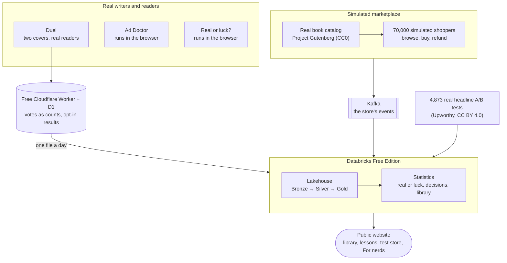

- **The problem.** Writers decide on covers, titles, blurbs and ads with little to go on.
  - A poll among friends is not a fair test.
  - Paid panels cost about $1 per answer.
  - An ad test costs money and a week.
  - When sales move after a change, nobody can tell a real effect from luck (section E).
- **What we build:**
  1. **Antes de decidir · Before You Decide**, free, in Spanish and English, with no account:
     - **Duel**: two versions, one link, real readers, an honest result in days;
     - **Which would you read?**: a game that brings readers to Duels;
     - **Ad Doctor**: drop your Amazon Ads report and see what to stop, keep, wait on or treat as luck. The file never leaves the browser;
     - **Real or luck?**: two sales numbers and an honest answer;
     - **the library**: what worked for writers like you, pooled from Duels and shared ad tests, once a group has 5 results;
     - **inside**: the ad-test planner and reader from v2.3, *Real lessons*, and *Behind the scenes: our test store*.
  2. **The platform.**
     - Simulated shoppers buy real public-domain titles, and Kafka carries their events.
     - Real Duel votes arrive as one file a day.
     - A Databricks pipeline cleans everything, and statistics decide.
     - The site refreshes every day without the laptop.
  3. **Lessons from real experiments.** 4,873 real headline A/B tests give realistic expectations and three plain lessons.
  4. **For nerds**: the architecture map and the stack, for recruiters and developers.
- **Who benefits:**
  - writers get answers for free and see what they saved;
  - readers discover books and get first pages;
  - you get a product people use and a portfolio of end-to-end data engineering and experimentation.

## B. What you'll have at the end

<!-- screens -->

1. **A public website** at `pipe199x.github.io/ebook-ab-platform`:
   - **home**: three doors (a Duel, the Ad Doctor, Real or luck?);
   - **the Duel**: create it in 30 seconds, share one link, readers vote, the writer follows progress without seeing the winner, then the reveal and a ready post for social media;
   - **Which would you read?**, the game;
   - **the library**: what worked for writers like you. On launch day it is empty, and it says so (section C);
   - **inside**: the ad-test planner and reader, *Real lessons*, *Behind the scenes: our test store*, and **For nerds**;
   - on every page, a badge on each number says where it comes from.
2. **A free voting and sharing service.** A Cloudflare Worker with a D1 database stores Duels, votes as counts and opt-in results. Covers are deleted 30 days after the Duel.
3. **A pipeline that runs every day without your laptop.** GitHub Actions:
   - simulates one day of shopping through Kafka;
   - copies yesterday's Duel votes and shared results out of D1 as files;
   - updates the lakehouse and the statistics;
   - refreshes the site, library included.
4. **A governed lakehouse.** Bronze, Silver and 20 Gold views, with access grants, masked personal data, tags and lineage.
5. **Proof the statistics are right:**
   - the analysis recovers the effects we planted in the simulated store;
   - fake A/B splits give false alarms at the expected ~5% rate;
   - a broken split is caught, in the store and in every Duel.
6. **Lab (practice for the portfolio, clearly labelled):** a local job cluster that starts for a run and is deleted after it, and a Spark UI performance lab.
7. **A public repo** with tests and green CI, a runbook, design decisions (ADRs), one-page decision memos, and a README a recruiter can read in 5 minutes.


## C. Where the numbers come from

In one sentence: **every number on the site wears a badge that says where it comes from, and numbers from real people appear only when a group has 5 results.**

| Badge | What it is | Where you see it | On launch day |
|---|---|---|---|
| **Shared by writers** | Real results from real people: Duels that readers voted on, and ad tests writers already ran. The writer chose to add each one. | The library, and the "compared with writers like you" lines | **Empty.** It fills as Duels end. Each group needs 5 results. |
| **Real public tests** | 4,873 real A/B tests of news headlines, published as open data by Upworthy (2013–2015, CC BY 4.0) | *Real lessons*, and the tools' realistic expectations | **Ready.** Analyzed in Phase 6. News headlines, not book sales. |
| **Simulated** | Made up on purpose by our program: 70,000 fictional shoppers in a fictional store | *Behind the scenes: our test store*, and the demo | **Running** every day. Never mixed into the library (D26). |

**How a group fills up** (for example, cover changes · romance · Spanish):

| When | Results | What the writer sees |
|---|---|---|
| Launch day | ○○○○○ 0 of 5 | "Not enough results yet: be one of the first." Plus lessons from the real headline tests. |
| Some weeks later | ●●●○○ 3 of 5 | The same message, with the counter moving. Each Duel counts. |
| 5 results in | ●●●●● 5 of 5 | The numbers appear: how often the change won, the typical change, one dot per result. |

- **The minimum of 5 applies to everything built from real results:** each group, each idea ("worked in W of N"), and the "compared with writers like you" lines (D26).
- **What "won" means.**
  - In a Duel: more readers wanted to read the first page, in a fair test.
  - In an ad test: more people clicked.
  - Neither proves more sales, and the card says so.
- **The Duel, the Ad Doctor, Real or luck?, the planner and Real lessons all work from day 1.** None of them needs the library.
- **In the demo, all numbers are examples.**

**Founding writers.** To fill the first groups, we invite Spanish-language indie writers to run the first Duels. Writers who already run ads can also type in tests they ran before.
- **First goal:** 5 results in the most common groups, such as romance · Spanish · cover.
- **A public counter** on the home page shows "N results so far".
- **The invitation line:** "Ask your readers. Share what you learned. Decide with data, not luck." In Spanish: "Pregúntales a tus lectores. Comparte lo que aprendiste. Decide con datos, no con suerte."
- **No analytics, by design.** We count Duels and shared results per week.
- **The promise:** better decisions and fewer guesses, never more sales.

## D. The journey of one purchase, and of one vote

The simulated store's purchase:

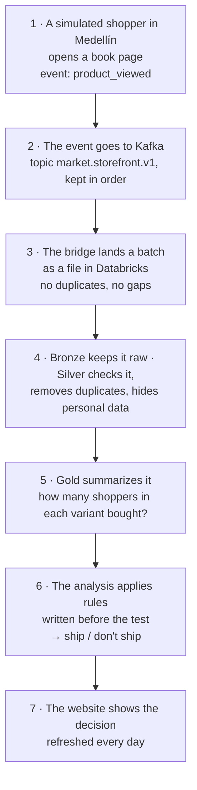

A real reader's vote:

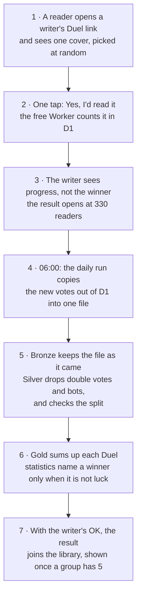

- **Kafka** is like a post office for the busy store. It keeps every letter in order, and several readers collect the same letters independently.
- **The votes don't need it.** A few votes a day travel together in one envelope: a daily file.
- **Bronze, Silver, Gold:**
  - Bronze holds the original letters, untouched.
  - Silver holds the checked and cleaned copies, with personal data hidden.
  - Gold holds the summaries people actually read.
- **Rules written before the test** work like a referee who sets the rules before the game. Nobody can move the goalposts after seeing the score.

## E. Why small sellers struggle with A/B tests

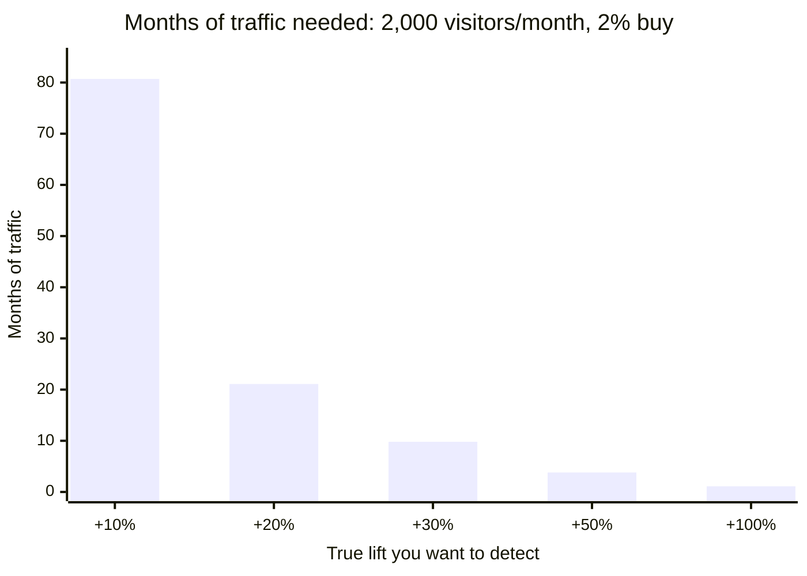

The chart assumes 50/50 split, α = 0.05 two-sided and 80% power. Visitors needed per variant:

| Lift | Per variant | Months at 2,000/month |
|---|---|---|
| +10% | 80,682 | 80.7 |
| +20% | 21,109 | 21.1 |
| +30% | 9,798 | 9.8 |
| +50% | 3,826 | 3.8 |
| +100% | 1,141 | 1.1 |

- **What this means:** a small seller can't test small tweaks on a sales page. A "win" after a lucky week is usually noise.
- **What helps:**
  - **ask readers directly, with a fair test.** In a Duel each reader sees one version and taps once. A bold difference (30% → 45% of readers who want the first page) needs 330 readers, which a writer's followers and the game can bring in days;
  - **test in ads, where traffic is fast.** Two ads that differ only in the cover need about 16,500 views each to show a bold difference (+30% more clicks): about 4 days at 5,000 views a day per ad. We still run every ad test for a full week, with the same budget spread over the 7 days, because ads behave differently on weekdays and weekends (D29);
  - test big changes: covers, offers, bundles, how the price is presented;
  - treat clicks and votes as a fast first signal, then check sales afterwards (Real or luck? helps);
  - start from realistic expectations taken from real tests, so a lucky streak is not trusted;
  - **pool what many writers learned.** One writer's test is small, but many Duels show which changes usually win for a genre.

**What exists today, and what it lacks** (checked 2026-10-16):

| Option | Cost | Fair test? | What it lacks |
|---|---|---|---|
| Facebook or Instagram poll | Free | No | Both covers side by side, visible votes, mostly friends |
| Rate Book Cover (stars from strangers) | Free, paid extras | No | Star ratings of one cover, not two versions; voters aren't your readers |
| PickFu | About $1 per answer (about $50 for 50 people), plus about $0.40 per answer per audience filter | Panel | Paid per poll; an English-first panel |
| A/B test in Meta or BookBub ads | Ad money | Yes | Costs money and a week, and needs ad skills |
| **Duel** | **Free** | **Yes** | Needs voters: the writer's followers plus the game |

## F. Who does what, and when

| When | You do | I do |
|---|---|---|
| Now | Read this PDF and try the demo. Ask for changes or say "start Phase 0". | Revise and re-render on request |
| Phase 0 | OK the public repo (S0.1). Run about 6 `sudo` lines for Docker. Log in to Databricks in the browser. Sign up to Aiven, about 10 minutes (S0.2). LinkedIn verification only if needed (S0.3). Sign up to Cloudflare's free plan, about 5 minutes (S0.4). | Repo, tools, probes, evidence, the local-cluster spike |
| Phase 1 | OK the first public deploy: the site and the voting service (S1.1). Then show the Duel to 5 writers. | The lifesaver launch: site, Worker + D1, Duel, Real or luck?, home |
| End of every phase | Run the commands I give and paste the output | Code, tests and docs. Then I wait for your results. |
| Phase 7 | Approve which Duels enter the game, a few minutes a week at first | The game, the Ad Doctor, the library from Duels and the other pages |
| Phase 8 | OK the repo secrets (Databricks, Cloudflare) and the daily public refresh (S8.1) | Workflows and the daily run |
| End | Review the site, the memos and the report. Share the "Founding writers" invitation with writer groups if you want. | Final docs, the launch note and the clean-clone dry run |

**Accounts.**
- New:
  - **Aiven** (free Kafka, no card): https://console.aiven.io/signup;
  - **Cloudflare** (free plan, for the Duel votes and the sharing service; a card is not expected, and we check at sign-up): https://dash.cloudflare.com/sign-up.
- Already have: Databricks Free Edition and GitHub (`Pipe199x`).
- Not needed: AWS, Microsoft/Power BI, Docker Hub, npm, PyPI, Vercel, Supabase.

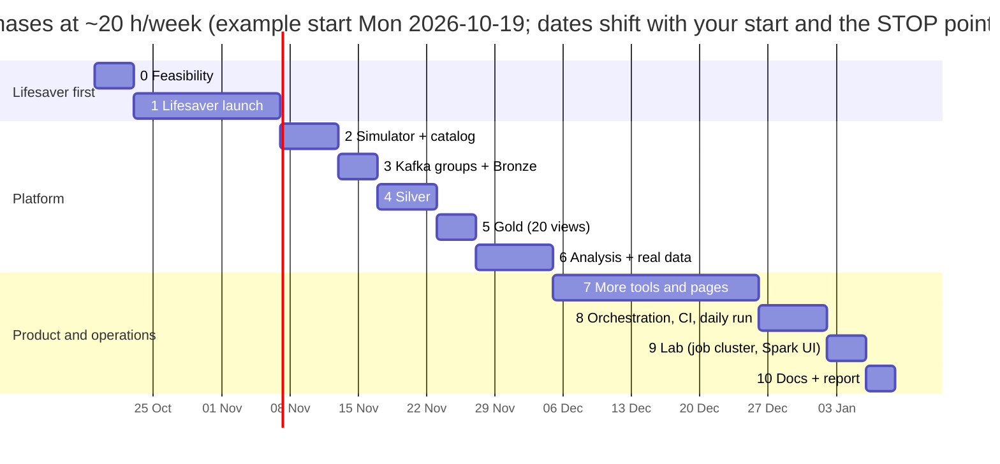

## G. What it costs: $0

| What | Cost | Note |
|---|---|---|
| Databricks Free Edition | $0 | Serverless only, with a daily fair-use quota |
| Aiven Kafka free tier | $0, no card | 5 topics × 2 partitions, for the simulated store |
| Cloudflare Workers + D1, free plan | $0 | Workers: 100,000 requests a day. D1: 500 MB per database, 100,000 rows written a day. Holds Duels, votes as counts, covers (deleted after 30 days) and shared results |
| GitHub repo, Actions, Pages | $0 | Public repo, standard runners |
| Docker, Kafka, Spark, Delta, React, Python libraries | $0 | Open source |
| Real data: Upworthy, Gutenberg | $0 | CC BY 4.0 / CC0 metadata |
| **Total** | **$0** | Your Claude plan, laptop and internet are outside the rule |

**What I said no to:**

| Option | Why not |
|---|---|
| Real Databricks job clusters | Not available in Free Edition. A paid workspace costs about $40–60/month; the NAT gateway alone is about $33. |
| AWS | The free plan is an expiring trial: 6 months or $100–200 of credits. |
| Power BI | You chose React. Sharing would need Pro at $14/user/month. |
| Confluent Cloud, Databricks trial | Their credits expire. |
| Supabase free, as the main store for shared results | Free projects pause after about a week of low activity. It stays the fallback (D23). |
| Cloudflare R2 for covers | It asks for a payment method. Covers stay small and live in D1 instead (D35). |
| PickFu or other paid panels | About $1 per answer. The Duel gets real readers for free. |

---

## Part 2 · Technical plan

Sections 1–9 below are the nine contents you asked for in the original brief.

## 1. Executive summary and scope

### 1.1 Summary
**For writers and readers (real people).** The public React site on GitHub Pages hosts **Antes de decidir · Before You Decide**, in Spanish and English, with no account. Its home page has three doors:
- **Duel**, the only real experiment.
  - A writer uploads two covers, or two titles, blurbs or book ideas, and shares one link.
  - Each reader sees one version, picked by a hash of the Duel and the visitor, and taps once: "Would you read the first page?"
  - A Cloudflare Worker counts the votes in a free D1 database, as counts only.
  - The result opens at a target fixed before the start: 330 readers or 14 days. A split check (SRM) and a two-proportion z-test give one of four plain endings (D34).
- **Ad Doctor.** It reads an Amazon Ads search-term report in the browser and gives each keyword Stop, Keep, Luck or Wait, measured against the book's own average (a beta-binomial model). Nothing is uploaded.
- **Real or luck?** An exact test on two sales counts, adjusted for the number of days, in the browser.

Around the three doors:
- **Which would you read?**: vote on other writers' Duels to earn votes for yours;
- the **library** of what worked for writers like you, built from Duel results and shared ad tests (opt-in, 5 results per group);
- the v2.3 ad-test planner and reader, now inside;
- *Real lessons*;
- *Behind the scenes: our test store*;
- **For nerds**: the architecture map and the stack.

**The platform, behind the screen.** A simulator built on Faker `es_CO` and confluent-kafka plays **70,000 synthetic shoppers** over 92 simulated days (2026-06-22 → 2026-09-21). They shop a fictional Latin American ebook marketplace whose catalog is **real**: about 2,000 public-domain titles from Project Gutenberg's offline catalog (CC0 metadata), with demand weighted by real 30-day download counts.

Three concurrent experiments run in the store. The simulator injects **known true effects** and scheduled faults:
- **EXP-CHK-001**, wallet-first checkout;
- **EXP-PDP-002**, new cover + subtitle;
- **EXP-BUN-003**, a 3-book bundle banner.

The store's events go to 5 Kafka topics (2 partitions each). The topics are identical locally (Docker, KRaft), on Aiven's free tier, and in CI service containers. They reach Databricks Free Edition in one of two ways:
- **Path B:** `lakehouse-bridge`, a real consumer group that lands idempotently named files in a Unity Catalog volume for Auto Loader. It is always built.
- **Path A:** Spark's Kafka source, added only if Phase 0 proves serverless can reach Aiven.

**Real votes come in as files, not through Kafka** (D30). Every morning the daily run copies yesterday's new Duel votes, shared results and withdrawals out of D1 into `landing_real/`.

One triggered Lakeflow Spark Declarative Pipeline builds everything:
- **Bronze:** raw streaming tables. Five come from Kafka and four from files: the catalog, Upworthy, shared results and Duel votes.
- **Silver:** typed, deduplicated and quarantined streaming tables. It also holds the Duel votes (double votes and bots out, a split check per Duel) and an SCD2 users table with hashed and masked PII.
- **Gold:** 20 metadata-driven materialized views, including Duel results and the Duel library.

Notebooks then:
1. check validity (SRM, A/A, invariants);
2. run the pre-registered tests (z-test, Welch/bootstrap, CUPED, Holm/BH, fixed horizon);
3. write `gold.experiment_results` and one-page memos;
4. prove themselves against the injected truth;
5. rebuild the library from Duel results and shared ad tests (`13_community_summary`).

A real-data notebook fits a random-effects model to 4,873 real Upworthy headline tests. It publishes the lessons and a realistic prior.

GitHub Actions runs the whole loop every day without the laptop and exports small Gold summaries to JSON for the static site. A Lakeflow Job orchestrates the runs, and Declarative Automation Bundles deploy them.

**Lab (practice for the portfolio, labelled as such; D31).**
- A **local throwaway Spark cluster** (Docker: 1 master + 2 workers, created per run and deleted after it) gives the job-cluster experience at $0. It hosts the Spark UI performance lab, because Free Edition serverless has no Spark UI.
- The plain Structured Streaming track and the OPTIMIZE/VACUUM demos are Lab too. §3.0 says plainly what each piece is really for.

### 1.2 In scope
- Brief items 1–10, adapted to the new domain:
  - the producer and contracts;
  - both consumer groups;
  - Bronze, Silver, Gold;
  - analysis and proofs;
  - the plain Structured Streaming track (Lab);
  - performance and observability;
  - orchestration and CI/CD;
  - compliance.
- Deliverables 0–6.
- From v2:
  - the public website and the writer tools;
  - the real-data track;
  - the local job cluster (Lab);
  - the laptop-free daily run;
  - the community library and opt-in anonymous sharing (Q14–Q16);
  - round 5's clarity changes C1–C12 (§2.8).
- New in v3.0 (round 6, §2.9):
  - the Duel (L1), the game (L2), the Ad Doctor (L3) and Real or luck? (L4);
  - the three-door home (L5);
  - the library fed by Duels (L6);
  - real votes through the platform (L7);
  - lifesaver first (L8);
  - a warmer voice (L9) and the new look (L11);
  - the For nerds page (N1);
  - the real-use table with Lab labels (N2).

### 1.3 Out of scope

| Item | Why |
|---|---|
| Real customers and real PII in the store | Synthetic data only. Free Edition also reserves the right to train on workspace data. |
| Sending a writer's numbers anywhere without their OK | The Ad Doctor, Real or luck? and the planner compute in the browser. Only Duel votes (as counts), the writer's own Duel and results a writer chooses to share leave it (D24, D37). |
| Writer accounts, logins, free-text comments | A Duel lives on its private link; sharing is anonymous. Free text invites personal data and spam (D25). |
| A live, real-time library | The library refreshes every night with the daily run. The site stays static (D12). |
| Showing a Duel's winner before the end | Progress shows counts and the split check, never the winner. Peeking is how people pick the wrong cover (D34). |
| Storing IP addresses | One vote per visitor and the share cap use a hash that changes every day and is deleted after a day (D25). |
| Mixing simulated results into the real library | The demo uses example data. The real site shows only real results (D26). |
| Routing Duel votes through Kafka | A few votes a day fit in one daily file. Kafka adds nothing for them (D30). |
| Showing different prices to different people | Ethically and legally sensitive (D20). We test how the price is presented, not the price. |
| Real Databricks job clusters, AWS | Not $0 (§4.1). Replaced by the local job cluster (Lab). |
| Power BI | Replaced by the React site (Q10). |
| Sequential testing (mSPRT) | Fixed horizon (Q6), for the store and for Duels. |
| Avro + Schema Registry, Kafka Connect, MirrorMaker 2 | ADR-004. Connect and MM2 are not on Aiven's free tier. |
| Book texts and real cover images in the store | The store uses only CC0 metadata and generated SVG covers. Writers upload their own covers to their Duels; those are deleted 30 days after the Duel (D35). |
| The Duel "for everyone" (thumbnails, product photos, menus) | L10: not now. Writers first. |
| AI/BI dashboards | Optional stretch, 1–2 h. The React site is the BI layer. |
| SLAs, HA, multi-region, ML models | Portfolio scope. |
| Test guides for newsletters, own sales pages and big stores | Not chosen in Q13. The Duel and the tools' math work for any two-version choice. |
| A public "See an A/B test from inside" page made from the store | C13, skipped in round 5 (§2.8). |

### 1.4 Additions and deviations from the brief
None of these is silent. Each is explained.

| ID | Change | Reason |
|---|---|---|
| A1 | The topics are named `market.*` instead of `fintech.*`. Still exactly 5 topics × 2 partitions. | The domain changed (Q8). |
| A2 | Validation fixtures `EXP-AA-000` (A/A) and `EXP-SRM-900`, which drops 5% of treatment exposure logs. | The A/A and SRM proofs run on real pipeline data. |
| A3 | Landing path `topic/epoch/partition/firstOffset-lastOffset.jsonl.gz`. | Offsets restart when Aiven powers off or a CI Kafka is created per run. The epoch keeps file names unique. |
| A4 | Bronze adds `source_epoch`, `_ingest_path` and `_source_file` on both paths. | Keeps the schema identical across paths and the lineage auditable. |
| A5 | `schema_version` lives on the envelope. v2 adds an optional `network_type` from 2026-07-20. | Lets `from_json` parse each version cleanly. |
| A6 | `gold.experiment_results` and `gold.real_prior` are Delta **tables** written by notebooks, not MVs. | A notebook can't write an MV. |
| A7 | One volume, `ops.lakehouse_files`, with folders `landing/`, `landing_real/`, `checkpoints/`, `artifacts/`. | Holds landing files, checkpoints and artifacts. |
| A8 | Gold has 20 views instead of 41, and every view names its consumer. | Your point 1; v3.0 adds 2 Duel views (A20). |
| A9 | File-based Bronze sources (catalog, Upworthy) sit beside the 5 Kafka sources. | Real data arrives as files, not streams (Q9). |
| A10 | Phases are numbered 0–10 in v3.0 (A18). | New scope. |
| A11 | Catalogs `ebook_ab` / `ebook_ab_dev`; Python package `ebook_ab`; job and pipeline names use the `ebook_` prefix. | The domain changed. |
| A12 | The "job cluster" requirement is met by a local throwaway Spark cluster, plus a never-deployed `job_clusters` bundle target. | Free Edition is serverless only (§4). |
| A13 | Bayesian readouts with an empirical prior appear only in the public tools (the ad-test reader, the Ad Doctor). Platform decisions and Duels stay frequentist, fixed-horizon and pre-registered. | Q6 still holds for the platform. Small sellers need decision-oriented answers. |
| A14 | The daily schedule lives in GitHub Actions, which triggers the Lakeflow Job `ebook_daily` by API. The bundle also keeps a **paused** 06:30 Bogotá schedule as a fallback. The pipeline stays triggered, never continuous. | Data must be produced and landed before the job runs, and that happens in the GitHub run. |
| A15 | A file-based Bronze source, `community_raw`, filled by a daily export from D1 to `landing_real/community/`. | Shared results arrive through a web endpoint, not Kafka. Files keep one ingestion pattern for outside data (A9). |
| A16 | `gold.community_summary` is a Delta **table** written by notebook `13_community_summary`. | The random-effects summary runs in Python, like A6. |
| A17 | A small edge service in `edge/`: a Cloudflare Worker + D1, outside Databricks and GitHub. | A static site can't receive data, and a Databricks App needs sign-in and stops after 24 h (§4.1). |
| A18 | v3.0 renumbers the phases 0–10: the lifesaver launch becomes Phase 1, the old phases 1–5 become 2–6, the rest of the website is Phase 7, orchestration Phase 8, the Lab Phase 9 and docs Phase 10. | Real writers use the Duel around week 3 or 4, while the pipeline is built (L8). |
| A19 | A fourth file-based Bronze source, `duel_votes_raw`, filled by the daily D1 export to `landing_real/duels/`. | Duel votes go as files, not through Kafka (D30). |
| A20 | Gold grows to 20 views: `duel_results` and `duel_library`. | L7. |
| A21 | The Worker grows from one share endpoint into the Duel service: create, read, vote, progress, game queue, report and withdraw. | L1, L2. |
| A22 | Practice-only parts are labelled **Lab**: the local job cluster and the Spark UI lab (Phase 9), the plain Structured Streaming track (Phase 8) and the OPTIMIZE/VACUUM demos. | D31: your question about the real use of each piece. |

---

## 2. Decisions log

### 2.1 Round 1 (plan v1 interview, 2026-10-15)

| # | Question | Options offered (recommended first) | Your answer | Consequence in v2 |
|---|---|---|---|---|
| Q1 | Which accounts do you already have? | Databricks Free Edition · LinkedIn-verified · Aiven account · Aiven free Kafka running | **Databricks Free Edition** only | Phase 0 has STOP points for the Aiven sign-up and, if needed, LinkedIn verification. |
| Q2 | Hours per week? | ~10 h (Rec.) · ~5 h · ~20 h | **~20 h/week** | ~230 h in v3.0 → about 11–13 weeks. |
| Q3 | Repo name? | fintech-ab-platform (Rec.) · fintech-ab-lakehouse · colombia-fintech-experimentation | **fintech-ab-platform** | **Changed to `ebook-ab-platform`** because the domain changed (D17). Veto it at review if you prefer the old name. |
| Q4 | Plan language? | English (Rec.) · Spanish · English + Spanish summary | **English** | Docs in English. The public site is Spanish + English. |
| Q5 | Docker runtime? | Docker Engine in WSL2 (Rec.) · Docker Desktop | **Docker Engine in WSL2** | Runs Kafka and the local Spark cluster. |
| Q6 | Peeking policy? | Fixed horizon only (Rec.) · Add mSPRT interim looks | **Fixed horizon only** | One readout per experiment at its cutoff. |
| Q7 | Injected truth story? | Mixed outcomes (Rec.) · All three ship · Mixed with a true null | **Mixed outcomes** | Expected verdicts: CHK ship; PDP **don't ship** (buyers up, refunds way up); BUN ship. |

### 2.2 Your 8 points on v1, and what changed

| # | Your point | What changed |
|---|---|---|
| 0 | Ebook sellers instead of fintech? | The domain is now a marketplace with a payments checkout (Q8). The small-traffic caveat is built in: the marketplace pools traffic, and the tool explains the caveat to sellers. |
| 1 | 41 views were only an example | Gold has 18 views, each with a named consumer (A8); 20 since v3.0 (A20). |
| 2 | Real monetary impact; real data? | A free seller tool, real-data lessons, and the simulation kept as proof (Q9). |
| 3 | Job clusters instead of serverless | Impossible on Free Edition under the $0 rule. Replaced by the local throwaway cluster plus a `job_clusters` config (Q11, ADR-006). |
| 4 | Easy, visual, interactive; what we achieve | Part 1 tells the story in pictures. Section B lists what you'll have at the end. The interactive companion page adds the rest; since v3.0, the demo does (`docs/plan/DEMO.html`). |
| 5 | React or Angular, not Power BI | React + TypeScript on GitHub Pages (Q10). Power BI is removed. |
| 6 | Local or AWS? | The design was already hybrid. AWS is rejected (§4.1). A laptop-free daily run on GitHub Actions replaces it (D19). |
| 7 | Why Docker? | Same Kafka locally and in CI, plus the local Spark cluster. Kept (Q5). |
| 8 | Which accounts? | Aiven is new. v2.2 adds Cloudflare's free plan for the sharing service (Part 1, F). |

### 2.3 Round 2 (2026-10-15)

| # | Question | Options offered (recommended first) | Your answer | Consequence |
|---|---|---|---|---|
| Q8 | Which domain should the platform serve? | Ebook marketplace + payments (Rec.) · Ebook sellers, content only · Keep the Colombian fintech | **Ebook marketplace + payments** | The checkout keeps payment methods, fraud, refunds and chargebacks as guardrails. |
| Q9 | How should the project create real-world impact? | Tool + real data + simulation (Rec.) · Tool + simulation, no real data · Simulation only | **Tool + real data + simulation** | §3.12 (real data) and §3.13 (tool). |
| Q10 | Which frontend stack and hosting? | React + TS on GitHub Pages (Rec.) · Angular on GitHub Pages · React as a Databricks App | **React + TS on GitHub Pages** | A static site. CI exports JSON. No tokens in the browser. |
| Q11 | Job clusters: keep $0 or pay? | $0: local job cluster (Rec.) · Pay for real job clusters · $0: serverless only | **$0: local job cluster** | §3.14 and ADR-006. |

### 2.4 Verified instead of asked (2026-10-15)
- **GitHub:**
  - `Pipe199x`.
  - Repo names `ebook-ab-platform`, `ebook-ab-lakehouse` and `creator-ab-platform` are all free.
  - Action versions: checkout v7.0.1, setup-node v7.1.0, setup-uv v10.3.0, configure-pages v6.0.0, upload-pages-artifact v5.0.0, deploy-pages v5.0.1, databricks/setup-cli v1.21.0 (Databricks CLI v1.21.0 was released 2026-10-14).
- **npm** (latest; versions re-pinned at Phase 1 start): react 19.3.1, vite 8.3.4, typescript 7.0.2, @vitejs/plugin-react 6.1.2, echarts 6.1.0, i18next 26.4.5, react-i18next 17.0.17, vitest 5.0.5, @testing-library/react 16.3.3.
- **Spark image:** `apache/spark:4.2.0-scala2.13-java21-python3-ubuntu` exists (updated 2026-07-16).
- **delta-spark:** 4.4.1 (2026-10-05) requires `pyspark>=4.0.1,<=4.2.0`. Note that the Delta docs' compatibility table still lists only Spark 4.0/4.1, for 4.3.x and older.
- **Brand name:** one candidate brand name ("Librora") is already an app, so the marketplace stays **unnamed** (D18).

### 2.5 Lead decisions (my calls; override them at review)

| ID | Decision | Rationale |
|---|---|---|
| D1 | The repo lives at `D:\abtesting`. Heavy local data lives on WSL ext4: Docker volumes and `~/ebook-data`. | Windows tools need Windows paths; Linux I/O stays on ext4 ([WSL docs](https://learn.microsoft.com/en-us/windows/wsl/filesystems)). |
| D2 | Python **3.12** via `uv`, with one lockfile. | Matches serverless environment v6 (Python 3.12.3). |
| D3 | Local PySpark **4.2.0** with delta-spark **4.4.1**. The Spark cluster image ships Java 21; host tests use OpenJDK 25 (Spark 4.2 supports 17/21/25). | One Spark version everywhere. |
| D4 | Kafka **4.2** everywhere (`apache/kafka:4.2.2`; `kafka_version=4.2` on Aiven). | No version drift. |
| D5 | The Path B flow is always on. It carries the daily run, local Kafka and the kill test. A Path A Kafka flow is added only if Phase 0 passes. | Bronze is identical either way; epochs keep coordinates distinct. |
| D6 | JSON + JSON Schema (draft 2020-12) contracts in Git. | ADR-004. |
| D7 | Primary metrics are user-level. Ratio metrics use the delta method. | Users are the randomization unit. |
| D8 | N = **70,000** shoppers over 92 days. | Sized by EXP-PDP-002, the binding constraint (§3.19). |
| D9 | Producer settings: idempotence, `acks=all`, zstd, a 50 KiB/s token bucket, `throttle_cb`. Kafka timestamps are **send time**. | Aiven limits; retention safety. |
| D10 | Silver dedup is a 1 h watermark on `event_ts` + `dropDuplicatesWithinWatermark(["event_id"])`. | 2× the maximum injected lateness. |
| D11 | Keyed SHA-256 hashes (a pepper in the secret scope) make the join keys. UC masks hide display columns. Gold has no PII. | Ley 1581 minimization. |
| D12 | The **React site is static**: Gold → JSON in CI → GitHub Pages. No Databricks token ever reaches a browser. | $0, public, secure. A Databricks App needs sign-in and stops after 24 h. |
| D13 | Primary: two-sided α = 0.05. Secondaries: Holm. Segments: BH q = 0.10. Guardrails: one-sided α = 0.05. | Unchanged. |
| D14 | Catalogs `ebook_ab_dev` / `ebook_ab`, chosen by a bundle variable. Fallback: `workspace`. | |
| D15 | The job failure email is `${workspace.current_user.userName}`. | Keeps your address out of the repo. |
| D16 | MIT license, `.env` git-ignored, secret scanning + push protection on. | |
| D17 | The repo is `ebook-ab-platform`, which replaces `fintech-ab-platform`. | The domain changed. Name checked as free. |
| D18 | No brand name: the site calls it "a fictional Latin American ebook marketplace" and shows a banner. | Avoids clashing with real brands. |
| D19 | The daily laptop-free run uses an **ephemeral Kafka service container** in GitHub Actions, with one epoch per run, plus the bridge. Aiven is used for the cloud backfill and demos. | Aiven's free tier powers off when idle, and its docs mention power-on only from the console. A CI Kafka always works. |
| D20 | Experiment ethics: no individual price differences, no fake urgency or scarcity, presentation-only changes, invariants that prove prices are identical across arms. | Fairness and consumer trust (see O12). |
| D21 | Real data comes from the Upworthy **exploratory** sample only; the confirmatory sample is reserved for registered reports. We use Gutenberg **metadata** only. | Follows each source's guidance and license. |
| D22 | The public site sets no cookies, has no analytics and makes no third-party requests. Tool math runs in the browser. **Amended by D24** for the opt-in share, and **by D37** for Duels. | Privacy by design. |
| D23 | Shared results, and in v3.0 the Duels and their votes, are stored with a **Cloudflare Worker + D1** on the free plan. Fallbacks: Supabase free; then moderated submissions through GitHub. | $0 with no expiring credits. D1 has no pause for low activity (Supabase free projects pause after about a week), and 100,000 requests a day is far above our need. The GitHub fallback would force writers to have an account. |
| D24 | The only request that leaves a visitor's browser is the **opt-in Share**: one POST to our own endpoint, after the writer reviews every field and presses Share. Still no cookies, no analytics, no third-party scripts. | Keeps D22's promise, with one visible, voluntary exception. **v3.0:** Duels and their votes are the second exception (D37). |
| D25 | Anti-abuse without accounts: JSON Schema validation, fixed lists (genre, book language, change type, idea tags), number ranges, clicks ≤ views, fair tests only (views ratio < 1.5), duplicate payloads rejected, a cap of 5 shares per visitor a day, outlier flags, and robust statistics (median, middle half, minimum cell size). The cap uses a daily-salted hash of the IP address that is never stored for more than a day. **v3.0:** the same hash allows one vote per visitor per Duel, and Silver drops double votes and bot-like bursts. | Spam and poisoning are the main risks of open sharing (R34). No free text, so nothing personal can be typed in. |
| D26 | Cold start: the real site shows **only real shared results**. A genre × book language × change with fewer than 5 results shows "Not enough results yet: be one of the first", an "x of 5 results needed" counter, and the general lessons from the 4,873 real headline tests. **v2.3:** the same minimum of 5 applies to everything built from shared results: the ranking of the five changes (each change needs 5), each idea tag (5 tests that used it) and the "compared with writers like you" lines (C2, C3, C7). Simulated data never enters the real library; the demo stays simulated and labelled. | Honesty. A library padded with invented results would mislead the writers it is meant to help (R35). One lucky test must not look like a finding. |
| D27 | The library is published as **open data (CC BY 4.0)** in `library.json`: counts, summaries, idea tags and rounded lifts. Raw shared records (views, clicks, dates, IDs) are never published. A writer gets a receipt code after sharing and can withdraw the result with it. | Gives back to the community. Summaries protect writers in small groups (R37). The receipt builds trust. |
| D28 | Every number block on the site wears a **source badge**: *Shared by writers* (the library and its comparisons), *Real public tests* (the Upworthy lessons and the realistic expectations) or *Simulated* (the test store, and everything in the demo). In the demo, the library's badge reads "Shared by writers · simulated here". | A visitor reading alone must never mistake a simulated or borrowed number for a real result from writers (your questions II, VI and VIII; C1). |
| D29 | Every ad test is planned for **at least 7 days** (a full week). When the math needs fewer days, the same views are spread over the week, so the budget stays the same; when it needs more, the test runs longer. | Ads behave differently on weekdays and weekends. TikTok's split-test guide recommends at least 7 days and at most 30 ([Split Test Best Practices](https://ads.tiktok.com/help/article/split-test-best-practices?lang=en), checked 2026-10-15). Meta's A/B testing page couldn't be read that day (O19). (C12) |

### 2.6 Round 3 (plan v2.1, 2026-10-15)
You asked what an ebook writer would actually do with the tool.

| # | Question | Options offered (recommended first) | Your answer | Consequence |
|---|---|---|---|---|
| Q12 | How should the product be clearer for a writer? | Writer-first redesign (Rec.) · Add one writer's walkthrough only · The explanation is enough | **Writer-first redesign** | The seller tool becomes a guided assistant: what to change, where, for how long, and a plain verdict (§3.13). The demo separates "for writers" from "behind the scenes". |
| Q13 | Where do the writers in mind sell or promote? | Ads · Email newsletter · Own sales page · Big stores (multi-select) | **Ads** | The tool plans and reads **ad tests**. An optional sales-page comparison shows why testing there is slow. Other channels are out of scope (§1.3). |

### 2.7 Round 4 (plan v2.2, 2026-10-15)
You made two points:
- writers must come back again and again, like people do with a Word-to-PDF converter;
- ad platforms such as Meta already say which of two ads won, so where is the magic?

My answer: one writer's numbers are too small to learn much from, but many writers' results together are enough. An ad platform sees one advertiser's two ads; this tool pools what many small writers learned, by genre, book language and type of change. Writers come back **before each decision** to see what worked for others, and **after each test** to share their result.

| # | Question | Options offered (recommended first) | Your answer | Consequence |
|---|---|---|---|---|
| Q14 | Which hooks should bring writers back? (multi-select) | Before you decide + journal (Rec.) · Real or luck? quick check (Rec.) · Community library (Rec.) · Weekly check-in | **Community library** | The library becomes the home page of the writer tool (§3.13). The journal, the quick check and the weekly check-in are not built. |
| Q15 | Should writers be able to share results anonymously? | Yes, opt-in and anonymous (Rec.) · No, everything stays in the browser | **Yes, opt-in and anonymous** | A free storage service is needed: Cloudflare Workers + D1 (D23). Privacy, abuse and cold-start rules: D24–D27. |
| Q16 | What should the writer app be called? | Antes de decidir · Before You Decide (Rec.) · ¿Real o suerte? · Real or Luck? · Brújula del escritor · Writer's Compass | **Antes de decidir · Before You Decide** | The name is the habit: open it before any decision. It names the site's writer pages and the demo app. |

### 2.8 Round 5 (plan v2.3, 2026-10-15)
You read v2.2 and the demo and asked nine questions: what is empty on launch day, where the library's numbers come from, where a writer finds the ad numbers, what "your sales page" is, what the bookstore is for, what *Real lessons* concludes, what *Marketplace experiments* shows, and how to sell the project. The answers are in `docs/plan/answers/ANSWERS-v2.2.pdf`. Checking the facts for them also found two problems: the demo listed an idea by one single test's best result, and the tool's "about 4 days" was shorter than the 7 days that TikTok's split-test guide recommends. The answers proposed 13 changes, and you chose "apply C1–C12, skip C13".

| # | Change | From your question | Where in v2.3 |
|---|---|---|---|
| C1 | Badges for the three kinds of numbers: *Shared by writers*, *Real public tests*, *Simulated* | I, VI, VIII | Section C, D28, §3.13 |
| C2 | The library's launch-day state: an "x of 5 results needed" counter per group, "be one of the first", and real headline lessons meanwhile. The ranking waits for 5 results per change. | II | Section C, D26, §3.13 |
| C3 | An idea is listed only after 5 tests used it, as "worked in W of N · typical +X%". Never one test's result. | II | D26, §3.12, §3.13 |
| C4 | The library card says what "worked" means: more people clicked the ad, in a fair test. Not sales. | II | Section C, §3.13 |
| C5 | A "?" on each ad number: where to find it on Meta, Amazon Ads, BookBub and TikTok, and what to do if you never ran ads | III | §3.13, O20 |
| C6 | The sales page leaves the main form, into a folded "Why not test on my book's page?" box | IV | §3.13 |
| C7 | The "compared with writers like you" line needs 5 results, and uses plain words: "higher than 24 of the 26" | V | D26, §3.13 |
| C8 | *Real lessons* becomes three lessons, the conclusion first, each with "what this means for you" | VII | §3.13 |
| C9 | *Marketplace experiments* becomes *Test store*, under "Behind the scenes": one plain sentence per decision, and "not advice for your book" | VIII | §3.13 |
| C10 | New risk R38, writers may share mostly wins: Share is offered for every fair verdict, and we watch the share of wins | II | §3.13, §6 |
| C11 | The "Founding writers" launch plan, plus a public counter of shared results | IX | Section C, §3.13, Phase 9 |
| C12 | Every ad test runs at least 7 days, with the same budget spread over the week | III | Section E, D29, §3.13 |
| C13 | Optional: a "See an A/B test from inside" page on the real site, made from the demo's bookstore | VI | **Skipped** (§1.3) |

### 2.9 Round 6 (plan v3.0, 2026-10-17)

Here is how round 6 went:
- **Your question:** how could this be a lifesaver for tons of people? You found it a bit boring.
- **My answer:** `docs/plan/answers/LIFESAVER.pdf`, with a clickable prototype. Its core idea is that A/B testing is the engine, never the product. It proposed changes L1–L11.
- **What you then asked for:**
  - the look of cursor.com (L11);
  - a For nerds tab with the architecture and its stack;
  - the real use of each technology, "not just for the sake of using it";
  - finally, one plan without the clutter of versions.

v3.0 takes the full package that LIFESAVER recommended, L1–L9 and L11. L10 stays out, as LIFESAVER advised. The prototype is now the demo, `docs/plan/DEMO.html`.

| # | Change | Where in v3.0 |
|---|---|---|
| L1 | **Duel**: cover, title, blurb or book idea. One link, one version per person, progress without peeking, the reveal and a share image. Optional first page and the writer's own "tell me when it's out" link. | Sections A–D, §3.13, D34–D37, Phase 1 |
| L2 | **Which would you read?** A game: readers vote, and writers earn votes by voting. You approve entries at first. | §3.13, D36, Phase 7 |
| L3 | **Ad Doctor**: Amazon Ads reports read in the browser; Stop / Keep / Luck / Wait N clicks, and the money to stop wasting. Meta Ads compares cost per click. | §3.13, Phase 7 |
| L4 | **Real or luck?**: two numbers, an honest answer. | §3.13, Phase 1 |
| L5 | **A home page with three doors**, one per pain. The library and the ad-test planner move inside. | Sections A–B, §3.13, Phase 1 |
| L6 | **The library fills itself from Duels**: opt-in, the same 5-result minimum, by genre × book language × what changed. | Section C, §3.12, §3.13, Phase 7 |
| L7 | **Real votes through the platform**: Duel votes → Bronze/Silver/Gold, an SRM check per Duel, a bot filter, 2 new Gold views (18 → 20). **As files, not through Kafka** (D30). | §3.2, §3.6, §3.9, §7, Phases 3–8 |
| L8 | **Lifesaver first**: ship L1, L4 and L5 right after Phase 0, then build the pipeline while real data arrives. | §5, Phase 1 |
| L9 | **A warmer voice**: plain, kind, direct sentences on every screen. | §3.13 |
| L10 | Later: the Duel "for everyone". | **Not now** (§1.3) |
| L11 | **The new look** in the style of cursor.com: warm paper colors, regular-weight type, pill buttons, app windows on paintings, light and dark themes. Our own name, logo and paintings; free fonts. | §3.13, Phase 1 |
| N1 | **For nerds**: the live architecture map and the stack, on the site as in the demo. | Section B, §3.13, Phase 7 |
| N2 | **The real use of each piece**, with practice-only parts labelled Lab. | §3.0, D31 |

**Lead decisions added in v3.0** (my calls; override them at review):

| ID | Decision | Rationale |
|---|---|---|
| D30 | **Duel votes travel as files, not through Kafka.** The daily run exports new votes, shared results and withdrawals from D1 as JSONL to `landing_real/duels/` and `landing_real/community/`; Auto Loader loads them into Bronze. Kafka carries only the simulated store, so the layout stays at 5 topics × 2 partitions, inside Aiven's free tier. | Real use, not for show: a few votes a day fit in one file, and they leave D1 once a day, so Kafka's strengths (ordering, many readers, replay of a busy stream) buy nothing here. |
| D31 | Practice-only parts stay, labelled **Lab**: the local job cluster and the Spark UI lab, the plain Structured Streaming track (`30_sss_orders`) and the OPTIMIZE/VACUUM demos. The README and the For nerds page say so. | They are good portfolio practice, but the product does not need them. Saying so is honest (§3.0). |
| D32 | Round 6 takes the full package L1–L9 and L11. L10 waits. | You asked for the lifesaver approach and the demo already shows all of it. |
| D33 | The plan stays in English (Q4). I summarize each version in Spanish in the chat. | Round 1 decision. |
| D34 | **Duel rules, fixed before it starts.** Target: 330 readers or 14 days, whichever comes first (30% → 45% at 95% confidence and 80% power). The result opens only at the end. SRM p < 0.001 gives "Not fair yet". A gap under 5 points gives "Too close to call". Otherwise a two-proportion z-test at 95% names the winner, or says "Not sure yet: about N more readers". One vote per visitor per Duel. The writer's own device is not counted (a flag in its local storage, never sent). | The same referee rule as the store: nobody moves the goalposts after seeing the score. |
| D35 | Covers are shrunk in the browser to about 60 KB (WebP, JPEG fallback), stored in D1 and deleted 30 days after the Duel ends. No Cloudflare R2. | R2 asks for a payment method. At ~120 KB per Duel, one 500 MB database holds about 4,000 live Duels. |
| D36 | **Moderation.** Duel links are unlisted. At first you approve which Duels enter the game, with `ebook_ab.tools.moderate` (list, approve, remove) through a token-protected Worker route. Every Duel has a report button, and covers are deleted automatically. | People upload images. It takes a few minutes a week at first. |
| D37 | **D22 and D24 amended.** Besides the opt-in Share, two things leave the browser: a writer's Duel (covers or texts, genre, book language) and readers' votes (counts only). No cookies, no names. One vote per visitor uses a daily-salted IP hash that is never kept longer than a day. The Ad Doctor, Real or luck? and the planner still send nothing. | A Duel can't work without votes leaving the reader's phone. Everything else keeps D22's promise. |

---

## 3. Architecture
The diagrams are rendered from the Mermaid sources in `docs/plan/diagrams/`. The demo's For nerds tab (section B) draws the same architecture live.

### 3.0 What each piece is really for (N2)
You asked for the real use of each technology, not "for the sake of using it". Our data is small: about 1.8 M simulated events (0.9 GB of raw JSON) plus a few real votes a day. So the table says when a piece is truly needed, when it is real but bigger than we need, and when it is practice (**Lab**, D31).

| Piece | Real use in this project | Without it | Verdict |
|---|---|---|---|
| **Kafka** | The simulated store's event stream: events in order per shopper; two independent readers (the bridge to files, and `guardrail-monitor`, which raises hourly alerts on fraud, refunds and latency per version); a restart that loses and repeats nothing (§3.3) | Every reader would need its own copy of the data, and a crash could lose or repeat events | **Real**, for the store. Not used for Duel votes (D30). |
| **Databricks Free Edition** | Runs the daily pipeline with quality rules and quarantine, Unity Catalog (masked personal data, grants, tags, lineage), and the job that orders the daily tasks | We would rebuild incremental loading, quality checks, governance and orchestration by hand | **Real.** At 1 GB a laptop could compute it; Databricks gives these pieces ready-made, free, as real teams use them. |
| **Delta Lake** | MERGE updates `experiment_results` instead of duplicating it; AUTO CDC deletes a withdrawn shared result (privacy); time travel reproduces a memo's exact numbers; Change Data Feed shows which decisions changed between runs; exactly-once loading with Auto Loader | Re-runs would duplicate rows, withdrawals would linger, and old decisions could not be reproduced | **Real.** OPTIMIZE and VACUUM at our size are **Lab** demos. |
| **JSON with arrays (events)** | `order.items[]`: one order holds several books, and EXP-BUN-003 needs books per order; `experiments[]`: one shopper is in several experiments at once; `events[]`: about 4 events per message, to stay inside Aiven's free bandwidth | One message per book and per experiment: more traffic and harder joins | **Real.** Silver explodes the arrays into `order_items` and `event_experiments`. |
| **JSON for the site** | `site_export` writes small JSON files (such as `library.json`), checked against schemas, that the static site reads | The browser would need a Databricks token, or a server to keep running | **Real** (D12). |
| **Notebooks** | Statistics (10), validation against the planted truth (11), real lessons (12), the library (13), data quality (20) | The analysis would hide in scripts nobody can read step by step | **Real.** Parsing JSON is **not** their job: the pipeline does it (§3.9). |
| **Lakehouse (Bronze, Silver, Gold)** | Raw files and clean tables in one governed place. Bronze keeps the raw data forever, so Silver and Gold can be rebuilt when a rule changes | One copy for analysis, another for the site, and no replay | **Real.** |
| **PySpark** | All pipeline transforms (parse, explode, deduplicate, hash), shared with the local cluster; per-shopper aggregation before the statistics | Pandas would do at this size, but not on Databricks and not at a real store's scale | **Real**, with room to spare. |
| **Spark UI** | Free Edition serverless has no Spark UI. On the local cluster, the performance lab uses it to find and fix a bestseller skew in 20 M generated views | Nothing in the product | **Lab.** On Databricks we read the query profile instead. |
| **Local job cluster (Docker Spark)** | The job-cluster lifecycle (start, run, delete) at $0, and the performance lab | Nothing in the product | **Lab.** |
| **Plain Structured Streaming track** (`30_sss_orders`) | Parses orders by hand to compare with the declarative pipeline (ADR-003) | Nothing in the product | **Lab.** |
| **Cloudflare Worker + D1** | Receives Duels and votes, enforces one vote per visitor, stores covers for 30 days and opt-in results | A static site can't receive data | **Real.** The only server in the project. |
| **GitHub Actions + Pages** | Tests, deploys, and the 06:00 run that refreshes everything without the laptop; hosts the static site | Someone would have to run it by hand | **Real.** |
| **React + TypeScript** | The site: the Duel, the game, the Ad Doctor, Real or luck?, the library and the pages, in Spanish and English | — | **Real.** |
| **scipy, statsmodels, `ebook_ab.stats`** | The tests (z-test, Welch, bootstrap, CUPED, Holm/BH, SRM), checked against the same vectors as the browser's math | — | **Real.** |

### 3.1 Path A (direct). Added only if the Phase 0 probes pass.
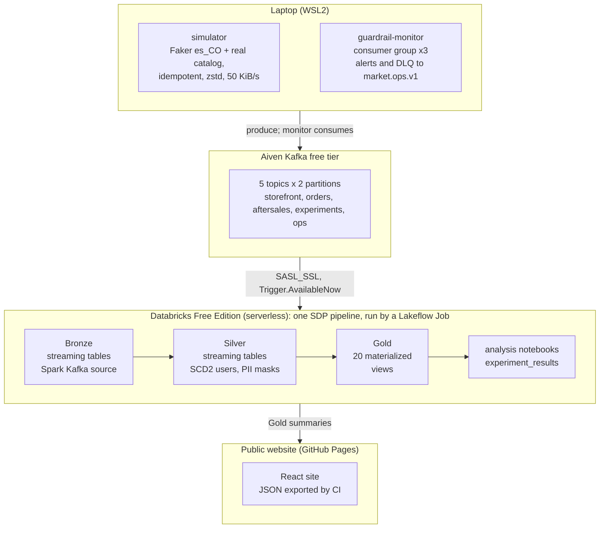

### 3.2 Path B (guaranteed $0). Always on.
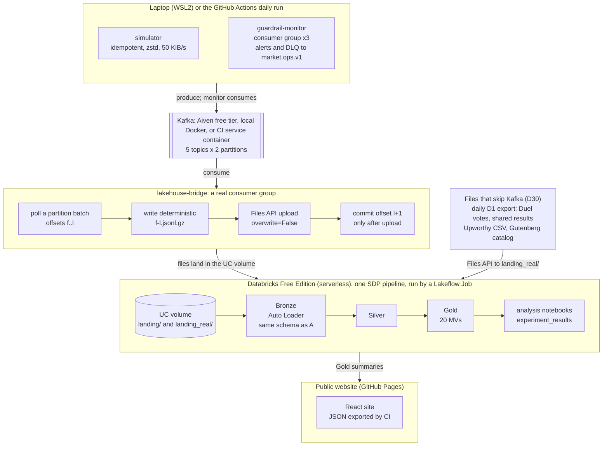
Files from outside the store skip Kafka (D30): the Upworthy CSV, the Gutenberg catalog, and the daily D1 export of Duel votes and shared results. They go through the Files API to `landing_real/`, then Auto Loader picks them up into the file-based Bronze tables (§3.12, §3.13).

### 3.3 lakehouse-bridge commit protocol: why at-least-once plus idempotent names gives zero Bronze duplicates
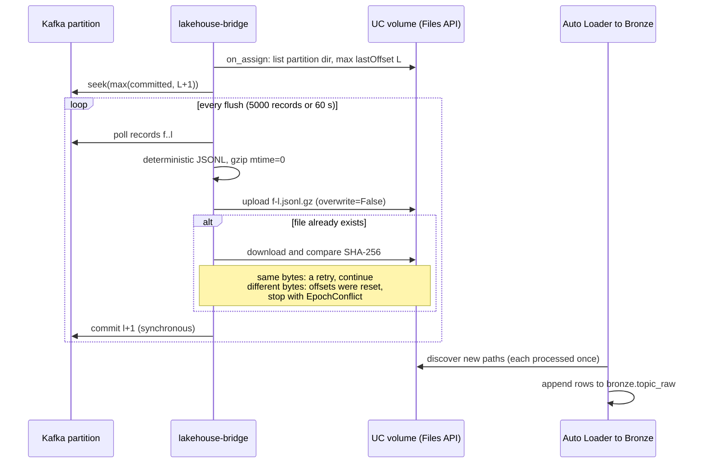
**Argument.** Each Kafka coordinate (topic, epoch, partition, offset) lives in exactly one file path, and ranges never overlap. The bridge can crash at three points:
- **Before upload:** nothing exists yet, so the batch is re-read.
- **After upload, before commit:** on restart, reconcile-on-assign seeks past the uploaded range.
- **During or after commit:** normal operation.

A re-upload produces the same path with identical bytes. Auto Loader processes each path once ([Auto Loader FAQ](https://docs.databricks.com/aws/en/ingestion/cloud-object-storage/auto-loader/faq): with `allowOverwrites=false`, "files are processed exactly once").

**Proof in Phase 3.** Run `--crash-after-upload 3`, restart, and expect 0 duplicate coordinates and 0 offset gaps.

### 3.4 Phase 0 decision rule (Path A vs B)
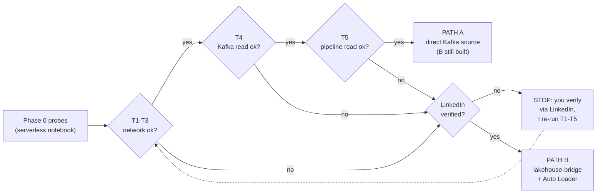
**Rule.** Path A's Kafka flow is added if and only if T1–T5 all pass from Free Edition serverless:

| Probe | What it checks |
|---|---|
| T1 | DNS resolution of the Aiven host |
| T2 | TCP connect to the SASL_SSL port |
| T3 | TLS handshake against the Aiven CA |
| T4 | `spark.read.format("kafka")` with SCRAM-SHA-256 and a PEM truststore returns the 10 probe rows |
| T5 | The same read inside a pipeline update |

The docs disagree on what LinkedIn verification unlocks. The AWS limitations page (updated 2026-09-29) says only that some limits rise and limited serverless GPU becomes available. So we test before and after verification.

Evidence goes to `docs/evidence/phase0/` and ADR-002. **Expected outcome: Path B only.** Free Edition restricts outbound traffic to trusted domains, and Kafka uses non-HTTP ports.

### 3.5 Topics, keys, contract

| Topic (2 partitions; retention 72 h on both sides) | Key | Event types |
|---|---|---|
| `market.storefront.v1` | user_id | session_started, search_performed, product_viewed, bundle_offer_shown, added_to_cart, cart_viewed |
| `market.orders.v1` | user_id | checkout_started, payment_method_selected, payment_authorized, payment_failed, order_paid |
| `market.aftersales.v1` | user_id | book_downloaded, refund_requested, refund_issued, chargeback_opened, chargeback_resolved, marketing_opt_out |
| `market.experiments.v1` | user_id | assignment, exposure (both arms; control logs the counterfactual) |
| `market.ops.v1` | experiment_id or source topic | `kind = alert` or `kind = dlq` (flat record, no envelope) |

There is no Duel topic: votes arrive as files (D30), so the layout stays at 5 topics × 2 partitions on Aiven's free tier.

**Envelope.** One example; Phase 2 commits one example per topic under `docs/examples/`.
```json
{"envelope_id":"0f6c…","schema_version":2,"producer":{"app":"ebook-ab-simulator","version":"0.1.0","run_id":"bf-01","synthetic":true},
 "sent_at":"2026-10-20T14:03:11.204Z","session_id":"s-7f1e…",
 "user":{"user_id":"u_0012345","city":"Medellín","department_code":"05","segment":"avid_reader","device":"android",
         "preferred_language":"es","document_number":"99xxxxxxxx","phone":"+57 399 xxx xxxx","email":"f.salazar@example.com","marketing_opt_in":true},
 "events":[
  {"event_id":"e-…","event_type":"checkout_started","event_ts":"2026-07-14T23:58:02.120Z","network_type":"4g",
   "experiments":[{"experiment_id":"EXP-CHK-001","variant":"treatment"},{"experiment_id":"EXP-AA-000","variant":"b"}],
   "order":{"order_id":"o-…","items":[{"line_no":1,"book_id":"pg-2000","seller_id":"s-041","price_cop":"24900.00"},
                                      {"line_no":2,"book_id":"pg-1342","seller_id":"s-007","price_cop":"14900.00"}],
            "bundle_id":null,"total_cop":"39800.00","currency":"COP"}},
  {"event_id":"e-…","event_type":"order_paid","event_ts":"2026-07-14T23:58:44.870Z","network_type":"4g","experiments":[…],
   "order":{"order_id":"o-…","payment_method":"wallet","checkout_latency_ms":1850,"risk":{"fraud_flag":false,"score":"0.0312","band":"low"}}}]}
```
Format rules:
- COP amounts are strings, later `try_cast` to DECIMAL(18,2). Timestamps are ISO-8601 UTC with `Z`.
- Nested arrays, each with a real job: `order.items[]`, because one order holds several books (EXP-BUN-003 needs books per order); `experiments[]`, because one shopper is in several experiments at once. Silver explodes them into `order_items` and `event_experiments`.
- `events[]` batches about 4 events per message (1.8 M events in 0.42 M messages), which keeps the producer inside Aiven's free bandwidth (§3.19).
- Synthetic identifiers use reserved-looking ranges (O9). Book IDs are the real Gutenberg numbers.

**Assignment.** `bucket = int(sha256(f"{experiment_id}:{salt}:{user_id}").hexdigest()[:15], 16) % 100`. Buckets 0–49 are control and 50–99 treatment. The Spark twin is `pmod(CAST(conv(substr(sha2(concat_ws(':',exp,salt,user_id),256),1,15),16,10) AS BIGINT),100)`. Parity is unit-tested.

**Exposure triggers:**
- CHK: checkout opened.
- PDP: first view of a product page in the test set (the 200 most-viewed titles).
- BUN: bundle-slot evaluation on a product or cart page. Control logs `counterfactual=true`.
- AA-000: product page view.
- SRM-900: checkout opened.

### 3.6 Datasets by layer (one pipeline)

**Bronze** (streaming tables, no parsing)
- Kafka sources: `storefront_raw`, `orders_raw`, `aftersales_raw`, `experiments_raw`, `ops_raw`.
  - Columns: `key, value, topic, partition, offset, kafka_timestamp, source_epoch, _ingest_path ('A'|'B'), _source_file, _ingested_at`.
- File sources via Auto Loader from `landing_real/`: `catalog_raw` (Gutenberg RDF extract as JSONL), `upworthy_raw` (the CSV as-is), `community_raw` (the daily D1 export of shared results as JSONL, A15), and `duels_raw` and `duel_votes_raw` (the daily D1 export of Duels and their anonymous votes as JSONL, A19).
- Table property `pipelines.reset.allowed=false` ([pipeline updates](https://docs.databricks.com/aws/en/ldp/updates)).

**Silver** (streaming tables)
- Events: `storefront_events`, `order_events` (keeps `items` as an array), `aftersales_events`, `experiment_events`.
- Child tables: `order_items` (order_id, line_no), `event_experiments` (event_id, experiment_id).
- Dimensions:
  - `books`: title, author, language, subjects, download weight, seller, price;
  - `users_scd2`: the AUTO CDC SCD2 target.
- Real data:
  - `real_headline_packages`: typed Upworthy rows, with the `problem` flag kept;
  - `community_results`: validated shared results, one row per `result_id`, with a `flag` (ok, outlier, duplicate). It is an AUTO CDC target (SCD type 1), so a withdrawal deletes its row.
  - `duels`: one row per Duel (kind, genre, book language, target, status, library opt-in, idea tag), an AUTO CDC target (SCD type 1);
  - `duel_votes`: one row per accepted vote (Duel, version, answer, minute), after dropping double votes and bot-like bursts; the daily visitor hash is used for that and then dropped.
- Ops and quality: `ops_alerts`, `ops_dlq`, `quarantine` (coordinates, raw value, `try_parse_json` VARIANT, `reason`).

**Gold:** 20 MVs (§7), including `duel_results` and `duel_library`, plus the private dataset `experiment_registry`. Notebook-written Delta tables beside them: `experiment_results`, `real_prior` (A6) and `community_summary` (A16), which pools Duel results and shared ad tests.

**ops schema:** `pipeline_event_log`, `producer_manifests`, `dq_reconciliation`, `validation_results`, and `simulation_truth` (read only by validation).

### 3.7 Offsets and consumer groups
- **Path A (Spark Kafka source):**
  - Offsets live in the pipeline checkpoint. Spark "doesn't commit any offset" to Kafka.
  - Each query gets a unique `group.id` (prefix `spark-kafka-source`). Use `kafka.group.id` only if ACLs demand it, and then "with caution". Use `groupIdPrefix` for prefix ACLs ([Spark 4.2 Kafka guide](https://spark.apache.org/docs/latest/streaming/structured-streaming-kafka-integration.html); [Databricks options](https://docs.databricks.com/aws/en/connect/streaming/kafka/options)).
  - Lag comes from `backlog_bytes`, or from end offsets minus Bronze `max(offset)`.
- **Path B (`lakehouse-bridge`):**
  - A real group: `enable.auto.commit=false`, `auto.offset.reset=earliest`, cooperative-sticky assignment.
  - Synchronous commit after a durable upload, plus reconcile-on-assign (§3.3).
- **`guardrail-monitor`:**
  - An independent group on the storefront, orders and aftersales topics.
  - Range assignor with 3 members and 2 partitions: one member stays idle. Killing an active member triggers a rebalance.
  - At-least-once: `enable.auto.offset.store=false`, then `store_offsets()` after processing.
  - Hourly event-time windows per experiment × variant compute fraud-flag rate, refund rate, p95 checkout latency and payment failure rate.
  - Output: `kind=alert` records with deterministic `alert_id`, and `kind=dlq` records with raw base64. Per-partition lag is logged every 30 s, with a lag alert.

### 3.8 Ingestion options (justified)

**Path A**

| Option | Value | Why |
|---|---|---|
| `startingOffsets` | `earliest` | It only matters on the first start; it captures everything still in retention. |
| `maxOffsetsPerTrigger` | 200,000 | Bounded batches that advance event time evenly. A quota stop loses at most one batch. |
| `failOnDataLoss` | `true` | Silently missing orders would bias metrics. Fail loudly, then follow the runbook: reset the checkpoint, bump `epoch`, re-seed. |
| Auth | `SASL_SSL`, SCRAM-SHA-256, `kafkashaded…ScramLoginModule`, PEM truststore in the volume | [Kafka auth docs](https://docs.databricks.com/aws/en/connect/streaming/kafka/authentication); T4 |

**Path B and the real-data files: Auto Loader**

| Option | Value | Why |
|---|---|---|
| `cloudFiles.format` + explicit schema | `json` (Kafka landing), `csv` (Upworthy), `json` (catalog, community) | Fixed contracts |
| `cloudFiles.schemaEvolutionMode` | `none` | Schemas are fixed. |
| `pathGlobFilter` | `*.jsonl.gz` (landing) | Ignores stray files. |
| `cloudFiles.includeExistingFiles` | `true` | Picks up the backfill. |
| `cloudFiles.allowOverwrites` | `false` | Exactly once per path. |
| `cloudFiles.maxFilesPerTrigger` | 1000 | The backfill lands in one micro-batch, which protects the Silver watermark (R10). |
| File detection | directory listing | Small file counts. |
| `cloudFiles.cleanSource` | `OFF` | Landing files are our replay log. Revisited in Phase 9. |

### 3.9 Silver design
- **Parsing.**
  - `get_json_object(value,'$.schema_version')` routes v1 and v2 to their schemas, followed by `unionByName(allowMissingColumns=True)`.
  - Unknown versions and malformed JSON go to quarantine.
  - `try_cast` / `try_to_timestamp` handle amounts and timestamps (ANSI on).
  - `from_json` is chosen over VARIANT: VARIANT can't be a clustering key or be grouped or compared ([VARIANT vs JSON](https://docs.databricks.com/aws/en/semi-structured/variant-json-diff)). VARIANT is used only in quarantine.
- **Expectations** ([expectations](https://docs.databricks.com/aws/en/ldp/expectations)):

  | Action | Rules | Why |
  |---|---|---|
  | `expect_or_fail` | `known_topic`; `no_clear_pii` | Wiring bugs or PII leaks must stop the flow. |
  | `expect_or_drop` | `event_id_not_null`, `valid_event_ts`, `valid_event_type`, `amount_non_negative`, `user_id_not_null` | The complement goes to `silver.quarantine` with a reason. |
  | `expect` (warn) | `latency_in_range` (50–60,000 ms), `not_future_ts`, `late_arrival_le_30m` | Monitored, kept. |
- **Dedup.** 1 h watermark (D10). The backfill lands in one micro-batch, and it is reconciled exactly against the producer manifest.
- **SCD2 users.**
  - `dp.create_streaming_table` with MASK DDL, then `dp.create_auto_cdc_flow(keys=["user_id"], sequence_by=struct("observed_at","topic","offset"), stored_as_scd_type=2, track_history_column_list=["segment","city","department_code","device","preferred_language","marketing_opt_in"])` ([create_auto_cdc_flow](https://docs.databricks.com/aws/en/ldp/developer/ldp-python-ref-apply-changes)).
- **PII.**
  - Keyed `sha2(concat(pepper,':',normalized),256)`. The pepper comes from `secret('ebook','pii_pepper')`, or `dbutils.secrets.get` if needed (O7).
  - Masks use `is_account_group_member('pii_readers')` ([masks](https://docs.databricks.com/aws/en/data-governance/unity-catalog/filters-and-masks/manually-apply)).
  - Column tags `pii`, `ley_1581`, `ley_1266`, `purpose` ([tags](https://docs.databricks.com/aws/en/database-objects/tags)).
- **Books dimension.** Gutenberg fields plus simulated seller and price. Real `downloads` becomes the demand weight; it is never shown as sales.
- **Duel votes.**
  - Keep the first vote per Duel, visitor hash and day.
  - Flag bursts: more than 20 votes an hour from one hash, or a Duel jumping far above its usual pace.
  - Check the split per Duel (SRM, χ² on the two versions' counts).
  - The writer's own device never sends a vote, because the reader page checks a local flag.
  - The visitor hash is not kept past Silver.

### 3.10 Gold factory
- All pipeline code uses `from pyspark import pipelines as dp`, never `import dlt` ([Python ref](https://docs.databricks.com/aws/en/ldp/developer/python-ref)).
- `config/gold_views.yml` defines the 20 views. Each entry has: name, domain, grain, sources, **consumer** (required, checked in CI), description, cluster_by, columns, and SQL.
- `pipelines/ebook/gold_factory.py` registers one `@dp.materialized_view` per spec ([materialized_view](https://docs.databricks.com/aws/en/ldp/developer/ldp-python-ref-materialized-view)). Two safeguards:
  - **Late binding:** each closure captures its own spec, and a unit test proves it.
  - **Portable SQL:** Gold SQL stays OSS-Spark-compatible, so CI analyzes every view locally and the local cluster can reuse it.
- **Around the factory:**
  - The governance task issues the grants (`bi_readers`).
  - `tools/gen_data_dictionary.py` generates `docs/data_dictionary.md`, and CI fails if it is stale.
  - Timestamps are converted to Bogotá time in Gold only.

### 3.11 Analysis method (notebooks `10_ab_analysis`, `11_validation`; library `ebook_ab.stats`)
1. **Validity gates**, before any outcome is looked at:
   - SRM χ² (p < 0.001 = invalid);
   - exposure-based population;
   - invariants: identical risk-engine decisions by band (CHK) and identical prices shown (PDP, BUN);
   - A/A on EXP-AA-000.
2. **Tests:**
   - two-proportion z-test (pooled test, unpooled CI, delta-method relative CI);
   - Welch + 10,000-sample user-level bootstrap with a fixed seed, for COP revenue;
   - cluster bootstrap for p95 latency;
   - CUPED with pre-period covariates;
   - delta method for ratios;
   - non-inferiority via one-sided 95% bounds;
   - Holm for secondaries; BH q = 0.10 for segments.
3. **Outputs:** MERGE into `gold.experiment_results` (with `metric_role`, `p_value_adj`, `method`, `data_cutoff_ts`, `analysis_run_id`, `code_version`); memos in `docs/memos/`.
4. **Only then** does `11_validation` load the truth.

**Libraries.** scipy 1.16.3 is preinstalled in env v6; statsmodels is only in the ML base. So the stats library is numpy + scipy, with statsmodels as the CI oracle ([env v6](https://docs.databricks.com/aws/en/release-notes/serverless/environment-version/six)).

**Proofs:**
- (a) Truth falls inside each 95% CI. A 500-seed coverage simulation must land in [0.93, 0.97].
- (b) 1,000 re-salted A/A splits give an FPR in [3.65%, 6.35%] and KS p > 0.01.
- (c) EXP-SRM-900's SRM p < 0.001; clean experiments ≥ 0.001.

Bayesian readouts are used only by the public tool (A13).

### 3.12 Real-data track (Q9)
- **Upworthy Research Archive** ([archive](https://upworthy.natematias.com/), CC BY 4.0):
  - The exploratory sample is `upworthy-archive-exploratory-packages-03.12.2020.csv`: 14,260,949 bytes, 22,666 packages, 4,873 tests ([OSF listing](https://api.osf.io/v2/nodes/jd64p/files/osfstorage/), checked 2026-10-15).
  - Each row is a package: a headline/image bundle shown at random, with `impressions` and `clicks`. The archive holds aggregates only, no individual viewers.
  - We exclude `problem = 1` (tests from 2013-06-25 to 2014-01-10, which the archive discourages).
- **Pipeline:**
  1. Upload the CSV.
  2. `bronze.upworthy_raw` (Auto Loader, CSV).
  3. `silver.real_headline_packages` (typed).
  4. Gold `real_headline_effects`: each package's log-odds ratio vs the test's earliest package, with its standard error (SE).
  5. Gold `real_headline_tests`: a per-test summary.
- **Notebook `12_real_headlines`:**
  1. Fit a random-effects model (DerSimonian–Laird and REML) to get the mean and spread (τ) of true effects.
  2. Report the share of tests with a clear winner after Holm.
  3. Measure the winner's curse: how much the observed best lifts shrink.
  4. Compute the traffic needed to detect typical effects.
  5. Run a sensitivity analysis on impression filters (≥500 / 1,000 / 2,000).
- **Outputs:**
  - `gold.real_prior` (μ, τ, method, filters, n_tests);
  - `docs/reports/headline-tests.md`;
  - the site's *Real lessons* page.
- **Limitation, stated on the site:** these are news-headline click tests, not ebook purchases. The prior is offered as the default only for title, cover and copy tests. Users can switch to a neutral prior.
- **Gutenberg catalog** ([offline catalogs](https://www.gutenberg.org/ebooks/offline_catalogs.html)):
  - Per-book RDF metadata is CC0 and includes 30-day `downloads` (checked on the RDF of ebook #1342, 2026-10-15). Project Gutenberg asks tools to use these files instead of crawling.
  - We download the offline RDF catalog once and select about 2,000 Spanish and English titles by downloads. No book texts, no cover images.
- **Writers' shared results** (Before You Decide; Q14–Q16, D23–D27):
  - **One shared record holds only:** genre (a fixed list of about 10, plus "other"), book language (es, en), change (cover, title, blurb, price display, bundle), an optional idea tag from a fixed list per change (for example "photo cover instead of an illustration"), and views and clicks for ad A and ad B. The Worker adds a random `result_id`, the date received and the schema version. No names, emails, book titles, free text or IP addresses.
  - **Pipeline:**
    1. The share endpoint validates the record and stores it in D1 (§3.13).
    2. The daily run exports the records and withdrawals received since the last export (a `seq` watermark) as JSONL to `landing_real/community/<date>.jsonl.gz` (§3.17).
    3. `bronze.community_raw` (Auto Loader, JSON).
    4. `silver.community_results`: typed, with expectations on the source view: known enums, 100 ≤ views ≤ 10,000,000, clicks ≤ views, a fair views ratio (< 1.5). Failures go to quarantine. Duplicate payloads and outliers (click rate > 50%, or a lift beyond ×4) are flagged and kept out of the summaries. `create_auto_cdc_flow(keys=["result_id"], sequence_by="seq", apply_as_deletes=…)` applies withdrawals as deletes.
  - **Notebook `13_community_summary`**, for each genre × book language × change, pooling the ended Duels that writers added to the library (from `gold.duel_results`) and the shared ad tests:
    1. counts: results, clear wins and clear losses (two-proportion z-test, p < 0.05), by source (Duel or ad test);
    2. the typical change: the median lift and the middle half (25th–75th percentile), plus the share of tests at +30% or more;
    3. a random-effects mean with its 95% range (`ebook_ab.stats.meta`, as for the headline tests), pulled toward the change type's overall mean when a cell is small;
    4. idea tags: for each tag that at least 5 tests used, how many of those tests worked (W of N) and their typical change. Never a single test's result (v2.3, C3). Tags used by fewer than 5 tests are counted but not shown;
    5. for cells with fewer than 5 results: a "not enough results yet" mark and the number of results still needed (D26).

    It writes `gold.community_summary` (A16). The site export turns it into `library.json`.
  - **Expected size:** small. Even 10,000 shared results are about 2 MB in D1, far below the free 500 MB per database. Duel covers take most of the space (D35).
- **Duels and their votes** (L6, L7; D30, D34–D37):
  1. The Duel service stores Duels and anonymous votes in D1 (§3.13).
  2. The daily run exports what is new since the last export (a `seq` watermark) as JSONL: Duels to `landing_real/duels/duels-<date>.jsonl.gz` and votes to `landing_real/duels/votes-<date>.jsonl.gz` (§3.17).
  3. `bronze.duels_raw` and `bronze.duel_votes_raw` (Auto Loader, JSON).
  4. `silver.duels` (AUTO CDC, SCD type 1) and `silver.duel_votes`: the first vote per Duel, visitor hash and day; bot-like bursts flagged and dropped; the visitor hash dropped after use (§3.9).
  5. Gold `duel_results` (per Duel: readers and yes per version, rates, SRM p and the verdict once ended) and `duel_library` (per group: ended Duels added to the library, wins by version type, the typical gap). Both feed `13_community_summary`.
  - **Why files and not Kafka (D30):** the votes leave D1 once a day and are few, so a file per day is the simple, exactly-once path that Auto Loader already provides.

### 3.13 Website, the writer tools and the Duel service (Q10, Q14–Q16, L1–L11, N1)
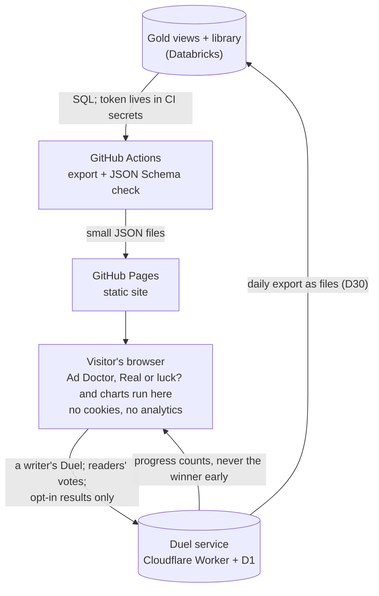
- **Stack.** Vite + React + TypeScript, Apache ECharts for charts, i18next for Spanish/English, Vitest + Testing Library for tests. All MIT or Apache-2.0.
- **The look (L11).** Warm paper colors and dark mode, regular-weight type, pill buttons, and app windows on paintings drawn in code. The fonts are free and served from the site: Instrument Sans, EB Garamond (book text), Geist Mono. We copy cursor.com's style, never its name, logo, fonts or images.
- **The voice (L9).** Plain, kind, direct sentences, in the writer's words. For example: "Too close to call. Both work. Pick the one you love and stop worrying."
- **Pages.**
  - The writer pages carry the name **Antes de decidir · Before You Decide**.
  - The test store sits under "Behind the scenes".
  - Every number block wears a source badge (D28): *Shared by writers*, *Real public tests* or *Simulated*.

  The demo (`docs/plan/DEMO.html`) shows each page with example data.
  1. **Home: three doors (L5).**
     - The headline: "About to decide something about your book? Ask real readers first. Free, no account, answers in days."
     - The three doors:
       - "Which cover?" opens a Duel;
       - "Losing money on ads?" opens the Ad Doctor;
       - "Did my change work?" opens Real or luck?.
     - Also inside: the game, the library and the "Behind the screen" notes.
     - A public counter: "N results so far" (C11).
  2. **Duel (L1, D34–D37).** Four steps.
     - **Create.**
       - What are you choosing? Cover, title, blurb or book idea. Then the two versions, the genre and the book's language.
       - Covers are shrunk in the browser to about 60 KB before upload (D35).
       - Optional: reward voters with the first page, and add the writer's own "tell me when it's out" link.
     - **Share.**
       - One unlisted link, for Instagram, WhatsApp, Wattpad, TikTok or a newsletter.
       - "The result opens at 330 readers. That's enough to see a clear difference."
     - **Readers vote.**
       - The browser picks the version from a hash of the Duel and a random number that never leaves the device. So each reader sees one version, and nobody sees both or sees the votes.
       - One tap: "Would you read the first page?" Anonymous, one tap, no account.
       - The thank-you page shows the first page, the writer's link and "Do you write? Test yours free".
       - The writer's own device is never counted.
     - **Progress.**
       - It shows readers so far and the fair-split check, but never the winner. "Stopping early on a lucky streak is how people pick the wrong cover."
       - The Duel ends at 330 readers or after 14 days.
     - **Reveal.** One of four endings (D34):
       - "Readers chose version B", with the gap and how rarely luck makes a gap that big;
       - "Too close to call: both work";
       - "Not sure yet: about N more readers";
       - "Not fair yet", when the split broke.

       For the curious: the difference with a 95% range and the split check.

       A ready image to post: "My readers chose my cover!", with "test yours free".

       A check box adds the result to the library, anonymously: only the genre, book language, what changed, an optional idea tag and the result.

     **What a Duel measures:** readers' interest in the first page, in a fair test. Not sales. The page says so.
  3. **Which would you read? (L2, D36).**
     - One card at a time: one random version from another writer's Duel. Each vote counts in that real A/B test.
     - Each vote you give earns one vote for your own Duel. The credit lives on your Duel's private link, so no accounts are needed. Photofeeler uses this same "karma" model.
     - At first you approve which Duels enter the game. Every card has a report button.
  4. **Ad Doctor (L3).**
     - Drop an Amazon Ads search-term report (CSV). English or Spanish columns are fine, with commas or semicolons. Enter what you earn per sale and the days in the report.
     - Each keyword gets a verdict and its reason, in plain words:
       - **Stop**: at least 10 clicks, and 90% sure it earns less than it costs;
       - **Keep**: at least 10 clicks, and 90% sure it earns more than it costs;
       - **Luck**: looks great, but from fewer than 15 clicks;
       - **Wait**: wait about N more clicks; if it's too close to break-even to judge soon, pause it when money is tight.
     - The headline number: "You can stop spending about USD X a month".
     - The model is beta-binomial. Each keyword starts from the book's own average, as if it already had 20 clicks. Break-even = cost per click ÷ what the writer earns per sale.
     - **Meta Ads:** book ads there usually send people to Amazon, so Meta sees clicks, not sales. The Doctor compares cost per click instead.
     - **The file never leaves the browser.**
  5. **Real or luck? (L4).**
     - Sales and days, before and after a change. An exact binomial test, adjusted for the days, gives:
       - "It's real" (p < 0.05);
       - or "You can't tell yet. A jump like this happens by luck about 2 times in 5", with the days of the same pace that would settle it.
     - It also says that a holiday, a promotion, a new review or a price change can move sales too.
     - For a sure answer about a cover or a title, it points to a Duel.
  6. **The library: what worked for writers like you (L6, inside).**
     - Results come mostly from Duels, plus ad tests that writers already ran and shared. Each result says which kind it is.
     - Filters: genre and book language. Then "What are you about to change?":
       - cover, title, blurb or book idea, from Duels;
       - cover, title, blurb, price display or bundle, from ad tests.
     - An evidence card (*Shared by writers*) shows:
       - how many results there are, and how often the change won;
       - the typical gap with its middle half;
       - a dot strip with one dot per result;
       - plain advice.
     - One line says what "won" means: more readers wanted the first page (Duels) or more people clicked (ad tests), in a fair test. Not sales (C4).
     - **Ideas:** "How often each idea worked" lists an idea tag once 5 results used it, as "Covers with a face · won 6 of 9 Duels". Never one result's best gap (C3).
     - **The ranking:** "What works best for romance writers in Spanish" ranks the changes once each has 5 results (C2).
     - **Launch day and small groups** show "Not enough results yet: be one of the first", an "x of 5" counter, an invitation to start a Duel, and the lessons from the real headline tests (D26).
  7. **Plan an ad test** (inside, kept from v2.3; it opens on an example writer, with example numbers):
     - inputs: what to change (cover, title, blurb, price display, bundle); views per day for each ad; % who click; optional cost per 1,000 views;
     - a **"?"** next to each number says where to find it in the writer's ad report (C5; names checked on each platform's help pages, 2026-10-15):

       | Ad platform | Views per day, per ad | People who click (%) | Cost per 1,000 views |
       |---|---|---|---|
       | Meta Ads Manager (Facebook, Instagram) | "Impressions" ÷ days the ad ran | "CTR (link click-through rate)" | "CPM (cost per 1,000 impressions)" |
       | Amazon Ads (KDP books) | "Impressions" ÷ days | Clicks ÷ Impressions × 100 | Spend ÷ Impressions × 1,000 (Amazon charges per click) |
       | BookBub Ads | "Impressions Served" ÷ days | "Click-through Rate (CTR)" | "Effective CPM (eCPM)" |
       | TikTok Ads Manager | "Impressions" ÷ days | "CTR (Destination)" | "CPM" |

       Sources: Meta Business Help Center ([Impressions](https://www.facebook.com/business/help/675615482516035), [CTR](https://en-gb.facebook.com/business/help/877711998984611), [CPM](https://www.facebook.com/business/help/753932008002620)); Amazon ([advertising for KDP books](https://kdp.amazon.com/en_US/help/topic/G201499010), [book advertising reports](https://advertising.amazon.com/library/guides/book-advertising-reporting)); [BookBub Ads 101](https://insights.bookbub.com/bookbub-ads-understanding-campaign-results/); TikTok Ads Manager ([glossary](https://ads.tiktok.com/help/article/tiktok-ads-manager-glossary-terms), [click metrics](https://ads.tiktok.com/help/article/about-updates-to-click-and-conversion-rate-metrics)). Writers who never ran ads keep the example numbers until their first day of ads. The Spanish names are checked in Phase 7 (O20);
     - outputs, verdict first: "Test it in ads. Run both ads for 7 days, a full week." When the math needs fewer days, the same views are spread over the week: "a bold change (+30% more clicks) needs about 16,500 views per ad: 4 days at your pace. Spread them over the week: about 2,400 views a day per ad, same budget." A small (+10%) difference needs longer: about 28 days (C12, D29);
     - also: the +10/20/30/50% table (never less than 7 days) and the ad budget for the test;
     - a fair-test checklist: change one thing; same audience, budget and text; the ad platform's A/B test feature; the end day chosen before starting, at least 7 days later; the same price in both ads;
     - one line from the library sets honest expectations, once the group has 5 results (C7): "Writers like you saw +9% with covers; 2 of 26 reached +30%."
     - a folded box, **"Why not test on my book's page?"** (C6): a book page shows one version at a time, so "before vs after" isn't a fair test, and it gets few visitors. With editable numbers (visitors a month, % who buy, price): "at 2,000 visitors a month, the same bold test takes 9.8 months; a small one, 6.7 years", and what a +20% sales lift is worth a month. It also says that Amazon's own A/B tool needs a Professional selling account and Amazon Brand Registry, and its page doesn't mention KDP books ([Manage Your Experiments](https://sell.amazon.com/tools/manage-your-experiments), checked 2026-10-15).
  8. **Read your ad results** (inside, kept from v2.3):
     - inputs: views and clicks for ad A and ad B;
     - verdict first: **Use B**, **Keep A**, **Not sure yet** (with the extra days needed at the current pace), **Too close to call** (a tiny difference), or **Not fair yet** when one ad got 50% more views. Ad delivery isn't random unless the platform's A/B feature is used; smaller gaps get a warning line;
     - "Details" (folded): the difference with a 95% range, the p-value, the chance B is better under the realistic or neutral prior, and the expected loss;
     - "What this doesn't tell you": clicks are not sales, so check sales next month; winners shrink when tested again;
     - a comparison with the library (*Shared by writers*), once the group has 5 results (C7): "Your +30% is higher than 24 of the 26 cover tests shared by writers like you". Before that: "Not enough cover tests from writers like you yet (0 of 5). Share yours to start the library."
     - **Share this result anonymously**, offered for every fair verdict, with "a test that didn't work is just as useful" (C10, R38). It is off only for "Not fair yet":
       - a dialog lists every field that will be sent: genre, book language, change, the optional idea tag, and views and clicks per ad. No names, emails or book titles;
       - a short notice says why (to build the public library), where it goes (our Cloudflare database, then the project's lakehouse) and what gets published (only summaries, CC BY 4.0);
       - nothing is sent until the writer presses Share. Then they see a receipt code that withdraws the result later (D27).
  9. **Real lessons** (*Real public tests*; C8):
     - the conclusion first, in one line: "Most changes make only a small difference. Test bold ideas, run the test to the planned end, and expect a bit less later.";
     - then three lessons, each with a small chart and "what this means for you": most changes are small (test a bold change, not a tiny tweak); clear winners are rare ("no clear winner" is a normal result, not a failure); winners shrink when tested again (don't stop early, and expect less later);
     - the numbers come from the Upworthy analysis in Phase 6 (§3.12), with attribution and the limitation: news headlines, not book sales. Until then they are marked as placeholders.
  10. **Behind the scenes: our test store** (*Simulated*; C9), with a "simulated · a fictional store we built · not advice for your book" banner:
      - one plain sentence per decision: "Wallet-first checkout: keep it. More shoppers paid within 30 minutes, and every safety limit held." "New cover + subtitle: don't keep it. More shoppers bought, but refunds rose above the limit set before the test." "3-book bundle banner: keep it. More money per visitor, and refunds stayed normal.";
      - the checks on the checks, in plain words: the A/A fixture (no false alarm) and the broken split (caught);
      - for the curious: readouts, guardrails, SRM and memos; business KPIs (sales, funnel, payment methods, refunds and chargebacks); a data-health badge and "data as of";
      - a closing line: "This shows how a store decides with rules set in advance. It says nothing about your book; for that, run a Duel or see the library."
  11. **For nerds (N1).** The architecture, live, for recruiters and developers. It is the same component as the demo's tab (`docs/plan/render/nerds.js`).
      - **The map.** Three colored lanes, one per kind of data, that never cross. Kafka touches only the simulated store, and Duel votes and open data arrive as files.
      - **The cards.** Every box opens one: what it does, where it lives in the repo, why it is built that way, and what it costs.
      - **Five guided stories:**
        - a reader's vote;
        - a simulated shopper;
        - the real headline tests;
        - the 06:00 run;
        - an Ad Doctor report.
      - **Filters and the stack.** A filter keeps one kind of data lit. The stack table marks the Lab parts (§3.0).
      - **Motion** pauses on request and stops when the visitor asks for less motion.
  12. **Methods:**
      - where the numbers come from (the three badges);
      - assumptions and formulas;
      - the Duel rules (D34);
      - how sharing and voting work: what is stored, the anti-abuse rules, how the library is computed;
      - a link to the repo.
- **The Duel service** (`edge/`, A17, A21, D23–D25, D34–D37): a Cloudflare Worker in TypeScript with a D1 database.
  - **Routes:**
    - `POST /v1/duels` creates a Duel and returns its public link and the writer's private link (an owner key, kept only as a hash);
    - `GET /v1/duels/:id` and `GET /v1/duels/:id/versions/:arm` serve a Duel and one version. The browser picks the version, so the random number never leaves it;
    - `POST /v1/duels/:id/votes` takes `{arm, answer}`;
    - `GET /v1/duels/:id/progress` (owner key) returns readers per version for the split check, never the answers;
    - `GET /v1/duels/:id/result` (owner key) returns the answers only once the Duel has ended. The server enforces "no peeking";
    - `POST /v1/duels/:id/library` adds an ended Duel to the library (opt-in);
    - `GET /v1/game/next` serves the game's next card, and votes given there add credit to the voter's Duel;
    - `POST /v1/duels/:id/report` reports a Duel;
    - `POST /v1/admin/...` (a token in repo secrets) lists, approves and removes Duels for the game (D36);
    - `POST /v1/results` and `POST /v1/withdraw` keep the v2.3 share and its receipt code.
  - **D1 tables:**
    - `duels`: id, owner key hash, kind, genre, book language, target, created, ends, status, in game, in library, idea tag, optional first page and link;
    - `versions`: a cover of at most 120 KB, or a text;
    - `votes`: seq, Duel, version, answer, minute, visitor hash;
    - `credits`, `reports`, `shared_results`, `rate_limit`.
  - **One vote per visitor per Duel.**
    - The check uses `HMAC(daily secret, date + IP + Duel)`. The IP itself is never stored.
    - A scheduled Worker (Cron Triggers, free) blanks the hashes after 24 hours.
    - It also deletes covers 30 days after a Duel ends (D35).
  - **Limits:**
    - CORS allows only `https://pipe199x.github.io`;
    - request bodies: at most 300 KB to create a Duel and 1 KB for a vote;
    - every body is checked against `contracts/duels/*.schema.json`, the same schemas the site and Silver use;
    - at most 5 Duels and 5 shares per visitor a day;
    - no request logging.
  - **When a free-plan limit is hit,** D1 refuses writes until 00:00 UTC. The site says "Voting is paused for today. Please try again tomorrow."
  - **Deploy and tests.** It is deployed with `wrangler` (pinned in `edge/package.json`). Tests run on Cloudflare's local Workers runtime, so they need no account.
- **Stats in TypeScript** (`web/src/stats`, no dependencies):
  - normal CDF and quantile; the z-test and its CI; sample size and days still needed;
  - a views-ratio check for ads; SRM χ² for Duels and for the store's pages;
  - a normal–normal posterior on the log-odds ratio, with closed-form expected loss;
  - the Ad Doctor's beta-binomial and Real or luck?'s exact binomial test.

  They are tested against shared vectors in `tests/vectors/*.json`, which the Python library generates with scipy/statsmodels as the oracle. The same vectors test both languages.
- **Data:**
  - `ebook_ab.site_export` queries Gold via the Statement Execution API, validates against `contracts/site/*.schema.json`, and writes `web/public/data/*.json`.
  - `library.json` holds, for each group:
    - the counts and the summary numbers;
    - the idea tags with 5 results or more (W of N, typical gap);
    - the rounded gaps for the dot strip;
    - the total number of results, for the public counter.

    It never holds single votes, views, clicks, dates or IDs (D27).
  - A frozen snapshot is committed in Phase 1, so the site always builds.
- **Deploy:**
  - the site: `pages.yml` using configure-pages v6, upload-pages-artifact v5 and deploy-pages v5. Base path `/ebook-ab-platform/`;
  - the Duel service: `wrangler deploy` from `edge/`, with D1 migrations in `edge/schema.sql` and the cleanup cron in `wrangler.toml`.
- **Quality:**
  - keyboard and contrast checks;
  - a mobile-first layout;
  - light and dark themes; motion that respects "reduce motion".
  - A headless-browser test asserts:
    - no request leaves the site's origin except to the Duel service: create, vote, progress, result, game, library opt-in, share;
    - the Ad Doctor, Real or luck? and the planner send nothing.
  - Every number block carries a source badge (D28). A build with no real results shows "0 of 5" everywhere and hides the ranking, the ideas and the compare lines (D26).
  - **Duel service tests:**
    - bad payloads are rejected;
    - a second vote from the same visitor is refused;
    - the result route refuses before the end;
    - the 6th Duel or share in a day is refused;
    - a withdrawal works;
    - covers are deleted after 30 days (fake clock);
    - the split check flags a broken split.
  - The demo's click-through test (`tools/check_demo.cjs`) is the acceptance script for the real pages.
  - A build-size budget (< 5 MB).

### 3.14 Local job cluster (Q11) · Lab
Practice for the portfolio (D31): the product runs on Databricks serverless and does not need it.
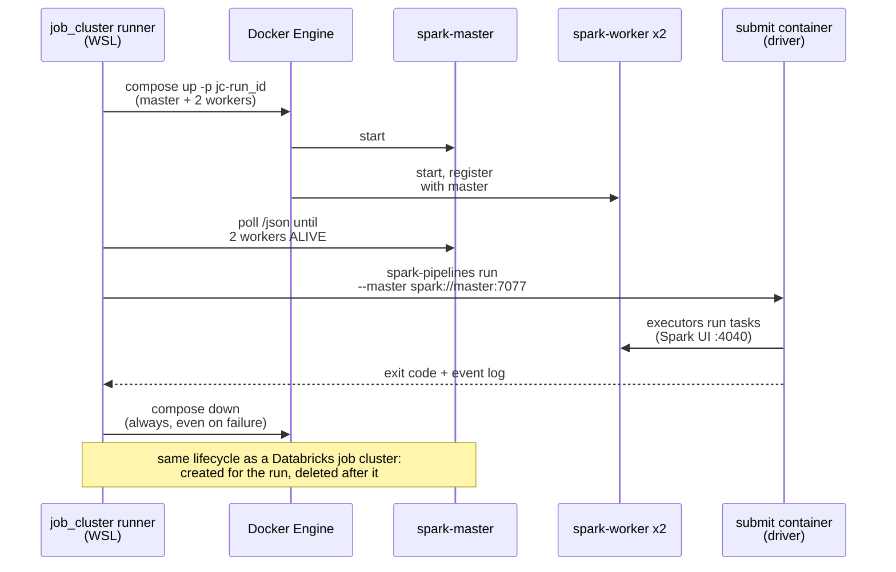
- **Why:** "Free Edition users only have access to serverless compute resources", and "Custom compute configurations are not supported" ([limitations](https://docs.databricks.com/aws/en/getting-started/free-edition-limitations), updated 2026-09-29). Real job clusters need a paid workspace (§4.1).
- **Cluster:** `docker/compose.cluster.yml` has master + 2 workers running `apache/spark:4.2.0-scala2.13-java21-python3-ubuntu`.
  - Each worker has 2 cores and 2 GB.
  - A submit container runs the driver.
  - It shares the Kafka network and uses named volumes for the lakehouse data, the Ivy cache and Spark event logs.
- **Runner:** `uv run python -m ebook_ab.tools.job_cluster run <job>` does:
  1. up;
  2. wait until the workers are ALIVE;
  3. run the job;
  4. collect logs and the event log;
  5. **always** tear down (`--keep` only for debugging).

  It prints the cluster lifecycle the way a Databricks job-cluster run does.
- **Jobs:**
  - `local_pipeline`: an OSS Spark Declarative Pipeline. Bronze reads local Kafka directly, Silver uses explicit filter + quarantine flows, plus 3 Gold views. It reuses `src/ebook_ab/transforms` and the portable Gold SQL.
  - `perf_lab` (§3.16).
- **What OSS doesn't have:** open-source SDP ([Spark 4.2 guide](https://spark.apache.org/docs/latest/declarative-pipelines-programming-guide.html)) documents streaming tables, MVs, temporary views and Kafka sources. It does not document expectations, AUTO CDC or `cluster_by`, and Auto Loader is Databricks-only. So the local twin shares the transforms, not the pipeline file.
  - Delta as the local table format is **unproven** (O11): the Phase 0 spike tests it.
  - Fallback: a plain Structured Streaming app with `foreachBatch` → Delta.
  - Differences go into ADR-006, plus a parity test: same fixture → same Silver counts and keys.
- **Paid-workspace showcase:** `resources/classic/ebook_daily.classic.yml` is a bundle target `classic` that is **never deployed**. Its `job_clusters` / `new_cluster` sets the DBR LTS (verified in Phase 8), the node type, autoscale 1–3, `SPOT_WITH_FALLBACK` with `first_on_demand: 1`, `spark_conf`, a policy and `data_security_mode`. It is validated with `databricks bundle validate -t classic` if Free Edition accepts that (O13); otherwise offline.
- **RAM:** Kafka + cluster ≈ 6 GB of the 7.7 GiB in WSL. Mitigations (R25): run them separately, or raise WSL memory in `%UserProfile%\.wslconfig` (no admin needed).

### 3.15 Plain Structured Streaming track (orders only) · Lab
Practice for the portfolio (D31): it parses orders by hand, which Silver already does, to compare the two approaches. Notebook `30_sss_orders`, run as a scheduled serverless job:
- **Q1:** Auto Loader (or Kafka on Path A) → `bronze.sss_orders_raw`, append-only.
- **Q2:** a Delta stream → `foreachBatch`. Each batch is parsed, exploded, de-duplicated, then MERGEd into `silver.sss_order_events` on `event_id`, inserting only when not matched.
- Both use `trigger(availableNow=True)` ([serverless limits](https://docs.databricks.com/aws/en/compute/serverless/limitations)).
- Replaying a batch inserts 0 rows.
- ADR-003 compares the two approaches on offsets, checkpoints, recovery, data quality and effort.

### 3.16 Observability, performance, Delta
- **Spark UI lab on the local job cluster (Lab).** Free Edition serverless has no Spark UI, so this lab runs on the local cluster with generated data:
  - 20M generated product views where one bestseller holds 30% of the views (natural skew in a book store).
  - Measure before/after for a broadcast join (books dimension), a skew fix (AQE skew join or salting) and file sizing.
  - Numbers go into `docs/perf/spark-ui-lab.md`. Spark History Server reads the saved event logs after the cluster is gone.
- **Databricks (real):**
  - query profile screenshots, the real way to read our own pipeline's runs;
  - event-log SQL for throughput, expectations, backlog and latency ([event log](https://docs.databricks.com/aws/en/ldp/monitor-event-logs));
  - `cloud_files_state` for Auto Loader.
- **Lag:** Path A from offsets and `backlog_bytes`; Path B and the monitor from their logs.
- **Delta** on regular tables (the SSS tables and `experiment_results`; MVs reject OPTIMIZE/VACUUM):
  - real: MERGE into `experiment_results`, time travel to reproduce a memo's exact version, and CDF to audit decision changes;
  - real: AUTO CDC deletes for withdrawn shared results (privacy);
  - Lab: OPTIMIZE after `foreachBatch` MERGEs and VACUUM with 168 h retention, demos at our size.

### 3.17 Orchestration and CI/CD
- **Bundle:** `databricks.yml` with targets `dev` (development), `prod` (production; explicit `run_as` + permissions, `/Workspace/Shared/.bundle/…` ([deployment modes](https://docs.databricks.com/aws/en/dev-tools/bundles/deployment-modes))) and `classic` (never deployed, §3.14).
  - Variables: `catalog`, `ingest_path`, `landing_root`.
  - Resources: pipeline, jobs, schemas, volume, secret_scope ([resources](https://docs.databricks.com/aws/en/dev-tools/bundles/resources)).
- **Job `ebook_daily`:**
  - Task order: `pipeline_update` → `governance` → `analysis` ∥ `dq_report` ∥ `community_summary` (≤ 3 concurrent tasks; the limit is 5). `community_summary` now pools Duels too.
  - `max_concurrent_runs: 1`; failure emails.
  - The GitHub daily run triggers it by API. A paused 06:30 Bogotá schedule in the bundle is the fallback (A14), so runs are never duplicated.
- **Job `sss_orders`:** daily (Lab, §3.15).
- **GitHub Actions** (standard `ubuntu-latest`: 4 CPU, 16 GB RAM, 14 GB SSD for public repos ([runners](https://docs.github.com/en/actions/reference/runners/github-hosted-runners))):
  - `ci.yml`:
    - Python: ruff, unit, stats and contract tests, plus Kafka integration with an `apache/kafka:4.2.2` service container and the bridge kill test;
    - web: `tsc`, Vitest including the shared vectors, build, the no-third-party-requests check;
    - `databricks bundle validate` (skipped on forks).
  - `deploy-dev.yml`: push to `main` runs `bundle deploy -t dev`.
  - `pages.yml`: builds and deploys the site.
  - `daily-e2e.yml` (cron 11:00 UTC = 06:00 Bogotá):
    1. start an ephemeral Kafka service container;
    2. `topics ensure`;
    3. run the simulator in `live` mode for one simulated "today" (about 2,000 active shoppers, shipped variants on);
    4. run the bridge with epoch `gha-<run_id>` until drained;
    5. export what is new in D1 (Cloudflare API token from repo secrets): shared results and withdrawals to `landing_real/community/`, Duels and votes to `landing_real/duels/` (D30);
    6. trigger `ebook_daily` and wait;
    7. run `site_export`, including `library.json` (Duels and shared ad tests);
    8. build and deploy Pages.

    Timeout 30 min, a concurrency group, secrets from repo settings.
- **Terms and limits:**
  - Hosted runners may be used for the "production, testing, deployment, or publication" of the project ([terms](https://docs.github.com/en/site-policy/github-terms/github-terms-for-additional-products-and-features)). A short daily end-to-end test that refreshes the published site fits; nothing runs 24/7.
  - Scheduled workflows in public repos are disabled after 60 days without repo activity ([docs](https://docs.github.com/en/actions/how-tos/manage-workflow-runs/disable-and-enable-workflows)). That is documented, with one-click re-enable.

### 3.18 Compliance and ethics by design
- **Ley 1581 de 2012** (personal data):
  - **Minimization:** hashes and masks; Gold carries no PII.
  - **Purpose limitation:** `purpose` tags.
  - **Least privilege:** `bi_readers` sees Gold only; `pii_readers` can unmask.
  - **Audit columns:** Kafka coordinates, epoch, file, `_processed_at`, `_refreshed_at`.
- **Ley 1266 de 2008** (financial habeas data, as amended by Ley 2157 de 2021): payment behavior (failed payments, fraud flags, chargebacks) is tagged `ley_1266`, with bounded, documented retention. Designed as if the law applied.
- **Consumer protection (Ley 1480 de 2011, open question O12):**
  - Refund ("retracto") rules and truthful-information duties shape the PDP guardrail and D20.
  - Both official law sites failed for me today (Senado: connection refused; Función Pública: TLS error), so the specifics wait for Phase 2.
  - Until then, the marketplace's "7-day satisfaction guarantee" is a simulator policy, not a legal claim.
- **Experiment ethics:** D20.
- **Public site:** D22, D24 and D37, plus source badges on every number (D28) and a "Simulated" banner on the test store.
- **Duels and votes** (D34–D37):
  - **Notice:** the Duel's create page says what is stored (the two versions, genre, book language, the optional first page and link), for how long (covers: 30 days after the end), and who can see it (people with the link).
  - **Votes:** anonymous. No cookies, no names. A daily-salted hash of the IP address keeps one vote per visitor per Duel and is blanked after 24 hours; the IP itself is never stored.
  - **Uploaded images:** the writer confirms they own the cover. A report button and your approval for the game (D36). Covers are deleted automatically.
  - **Minors:** the site asks for nothing personal; Duels and the game are for book choices only.
- **Shared results** (D24–D27):
  - **Consent:** the share dialog is the notice. It lists every field, says why, where it is stored and what is published, and sends nothing until the writer presses Share.
  - **Anonymity:** the shared fields are not personal data under Ley 1581 (no name, email, ID number, book title or free text). An IP address can be personal data, so the Worker uses it only in memory, as a daily-salted hash for the rate limit, and never stores it.
  - **Withdrawal:** the receipt code removes a result from the next nightly library.
  - **Small groups:** only summaries are published, and only for groups of 5 results or more.
  - **Processors:** Cloudflare (storage) and Databricks Free Edition (processing) are named in the notice. Free Edition may train on workspace data (§1.3); the shared fields hold nothing personal.
- **Licenses:**
  - Upworthy data: CC BY 4.0, with attribution on the site and in the report.
  - Gutenberg metadata: CC0, with no texts or covers.
  - The library (`library.json`): published by the project as open data under CC BY 4.0 (D27).
  - Docker Hub pulls are anonymous: 100 pulls per 6 h per IP ([limits](https://docs.docker.com/docker-hub/usage/pulls/)).
- **Synthetic flag:** every envelope carries `producer.synthetic=true`. Duel votes are real and never carry it; Silver keeps the two apart, and the library takes only real results (D26).

### 3.19 Sizing and throughput

| Experiment | Baseline | MDE | α / power | n per arm | Exposure probability | Users needed |
|---|---|---|---|---|---|---|
| EXP-CHK-001 | 70% paid within 30 min | +3.0 pp | 0.05 two-sided / 0.80 | **3,554** | ~0.25 | ~28,430 |
| EXP-PDP-002 | 4.0% purchase within 24 h | +0.6 pp (+15% rel.) | 0.05 / 0.80 | **17,943** | ~0.70 | **~51,270 (binding)** |
| EXP-BUN-003 | COP 2,400 net revenue per exposed user (σ ≈ 9,600) | +15% (COP 360) | 0.05 / 0.80 | **8,373** with CUPED ρ = 0.5 (10,159 at ρ = 0.3; 11,163 without) | ~0.60 | ~27,910 |

- **Formulas.** Proportions: n = [z₀.₉₇₅·√(2p̄q̄) + z₀.₈·√(p₁q₁+p₂q₂)]² / δ². Means: n = 2(z₀.₉₇₅+z₀.₈)²σ²(1−ρ²)/δ².
- **N = 70,000:** 51,266 × 1.35 for safety.
- **Expected exposed per arm:** CHK ~8,750, PDP ~24,500, BUN ~21,000.
- **Power at the expected n:**
  - primaries: CHK 0.99 at the MDE; PDP 0.91 at the MDE;
  - guardrails: CHK fraud 0.88, CHK chargebacks 0.98, PDP refunds ≈ 1.00, BUN any-purchase 0.98, BUN refunds ≈ 1.00.

**Timeline (simulated, America/Bogota):**

| Window | Dates |
|---|---|
| Pre-period (CUPED) | 06-22 → 07-05 |
| Enrollment | **07-06 → 08-02** (28 days) |
| Schema v2 switch | 07-20 |
| Cutoff: PDP | 08-10 (24 h purchase + 7-day refund window) |
| Cutoff: BUN | 08-17 (7-day revenue + 7-day refund maturity) |
| Cutoff: CHK (single final readout) | 09-21 (chargebacks mature 45 days after the last order, + 5 days) |
| Live mode | From Phase 8: one simulated "today" per daily run |

**Duels.** The target is 330 readers per Duel: 165 per version find a gap from 30% to 45% at α = 0.05 two-sided and 80% power (the prototype computes 326 and rounds up). A Duel holds about 120 KB of covers, so one 500 MB D1 database keeps about 4,000 live Duels; covers leave 30 days after the end (D35). Votes are tiny: 100,000 written rows a day is far above our need.

**Volume:** about 1.8 M events in about 0.42 M messages. That is ~0.9 GB of raw JSON, or ~0.17 GB on the wire with zstd at ~5×.

**Aiven budget.** The sources disagree on the limit: the docs say 250 + 250 KiB/s, while a changelog says 125 + 125. We design for **125/125**. With 2 consumer groups, egress is 2× ingress, so the producer runs at **50 KiB/s**. The backfill takes about **55–60 min**, with a ceiling of ~2.5 h if compression is only 2×. The local Docker backfill takes about 5–8 min.

---

## 4. Zero-cost bill of materials (all checked 2026-10-15; page update date in brackets)

| Component | Free tier / license | Limits | When a limit is hit | Official source | Paid option rejected | Free fallback |
|---|---|---|---|---|---|---|
| Databricks Free Edition | $0, no payment method, non-commercial | **Serverless only** ("Custom compute configurations are not supported"). Outbound internet limited to trusted domains. 1 SQL warehouse (2X-Small). 5 concurrent job tasks. 1 active pipeline per type. Up to 3 Apps, each stopped 24 h after start. | Quota exceeded: compute shut down for the rest of the day | [limitations](https://docs.databricks.com/aws/en/getting-started/free-edition-limitations) [2026-09-29] | Trial (credits expire); paid workspaces | Local Spark; small data; spread heavy runs across days |
| Serverless compute (in FE) | Included | `AvailableNow`/`Once` only; no cache, RDD or Spark UI; ANSI; UTC | Unsupported trigger error | [serverless limits](https://docs.databricks.com/aws/en/compute/serverless/limitations) [2026-10-07] | Classic job clusters (§4.1) | Local job cluster |
| Lakeflow SDP, Jobs, UC, volumes | Included | 1,000 datasets per pipeline | Second active pipeline blocked (O3) | [pipeline limits](https://docs.databricks.com/aws/en/ldp/limitations) [2026-10-09] | n/a | One pipeline; one target at a time |
| Databricks CLI v1.21.0 + Bundles | Databricks License | n/a | n/a | [bundles](https://docs.databricks.com/aws/en/dev-tools/bundles/) [2026-09-11]; CLI release 2026-10-14 | n/a | SDK/REST scripts |
| Aiven Kafka free tier | $0, **no credit card**, not a trial | 5 topics × 2 partitions; 250 + 250 KiB/s; fixed retention (≤72 h); powers off when there is "no ongoing Kafka activity", with power-on from the console; topic data deleted on shutdown | Throttling; data loss when idle | [free tier](https://aiven.io/docs/products/kafka/free-tier/kafka-free-tier) [2026-08-18]; [create](https://aiven.io/docs/products/kafka/free-tier/create-free-tier-kafka-service) [2026-09-09]; [advanced params](https://aiven.io/docs/products/kafka/reference/advanced-params-free-tier) [2026-05-18] | Aiven paid; Confluent Cloud | Local Kafka; CI Kafka (D19) |
| Apache Kafka 4.2.2 image (KRaft) | Apache-2.0 | RAM | Lower the heap | [downloads](https://kafka.apache.org/community/downloads/) | n/a | n/a |
| Docker Engine (Ubuntu 26.04) | Apache-2.0 | Anonymous Hub pulls: 100 per 6 h per IP | Wait or retry | [install](https://docs.docker.com/engine/install/ubuntu/); [pull limits](https://docs.docker.com/docker-hub/usage/pulls/) | Docker Desktop paid tiers | Docker Desktop personal |
| `apache/spark:4.2.0-scala2.13-java21-python3-ubuntu` | Apache-2.0 | Laptop RAM | Fewer/smaller workers | [Docker Hub tags](https://hub.docker.com/r/apache/spark/tags) [tag 2026-07-16] | Databricks classic compute | `local[*]` PySpark |
| delta-spark 4.4.1 | Apache-2.0 | Needs pyspark ≥ 4.0.1, ≤ 4.2.0 | n/a | [PyPI](https://pypi.org/project/delta-spark/) [2026-10-05] | n/a | Parquet tables in the local twin (O11) |
| uv 0.13.1 + CPython 3.12 | Apache-2.0/MIT; PSF | n/a | n/a | github.com/astral-sh/uv | n/a | `python3-venv` (sudo) |
| Python libraries | confluent-kafka 2.16.0, Faker (es_CO), scipy, statsmodels (CI), pytest, databricks-sdk 0.153.0, jsonschema, PyYAML, pyspark 4.2.0, ruff: all OSI licenses | PyPI from serverless unconfirmed (O6) | Vendored stats | [env v6](https://docs.databricks.com/aws/en/release-notes/serverless/environment-version/six) [2026-09-15] | n/a | numpy + scipy only |
| Frontend | React 19.3.1, Vite 8.3.4, @vitejs/plugin-react 6.1.2, Vitest 5.0.5, Testing Library 16.3.3, i18next 26.4.5 / react-i18next 17.0.17 (MIT); TypeScript 7.0.2, ECharts 6.1.0 (Apache-2.0) | n/a | n/a | npm registry [2026-10-15] | Power BI Pro ($14/user/month) | Last 5.x TypeScript if a plugin breaks |
| GitHub public repo + Actions (standard runners) | Free for public repos | ubuntu-latest: 4 CPU / 16 GB / 14 GB SSD. Scheduled workflows disabled after 60 days without activity. Hosted runners only for the project's production, testing, deployment or publication. | Re-enable the schedule | [plans](https://docs.github.com/en/get-started/learning-about-github/githubs-plans); [runners](https://docs.github.com/en/actions/reference/runners/github-hosted-runners); [terms](https://docs.github.com/en/site-policy/github-terms/github-terms-for-additional-products-and-features) | Larger runners | Self-hosted runner in WSL |
| GitHub Pages | Free in public repos | Site ≤ 1 GB; soft 100 GB/month bandwidth; deploys time out at 10 min; not for running an online business | Optimize assets | [Pages limits](https://docs.github.com/en/pages/getting-started-with-github-pages/github-pages-limits) | Paid hosting | `npm run preview` locally |
| Cloudflare Workers + D1 (the Duel service and the share endpoint) | Workers Free plan: "By default, users have access to the Workers Free plan". The docs don't say whether sign-up asks for a card (O16). | Workers: 100,000 requests/day, 10 ms CPU per request, Cron Triggers included (we need one). D1: 5 million rows read and 100,000 rows written per day, 5 GB in total, 500 MB per database, 10 databases, 50 queries per request. At ~120 KB of covers per Duel, one database holds about 4,000 live Duels (D35). | Daily limits: D1 errors until 00:00 UTC, and the site says "Voting is paused for today". Storage limit: covers are deleted 30 days after a Duel ends, so space comes back. | [Workers pricing](https://developers.cloudflare.com/workers/platform/pricing/) [2026-10-02]; [D1 pricing](https://developers.cloudflare.com/d1/platform/pricing/) and [D1 limits](https://developers.cloudflare.com/d1/platform/limits/) [2026-04-21] | Workers Paid plan | Supabase free (2 projects, 500 MB each; [paused](https://supabase.com/docs/guides/platform/free-project-pausing) after low activity over 7 days); then moderated submissions via GitHub |
| wrangler (Cloudflare's CLI, in `edge/`) | MIT or Apache-2.0 | n/a | n/a | npm registry (version pinned at Phase 0) | n/a | The Cloudflare dashboard |
| Fonts: Instrument Sans, EB Garamond, Geist Mono (L11) | SIL Open Font License 1.1 | Served from the site itself, so no font request leaves the origin (the privacy check stays strict) | n/a | the font projects' repositories | Paid typefaces | System fonts |
| GitHub secret scanning | Free for public repos | n/a | n/a | [secret scanning](https://docs.github.com/en/code-security/secret-scanning/introduction/about-secret-scanning) | Secret Protection (private repos) | `detect-secrets` hook |
| Upworthy Research Archive | **CC BY 4.0** | Exploratory CSV 14.3 MB; confirmatory sample reserved | n/a | [archive](https://upworthy.natematias.com/); [OSF](https://osf.io/jd64p/) | n/a | Skip the real-data track |
| Project Gutenberg metadata | **CC0** per record; titles public domain in the USA | Use the offline catalogs, not crawling | n/a | [offline catalogs](https://www.gutenberg.org/ebooks/offline_catalogs.html); RDF of #1342 | n/a | Synthetic titles |
| Docs toolchain | pandoc 3.12.1 (GPL-2.0+), Typst 0.15.1 (Apache-2.0), mermaid-cli 12.0.0 (MIT), Node 24.22.0, Chrome headless shell | Offline after install | n/a | releases pages | Online converters (forbidden) | WeasyPrint |

### 4.1 Rejected paid or expiring options

| Option | Facts (checked 2026-10-15) | What we lose without it |
|---|---|---|
| Databricks job clusters (classic compute) | Not in Free Edition. A paid workspace bills DBUs (about $0.15/DBU for classic jobs on AWS per third-party guides ([DoiT](https://www.doit.com/blog/databricks-pricing/), [OWOX](https://www.owox.com/blog/articles/databricks-pricing.md)); Databricks' own price table didn't load) plus EC2. Customer VPC subnets need a NAT gateway ([Databricks](https://docs.databricks.com/aws/en/security/network/classic/customer-managed-vpc)) at $0.045/h ≈ $33/month ([AWS](https://aws.amazon.com/vpc/pricing/)). Estimate: $40–60/month. | Real autoscaling, spot behavior, cluster policies and DBU tuning. The local cluster + `classic` target cover lifecycle, config and the Spark UI. |
| AWS (free plan) | No payment method for most new customers, but $100 credits + up to $100 more. The plan ends at 6 months or when credits run out. Then the account is suspended and erased after 90 days unless upgraded (the FAQ also says 12 months in one answer) ([FAQ](https://aws.amazon.com/free/free-tier-faqs/); [free tier](https://aws.amazon.com/free/)) | Nothing essential: Databricks and Aiven already run in the cloud. |
| Databricks App for the public site | FE allows 3 Apps; they support React and Angular, but they stop 24 h after start and viewers must sign in with CAN USE ([apps](https://docs.databricks.com/aws/en/dev-tools/databricks-apps/); [auth](https://docs.databricks.com/aws/en/dev-tools/databricks-apps/auth)) | Live queries, and a place to receive shared results. We serve daily snapshots and receive shares on Cloudflare (D23). |
| Power BI Pro / PPU | $14 / $24 per user per month to share | Not needed (React). |
| Cloudflare R2 for covers | It has a free allowance ([R2 pricing](https://developers.cloudflare.com/r2/pricing/)), but turning R2 on asks for a payment method | Nothing: covers shrunk to about 60 KB live in D1 and are deleted 30 days after the Duel ends (D35). |
| Confluent Cloud, Databricks trial | Credits expire | n/a |

---

## 5. Phases
**Effort: ~230 h (190–267), about 11–13 weeks at 20 h a week.** v2.3 was ~154 h. The rise comes from Round 6: the Duel service and its pages, the game, the Ad Doctor, the library from Duels, For nerds, and the Duel votes in the pipeline (§2.9). Each phase ends with its acceptance checks. A **STOP** means I wait for your OK.

**Lifesaver first (L8).** The Duel, Real or luck? and the home page go live in Phase 1, right after the feasibility spike. Real votes then collect while the pipeline is built, so Phases 3–8 work on real Duel data as well as simulated data.

| Phase | What | Hours | Weeks (20 h/week) |
|---|---|---|---|
| 0 | Feasibility spike, including the Cloudflare account (S0.4) | 9–12 | W1 |
| 1 | **Lifesaver launch**: the site base, Worker + D1, the Duel, Real or luck?, the home page, the new look, the first public deploy (S1.1) | 36–52 | W2–W3 |
| 2 | Simulator, contracts and the real catalog | 14–18 | W4 |
| 3 | Consumer groups and Bronze, with the file sources: Duel votes, shared results, Upworthy, catalog | 10–14 | W5 |
| 4 | Silver, with Duel votes | 14–19 | W5–W6 |
| 5 | Gold, 20 views | 9–12 | W6 |
| 6 | Analysis, validation, real-data lessons, the library | 18–25 | W7–W8 |
| 7 | More tools and pages: the game, the Ad Doctor, the library from Duels, the planner inside, Real lessons, the Test store, For nerds, Methods | 50–70 | W8–W11 |
| 8 | Orchestration, CI/CD, the daily run with the D1 export (S8.1); `30_sss_orders` is Lab | 16–22 | W12 |
| 9 | **Lab**: the local job cluster, the Spark UI lab, the Delta demos | 8–12 | W13 |
| 10 | Docs and report | 6–11 | W13 |
| | **Total** | **190–267** | |

The weeks assume the slower end. At the faster end, everything fits in about 10 weeks.

### Phase 0: Feasibility spike (9–12 h)
1. **Repo bootstrap:** `git init`, `.gitignore`, MIT LICENSE, `tools/make_plan_md.py`.
   - **STOP S0.1:** your OK before three steps:
     - (a) `gh repo create Pipe199x/ebook-ab-platform --public --source . --push`;
     - (b) turning on secret scanning + push protection;
     - (c) enabling Pages (source: GitHub Actions) with a one-page placeholder, which is public.
2. **Local tools (no sudo):**
   - `uv` → Python 3.12 → `uv sync`;
   - the Databricks CLI v1.21.0 tarball;
   - **you run** `databricks auth login --host <workspace-url> --profile ebook`.
3. **Docker Engine: you run** the apt-repo lines (I paste them) + `usermod`. Optionally raise WSL memory if the spike needs it.
4. **Databricks bootstrap** (`sql/bootstrap/00_catalog_schemas_volumes.sql`):
   - `current_metastore()`;
   - `CREATE CATALOG ebook_ab` / `ebook_ab_dev`, falling back to `workspace`;
   - schemas bronze/silver/gold/ops;
   - volume `ops.lakehouse_files`.
5. **Platform probes:**
   - groups + GRANT;
   - secret scope `ebook`;
   - service principal + OAuth secret, else a PAT for CI;
   - a second pipeline (O3);
   - `%pip install statsmodels` (O6).
6. **Files API probe:** upload 100 JSONL rows to `landing/_probe/`. Auto Loader reads them into `ops.probe_autoloader`.
7. **STOP S0.2, before the Aiven sign-up.** After your OK:
   - you sign up;
   - we create one free Kafka 4.2 service with SASL;
   - create the 5 `market.*` topics × 2 partitions;
   - check the internal topics (O4);
   - create service users if allowed (O5);
   - download the CA cert into `.env` and the secret scope.
8. **Kafka probe from WSL:** 10 SASL_SSL messages sent and received.
9. **Path A probes T1–T5.** **STOP S0.3** if they fail: LinkedIn verification, then re-run.
10. **STOP S0.4, before the Cloudflare sign-up.** After your OK:
    - you sign up to the free plan, about 5 minutes, and we note whether a card is asked (O16). If it is, we stop and switch to the Supabase fallback (D23);
    - `npx wrangler login` in the browser;
    - create the D1 database `antes-de-decidir-dev`;
    - deploy a probe Worker that writes and reads 10 rows and one 60 KB test image (D35), then delete it.
11. **Local job-cluster spike:**
    - bring up the compose cluster (master + 2 workers);
    - `spark-pipelines run` a 3-dataset pipeline that reads local Kafka;
    - try Delta tables with delta-spark 4.4.1 (O11);
    - record the result, or the fallback.
12. **Real-data probe:**
    - Upworthy exploratory CSV: expect 14,260,949 bytes, 22,666 rows and 4,873 test IDs.
    - Gutenberg offline RDF catalog: parse 10 records (title, language, downloads, CC0 marker).
13. **Write** ADR-002, ADR-005 and ADR-006, and refresh the BOM.

**Acceptance:**
- catalog, schemas and volume exist, or the fallback is in place;
- 100 probe rows;
- 10/10 Kafka messages;
- the T1–T5 matrix is recorded;
- 10/10 rows and the 60 KB image written and read back through the probe Worker, with no card asked;
- the cluster spike result is recorded;
- the Pages placeholder is live;
- real-data counts match the sources;
- O1–O6, O11 and O16 are resolved.

**Verification**
```bash
databricks current-user me -p ebook && databricks volumes list ebook_ab ops -p ebook
uv run python -m ebook_ab.tools.kafka_probe --target aiven             # sent=10 received=10
npx --prefix edge wrangler d1 execute antes-de-decidir-dev --remote --command "SELECT count(*) AS n FROM probe"   # n = 10
uv run python -m ebook_ab.tools.job_cluster run spike                  # cluster up -> 2 workers ALIVE -> job OK -> cluster down
uv run python -m ebook_ab.realdata.check                               # upworthy rows=22666 tests=4873; gutenberg sample ok
```
```sql
SELECT count(*) FROM ebook_ab.ops.probe_autoloader;          -- 100
```

### Phase 1: Lifesaver launch (36–52 h)
The writer-facing core goes live first (L8), so real votes collect while the pipeline is built.
- **The site base** (`web/`, §3.13): Vite + React + TypeScript, Spanish and English, the new look (L11) and the warmer voice (L9), light and dark themes, the source badges (D28), and the frozen data snapshot, so the site always builds.
- **The pages:**
  - Home with three doors (L5). The Ad Doctor door says "Coming soon" until Phase 7;
  - the Duel (L1, D34–D37): create, share, vote, progress, reveal, the share image, and the library check box (stored now, shown once the library opens);
  - Real or luck? (L4);
  - a first Methods page: the Duel rules, what is stored and for how long.
- **The Duel service** (`edge/`, §3.13): the Worker and D1 with the routes to create, serve, vote, see progress, see the result, opt into the library and report; the one-vote-per-visitor hash; the cleanup cron (hashes after 24 hours, covers 30 days after the end); the limits; `contracts/duels/*.schema.json`. The game and admin routes come in Phase 7.
- **Stats in TypeScript, first part:** the z-test and its range, SRM χ², the "Too close" rule and the exact binomial test. The shared vectors in `tests/vectors/` come from scipy for now; `ebook_ab.stats` (Phase 6) adopts the same files.
- **Checks:** the headless privacy test (no request leaves the site except to the Duel service), keyboard and contrast checks, the < 5 MB budget, and the demo's click-through test (`tools/check_demo.cjs`) pointed at the real pages.
- **Deploy:** `pages.yml` for the site; `wrangler deploy` for the Worker, with the prod D1 database `antes-de-decidir`. ADR-007 (static site + CI export) and ADR-009 (anonymous Duels and sharing on Cloudflare).
- **The "Founding writers" launch note**, `docs/launch/founding-writers.md`, in Spanish and English (section C, C11): who to invite (Spanish-language indie writers about to choose a cover or a title, and those who already run ads), where they meet (writer groups, BookTok and Bookstagram, Wattpad, writing forums, book fairs), what to ask (start a Duel on a choice they face now; from Phase 7, also share an ad test they already ran), the first goal (5 results in the most common groups), and what we never promise (more sales). Posting it is your call; I don't contact anyone.
- **STOP S1.1** before the first public deploy of the site and the Duel service.

**Acceptance:**
- Vitest green, and the TypeScript results agree with scipy within 1e-9 on the shared vectors;
- on the local Workers runtime: bad payloads are refused, a second vote from the same visitor is refused, the result route refuses before the end, the 6th Duel in a day is refused, and covers disappear 30 days after the end (fake clock);
- each of the four endings appears on its fixture Duel, with the right words in Spanish and English;
- a test Duel on the live site gets its two links, takes votes from two phones and shows progress without the winner; then it is removed;
- 0 cross-origin requests other than the Duel service; the build is < 5 MB.

**Verification**
```bash
npm --prefix web ci && npm --prefix web test && npm --prefix web run build
npm --prefix edge ci && npm --prefix edge test
node tools/check_demo.cjs --url https://pipe199x.github.io/ebook-ab-platform/   # the demo's click-through, on the live site
```

### Phase 2: Simulator + contracts + real catalog (14–18 h)
- **Config:**
  - `topics.yml`;
  - `catalog.yml`: title selection and price model;
  - `simulation.yml`:
    - 70k shoppers;
    - sessions with weekly seasonality and paydays on the 15th/30th (*quincena*);
    - a payment-method mix and success rates per method (invented, documented as assumptions);
    - risk engine, 7-day guarantee, chargeback lag of 10–60 days;
    - faults;
    - the **truth** block;
  - `experiments.yml`.
- **Freeze the pre-registrations:** `docs/prereg/EXP-*.md` + tag `prereg-v1`, *before the first full backfill*.
- **Catalog builder:**
  - Gutenberg RDF → about 2,000 es/en titles, about 150 fictional sellers;
  - prices COP 9,900–39,900;
  - demand ∝ downloads^α;
  - JSONL for `landing_real/catalog/`.
- **Contracts:** envelope v1/v2, every event type per version, ops records, and `contracts/community/result.schema.json` for shared results.
- **Simulator** (`src/ebook_ab/simulator`): backfill and live modes, token bucket + `throttle_cb`, run manifests.
- **Faults:** duplicates 1% (0–120 s), late 2% (1–30 min), malformed 0.5%, the v2 switch on 07-20, the SRM toggle (EXP-SRM-900 only), one malformed burst.
- **Infra and examples:** `docker/compose.yml` (Kafka 4.2.2, KRaft, 72 h), `tools/topics.py`, `docs/examples/<topic>.json`.
- **Tests:**
  - assignment parity + uniformity χ²;
  - fault-rate tolerances;
  - schema validity;
  - catalog parsing;
  - payday seasonality sanity;
  - a local Kafka round trip.
- **Aiven smoke run:** 500 users × 1 day. The full backfill happens in Phase 3.

**Acceptance:**
- the same 5 × 2 layout locally and on Aiven;
- fault rates within ±20%;
- treatment share 0.5 ± 0.01;
- idempotence + `acks=all` in the logs;
- a local 70k backfill finishes and prints the compression ratio and the Aiven ETA.

**Verification**
```bash
docker compose -f docker/compose.yml up -d && uv run python -m ebook_ab.tools.topics ensure --target local
uv run pytest tests/unit tests/contract -q && uv run pytest tests/integration -m kafka -q
uv run python -m ebook_ab.simulator backfill --target local --users 70000 --seed 20260706   # manifest + Aiven ETA
```

### Phase 3: Consumer groups + Bronze, with the file sources (10–14 h)
- **Code:**
  - `src/ebook_ab/bridge` (§3.3, with `--crash-after-upload N` and `--epoch`);
  - `src/ebook_ab/monitor` (§3.7);
  - the bundle skeleton (serverless, triggered, event log to `ops.pipeline_event_log`).
- **Pipeline:** `pipelines/ebook/bronze.py` (Auto Loader flows; Path A Kafka flows behind `ebook.ingest_path`) and `bronze_files.py` (catalog, Upworthy, and the daily D1 files: Duel votes, shared results and withdrawals, D30). ADR-001.
- **Runs and demos:**
  - the full Aiven backfill with the bridge consuming in parallel;
  - a ≤15-min continuous-mode demo;
  - the kill test;
  - the monitor demo: 3 members → one idle → kill one → rebalance → alerts and DLQ.

**Acceptance:**
- the 5 Kafka Bronze tables share one schema;
- per (topic, epoch, partition): count = last − first + 1, with 0 duplicates and 0 gaps, including after the kill;
- independent group offsets, the idle member and the rebalance are visible;
- file Bronze counts match the sources.

**Verification**
```bash
databricks bundle deploy -t dev && databricks bundle run -t dev ebook_pipeline
uv run python -m ebook_ab.tools.groups describe --target aiven --group lakehouse-bridge
uv run python -m ebook_ab.tools.groups describe --target aiven --group guardrail-monitor
```
```sql
SELECT topic, source_epoch, `partition`, `offset`, count(*) c FROM ebook_ab_dev.bronze.orders_raw GROUP BY ALL HAVING c > 1;   -- 0 rows
SELECT topic, source_epoch, `partition`, max(`offset`) - min(`offset`) + 1 - count(DISTINCT `offset`) AS gaps
  FROM ebook_ab_dev.bronze.orders_raw GROUP BY ALL;                                                                          -- all 0 (repeat per Kafka Bronze table)
SELECT count(*) FROM ebook_ab_dev.bronze.upworthy_raw;                                                                       -- 22666
SELECT count(*) FROM ebook_ab_dev.bronze.duel_votes_raw;                                                                     -- = the rows in the D1 vote files
```

### Phase 4: Silver, with Duel votes (14–19 h)
- Parse/route/explode/dedupe flows; `order_items`, `event_experiments`.
- `duels` and `duel_votes` from the D1 files: the first vote per Duel, visitor hash and day; the bot filter; the visitor hash dropped after use (§3.9, §3.12, D30).
- `books`, `users_scd2`, `real_headline_packages`.
- Quarantine, the mask function, tags.
- Pure transforms in `src/ebook_ab/transforms`, tested with `assertDataFrameEqual`.
- ADR-004.

**Acceptance:** `ops.dq_reconciliation` all PASS:
- exact counts;
- duplicates removed = injected;
- late events kept;
- quarantine counts by reason;
- Duel votes: counts match the D1 files, and filtered votes sit in quarantine with their reason;
- v2 columns present;
- SCD2: 1 current row per user, contiguous intervals;
- 0 clear PII;
- masks and tags in place.

**Verification**
```sql
SELECT * FROM ebook_ab_dev.ops.dq_reconciliation WHERE status <> 'PASS';                                  -- 0 rows
SELECT user_id FROM ebook_ab_dev.silver.users_scd2 GROUP BY user_id HAVING count_if(__END_AT IS NULL) <> 1; -- 0 rows
SELECT * FROM ebook_ab_dev.information_schema.column_tags WHERE schema_name = 'silver';
```

### Phase 5: Gold, 20 MVs (9–12 h)
- `config/gold_views.yml` (20 entries with consumers), `gold_factory.py`, the private registry.
- The governance task and `docs/data_dictionary.md`.
- Tests: the YAML model, the closure test, local SQL analysis, staleness, and a required consumer.

**Acceptance:**
- 20 MVs: exp 8, mkt 3, pay 2, cat 1, real 2, ops 2, duel 2;
- every MV has comments and clustering, and is granted to `bi_readers`;
- Gold totals = Silver totals;
- SRM flags EXP-SRM-900 only.

**Verification**
```sql
SELECT split_part(table_name,'_',1) dom, count(*) FROM ebook_ab_dev.information_schema.tables
 WHERE table_schema='gold' AND table_type='MATERIALIZED_VIEW' GROUP BY 1;     -- exp 8, mkt 3, pay 2, cat 1, real 2, ops 2, duel 2
DESCRIBE DETAIL ebook_ab_dev.gold.mkt_daily_kpis;                              -- clusteringColumns [date_bogota]
```

### Phase 6: Analysis, validation, real-data lessons, the library (18–25 h)
- **Code:** `ebook_ab.stats`, including `bayes` (normal–normal) and `meta` (random effects), with oracle tests, the coverage simulation and `tests/vectors/*.json`.
- **Notebooks:** `10_ab_analysis`, `11_validation`, `12_real_headlines`, `13_community_summary` (with the v2.3 idea rule: a tag needs 5 tests, shown as W of N; C3).
- **Community pipeline:** `bronze.community_raw` and `silver.community_results` (§3.12), tested on a test-only fixture in the dev catalog. Fixture rows are flagged `synthetic` and never reach the prod library (D26).
- **Duels in the library (L6):** `13_community_summary` also pools the ended Duels that writers added to the library (`gold.duel_results`, `gold.duel_library`), with the same 5-result minimum. The endings in `gold.duel_results` must match the Worker's reveal on the shared vectors (D34).
- **Outputs:** `experiment_results`, `real_prior`, `community_summary`, 3 memos, `docs/reports/headline-tests.md`.

**Acceptance:**
- decisions follow the pre-registered rules mechanically;
- proofs (a), (b) and (c) pass;
- results are reproducible from a seed + code version;
- the real-data numbers reproduce from Gold, with the sensitivity table;
- on the fixture, `community_summary` matches hand-computed counts and medians, cells under 5 results are marked with the number still needed, idea tags under 5 tests are not shown, and bad rows are in quarantine.

**Verification**
```bash
uv run pytest tests/stats -q
```
```sql
SELECT experiment_id, metric, metric_role, variant, n, estimate, abs_lift, ci_low, ci_high, p_value, decision
  FROM ebook_ab_dev.gold.experiment_results ORDER BY 1,3,2,4;
SELECT check_name, passed FROM ebook_ab_dev.ops.validation_results;          -- all passed
SELECT * FROM ebook_ab_dev.gold.real_prior;                                   -- mu, tau, method, n_tests
SELECT genre, book_language, change, n, wins, losses, median_lift, enough FROM ebook_ab_dev.gold.community_summary;   -- fixture cells
```

### Phase 7: More tools and pages (50–70 h)
- **Which would you read?** (L2, D36): the game route, the vote credits on the Duel's private link, the report button, and `ebook_ab.tools.moderate` (list, approve, remove) through the token-protected admin routes.
- **Ad Doctor** (L3): the CSV reader for Amazon Ads search-term reports (English or Spanish columns, commas or semicolons), the beta-binomial verdicts, the money to stop spending, and cost per click for Meta Ads. Tested on made-up sample reports in `tests/fixtures/ads/`. The file never leaves the browser.
- **The library from Duels** (L6, §3.12): opt-in Duels plus shared ad tests, by genre × book language × what changed, with the v2.3 rules: the 5-result minimum, ideas as "W of N", the ranking only with 5 results per change, and the launch-day state (C1–C12).
- **Inside pages:** the ad-test planner (never fewer than 7 days), Real lessons (three lessons), the Test store under "Behind the scenes", For nerds (N1, from `docs/plan/render/nerds.js`) and the full Methods page.
- **Data for the site:** `ebook_ab.site_export` + `contracts/site/*.schema.json` (including `library.schema.json`); the Share for ad tests and its receipt code (`POST /v1/results`, `POST /v1/withdraw`).

**Acceptance:**
- the game serves only approved Duels, and a vote there counts in that Duel and adds one credit to the voter's own Duel;
- the Ad Doctor gives the expected verdict on every sample report, in both column languages, and sends nothing;
- the library shows "Not enough results yet" and "0 of 5" everywhere until real results arrive (no simulated rows), with the ranking, the ideas and the compare lines hidden;
- every number block carries a source badge, and the planner never plans fewer than 7 days;
- the Test store shows the 3 business experiments and the 2 teaching fixtures;
- For nerds passes the demo's checks on the live page: 19 boxes, the five stories, the filters, pause and reduced motion;
- a test share lands in D1 and its receipt code withdraws it; the 6th share in a day is refused;
- Vitest green; 0 cross-origin requests other than the Duel service; the build is < 5 MB.

**Verification**
```bash
npm --prefix web ci && npm --prefix web test && npm --prefix web run build
npm --prefix edge ci && npm --prefix edge test
curl -s https://pipe199x.github.io/ebook-ab-platform/data/portfolio.json | jq '.experiments | length'   # 5
curl -s https://pipe199x.github.io/ebook-ab-platform/data/library.json | jq '[.cells[] | select(.enough)] | length'   # 0 until a group has 5 real results
```

### Phase 8: Orchestration, CI/CD, the daily run with the D1 export (16–22 h)
- Jobs `ebook_daily` (with the `community_summary` task) and `sss_orders`; the `classic` target (never deployed).
- `ci.yml`, `deploy-dev.yml`, `daily-e2e.yml` with the D1 export step: new Duel votes, shared results and withdrawals as JSONL files (§3.17, D30).
- `notebooks/30_sss_orders` (**Lab**, D31), ADR-003, and the prod deploy (if O3 forbids two pipelines, `bundle destroy -t dev` first).
- **STOP S8.1** before adding repo secrets (Databricks; a Cloudflare API token limited to reading D1) and enabling the daily schedule.

**Acceptance:**
- the end-to-end job is green;
- a forced failure sends the email;
- ≤5 concurrent tasks;
- the SSS replay inserts 0 rows;
- CI is green on a PR, and a push to `main` deploys dev;
- the daily run is green, and the site shows "data as of" today;
- a test share reaches `silver.community_results` in the next daily run, and its withdrawal removes it the run after;
- a test Duel's votes reach `silver.duel_votes` in the next daily run;
- the O13 result is recorded.

**Verification**
```bash
databricks bundle validate -t prod && databricks bundle deploy -t prod && databricks bundle run -t prod ebook_daily
gh workflow run daily-e2e.yml && gh run watch
curl -s https://pipe199x.github.io/ebook-ab-platform/data/freshness.json | jq .data_as_of   # today
```
```sql
DESCRIBE HISTORY ebook_ab.silver.sss_order_events;           -- replay run: numTargetRowsInserted = 0
SELECT count(*) FROM ebook_ab.silver.community_results;      -- 1 after the test share; 0 after its withdrawal
```

### Phase 9: Lab: local job cluster, performance lab, Delta ops (8–12 h)
Everything in this phase is **Lab** (D31): portfolio practice that the product doesn't need (§3.0).

- The `job_cluster` runner (§3.14) and `pipelines_local/` with the parity test.
- `perf/spark_ui_lab`: before/after numbers, screenshots, History Server.
- `notebooks/40_delta_ops`: OPTIMIZE, VACUUM 168 h, time travel, CDF.

**Acceptance:**
- the lifecycle is logged (created → terminated; no leftover containers);
- every optimization improves a metric (wall time, shuffle bytes, or max/median task ratio);
- local Silver counts = Databricks Silver counts on the shared fixture;
- each Delta feature has one demo with output.

**Verification**
```bash
uv run python -m ebook_ab.tools.job_cluster run perf_lab --rows 20000000   # open http://localhost:4040 while it runs
docker ps -a --filter name=jc- --format '{{.Names}}'                        # empty after the run
```

### Phase 10: Docs and report (6–11 h)
- The README: problem, impact, architecture, the $0 table, how to run, results, screenshots of the site, pipeline graph, Spark UI and query profile.
- The runbook, the final ADR-001…009, the data dictionary, the memos, the headline-tests report.
- The README marks the Lab parts (D31) and links the For nerds page.
- The plan re-rendered with a changelog. An optional short write-up for LinkedIn or a blog.

**Acceptance:** a clean-clone dry run of the runbook reaches a readout and a site build, and every link resolves (checked in CI).

---

## 6. Risk register

| ID | Risk | L | I | Mitigation | Phase |
|---|---|---|---|---|---|
| R1 | Free Edition blocks Aiven (Path A) | H | M | Path B is always on; LinkedIn retest; ADR-002 | 0 |
| R2 | Daily quota stops compute mid-work | M | M | Triggered runs, small data, heavy runs split across days, bounded batches | All |
| R3 | Aiven powers off when idle and deletes topic data | H | M | Bronze + landing files are the record; the daily run uses CI Kafka (D19); re-seed runbook | 3, 8 |
| R4 | Aiven throughput throttling | M | L | 50 KiB/s, zstd, `throttle_cb`, live ETA | 2–3 |
| R5 | Internal topics consume the 5-topic quota | M | M | Disable the schema registry; else a documented merge plan | 0 |
| R6 | One active pipeline per type blocks dev + prod | M | M | Phase 0 probe; one target at a time | 0, 8 |
| R7 | Can't create a catalog, groups or a secret scope | M | M | `workspace` catalog; user grants; documented fallbacks | 0 |
| R8 | No service principal for CI | M | L | PAT in GitHub secrets, ≤90 days, rotation note | 0, 8 |
| R9 | PyPI blocked on serverless | M | L | numpy + scipy stats; statsmodels in CI only | 6 |
| R10 | Backfill ordering lets the watermark drop rows | M | H | One-micro-batch backfill; exact reconciliation | 4 |
| R11 | Full refresh loses Bronze | M | H | `pipelines.reset.allowed=false`; landing files kept | 3 |
| R12 | Clear PII in Bronze | H (by design) | M | Owner-only Bronze; hash at Silver; `no_clear_pii` fails the flow | 4 |
| R13 | Secrets leak into the public repo | L | H | `.env` ignored, detect-secrets, push protection, review | All |
| R14 | Statistical malpractice | M | H | Prereg tag before data, fixed horizon, SRM gate, Holm/BH, truth loaded last; the Duel's rules are fixed in code, and the server opens the result only at the end (D34) | 1, 2, 6 |
| R15 | Seed luck (truth outside one CI) | M | L | Pre-registered seed + coverage simulation | 6 |
| R16 | Lagging chargebacks bias the CHK guardrail | M | H | Matured orders only; maturity share per arm; single final readout on 09-21 | 6 |
| R17 | Kafka timestamps in simulated time → instant deletion | M | H | Send time always; unit test | 2 |
| R18 | Free tiers change | M | M | Re-verify at each phase | All |
| R19 | WSL 9P slowness | M | L | Heavy data on ext4 | 2, 9 |
| R20 | Free Edition deletes an inactive account | L | M | Weekly use; rebuildable from IaC | All |
| R21 | Synthetic IDs collide with real people | M | M | Reserved-looking ranges, `example.com`, hashing (O9) | 2 |
| R22 | Chrome headless issues in WSL | L | L | Worked for v1; `--no-sandbox`; Windows fallback | docs |
| R23 | Continuous demo burns quota | M | L | ≤15 min | 3 |
| R24 | OSS SDP lacks expectations / AUTO CDC; local Delta unproven | M | M | Shared transforms; explicit filters; spike + fallback; ADR-006; parity test | 0, 9 |
| R25 | Not enough RAM for Kafka + Spark cluster | M | M | Run separately; small executors; `.wslconfig` memory | 0, 9 |
| R26 | Headline-click effects ≠ ebook purchase effects | H | M | Prior scoped to title/cover/copy tests; neutral-prior switch; sensitivity table; never used for platform decisions | 6, 7 |
| R27 | Site mistaken for a real company or real sales | L | M | No brand name; banner + footer; synthetic flag | 1, 7 |
| R28 | Writers over-trust the tool | M | M | Verdict-first wording, "not sure yet" with the days still needed, the uneven-views check, "what this doesn't tell you"; source badges on every number (D28); "worked" = more clicks in a fair test, not sales (C4); a Duel says it measures interest in the first page, not sales | 1, 7 |
| R29 | Scheduled workflows auto-disable after 60 days of inactivity | H (after the project) | L | Documented; one-click re-enable; the site keeps its last data | 8 |
| R30 | Copyright on texts or covers | M | M | CC0 metadata only; generated SVG covers in the test store; writers confirm that a Duel's covers and texts are theirs to use; the report button and removal (D36); covers deleted 30 days after the end (D35) | 1, 2, 7 |
| R31 | GitHub Actions usage terms | L | M | A short daily e2e test + publication only; nothing 24/7 | 8 |
| R32 | Frontend tool churn (TypeScript 7 / Vite 8) | M | L | Pin versions; fall back to the last 5.x TypeScript | 1, 7 |
| R33 | Ad tests mislead: delivery favors one ad, or clicks don't turn into sales | M | M | Tell writers to use the platform's A/B test feature with equal budgets; "Not fair yet" when views are very uneven; at least 7 days, so weekdays and weekends both count (D29); clicks treated as a first signal, sales checked next month | 7 |
| R34 | Spam or poisoned shares skew the library | M | H | D25: schema, fixed lists, ranges, fair tests only, duplicate rejection, 5 shares per visitor a day, outlier flags, median and middle half, minimum cell size; quarantine counts on the data-health badge; a Duel joins the library only after a fair end (split check passed) | 6, 7 |
| R35 | Cold start: few writers share, so the library stays empty | H | M | Honest empty state with an "x of 5" counter (D26, C2); general lessons from real headline tests meanwhile; a share button right after every verdict; the "Founding writers" plan: writers share tests they already ran (C11); a public counter; the tool stays useful without the library; Duels fill the library without any past tests (L6) | 1, 7 |
| R36 | Cloudflare's free plan changes or asks for a card | L | M | Checked at S0.4 (O16) and at each phase start; the Duel service is a small Worker with plain-SQL tables, so a Supabase fallback is a port of days, not weeks (D23) | 0, 1 |
| R37 | A writer in a small group is recognized from the library | L | M | No personal fields; summaries only for groups of 5 or more; rounded lifts; raw records never published (D27) | 6, 7 |
| R38 | Writers share mostly wins, so the library looks too rosy | M | M | Share is offered for every fair verdict, with "a test that didn't work is just as useful" (C10); the share of clear wins is watched over time and compared with the real headline tests; founding writers are asked to share all their past tests, not only the best; every Duel ending, including "Too close to call", can join the library | 1, 7 |
| R39 | Abusive or illegal images uploaded as covers | M | H | Unlisted links; you approve which Duels enter the game (D36); a report button on every Duel and card; `ebook_ab.tools.moderate` removes a Duel at once; covers deleted 30 days after the end (D35); no public gallery of uploads | 1, 7 |
| R40 | Votes are not sales: readers say they'd read the first page but wouldn't buy | H | M | One honest question; the reveal and the library say "interest, not sales" (C4); Real or luck? checks sales after the change | 1, 7 |
| R41 | Vote stuffing: the writer's friends, repeat votes or bots | M | M | Each reader sees one version picked at random, so friends' votes land on both versions alike; one vote per visitor per Duel (D34); the writer's own device isn't counted; rate limits; the Silver bot filter; the split check ("Not fair yet") | 1, 4 |
| R42 | A Duel never reaches 330 readers in 14 days | H | M | The game earns votes for your Duel (L2); progress says about how many readers are still needed; the 14-day end says "Not sure yet: about N more readers" instead of naming a false winner; sharing tips per network | 1, 7 |
| R43 | Ad report formats differ or change (Amazon's columns, Spanish exports, Meta's missing sales) | M | M | The reader maps known English and Spanish column names, says which columns it couldn't find, and is tested on sample reports; Meta is judged on cost per click only | 7 |
| R44 | Covers fill D1's 500 MB, or votes hit the daily write limit | L | M | Covers of about 60 KB, deleted 30 days after the end (about 4,000 live Duels fit); 100,000 row writes a day is far above expected votes; "Voting is paused for today" if hit; tracked by O17 | 1, 8 |

---

## 7. Gold catalog: draft of the 20 materialized views
All views live in `<catalog>.gold`, have SELECT granted to `bi_readers`, carry no PII, and use Bogotá dates. Every view names its consumer.

| # | View | Grain | Sources | Purpose | Consumer | cluster_by |
|---|---|---|---|---|---|---|
| 1 | exp_exposures | experiment × user | silver.experiment_events | First assignment and exposure, variant, bucket, timestamps | Analysis | experiment_id, first_exposure_date |
| 2 | exp_srm_daily | experiment × as_of_date | exp_exposures, registry | Cumulative exposed users per arm vs design; χ²; flag at p < 0.001 | Site: experiment cards; analysis gate | experiment_id, as_of_date |
| 3 | exp_invariants | experiment × check × stratum | exp_exposures, Silver order and storefront events | CHK: risk-band decline parity. PDP/BUN: prices shown identical. Pre-period balance. | Analysis | experiment_id |
| 4 | exp_user_metrics_chk | user (CHK exposed) | exp_exposures, silver.order_events, aftersales | First checkout paid within 30 min, method, latency, fraud flag, matured-chargeback flag, revenue | Analysis | variant, first_exposure_date |
| 5 | exp_user_metrics_pdp | user (PDP exposed) | exp_exposures, storefront, order, aftersales | Purchase within 24 h, add-to-cart, refund within 7 days, net purchase | Analysis | variant, first_exposure_date |
| 6 | exp_user_metrics_bun | user (BUN exposed) | exp_exposures, order, aftersales, pre-period revenue | 7-day net revenue, any purchase, refunds, books per order, CUPED covariate | Analysis | variant, first_exposure_date |
| 7 | exp_guardrails_daily | experiment × variant × date × metric | exp_user_metrics_*, silver.ops_alerts | Guardrail values plus monitor alert counts | Site: guardrail charts | experiment_id, metric_date |
| 8 | exp_portfolio | experiment | exp_srm_daily, exp_guardrails_daily, registry, experiment_results | Status, days running, n vs required, SRM, latest decision | Site: portfolio page | experiment_id |
| 9 | mkt_daily_kpis | date | storefront, order, aftersales events | Visitors, buyers, orders, GMV, net revenue, refund rate | Site: business page | date_bogota |
| 10 | mkt_funnel_daily | date × step × device | storefront, order events | Product view → cart → checkout → paid | Site: funnel chart | date_bogota, step |
| 11 | mkt_refunds_daily | date × reason | aftersales events | Refunds, rate, top reasons | Site; PDP memo | date_bogota |
| 12 | pay_method_daily | date × method | order events | Share, success rate, p95 latency per payment method | Site: payments panel | date_bogota, method |
| 13 | pay_risk_daily | date × method | order, aftersales events | Fraud flags, matured chargebacks, amounts | Site: payments panel; risk | date_bogota, method |
| 14 | cat_top_books_weekly | week × book | silver.books, storefront, order events | Views, buyers, conversion, refunds per real title | Site: bestsellers; perf-lab skew check | week_start, book_id |
| 15 | real_headline_tests | test | silver.real_headline_packages | Packages, impressions, CTR range, best-vs-reference log-OR and SE | Site: real lessons | test_week |
| 16 | real_headline_effects | test × package | silver.real_headline_packages | Per-package log-OR vs reference, SE, z | Analysis (prior fit); site histogram | test_week |
| 17 | ops_dq_summary | run × check | ops.dq_reconciliation, ops.validation_results | Pass/fail per check | Site: data-health badge | run_date |
| 18 | ops_data_freshness | dataset | event log, Silver/Gold max timestamps | Last update and lag per dataset | Site footer: "data as of" | dataset |
| 19 | duel_results | Duel | silver.duels, silver.duel_votes | Readers and yes per version, rates, the split check (SRM p), the gap and its 95% range, and the ending once the Duel is over (D34); votes the bot filter dropped | `13_community_summary`; the check against the Worker's reveal | ended_date |
| 20 | duel_library | genre × book language × what changed | duel_results (ended, fair, added to the library) | Duels per group, wins by version type, the typical gap, idea tags | `13_community_summary` → `library.json` | genre, book_language |

---

## 8. Pre-registration drafts
These are frozen as `docs/prereg/*.md` with tag `prereg-v1` before the full backfill. The simulator's truth block is deliberately **not** referenced here.

**Common rules:**
- Randomization unit: `user_id`, by deterministic salted hash, 50/50.
- Exposure-based analysis: metric windows start at first exposure.
- SRM gate: χ² p < 0.001 invalidates the readout.
- An A/A sanity check via EXP-AA-000.
- Fixed horizon: one analysis after the cutoff.
- Seed 20260706.
- No price differences between arms.

| Field | EXP-CHK-001 Wallet-first checkout | EXP-PDP-002 New cover + subtitle | EXP-BUN-003 3-book bundle banner |
|---|---|---|---|
| Hypothesis | Showing local wallets and PSE first, with one tap for saved wallets, raises checkout completion without more fraud, more chargebacks or slower checkout. **The risk engine is identical across arms.** | Redesigned cover thumbnails and benefit-led subtitles for the 200 most-viewed titles raise product-page conversion without raising refunds. | A "pick any 3 books, save 25%" banner raises net revenue per visitor without raising refunds or lowering purchase incidence. |
| Trigger / exposure | Checkout opened | First view of a test-set product page | Bundle-slot evaluation on a product or cart page (control logs the counterfactual) |
| Primary metric | Share of exposed users whose first post-exposure checkout ends paid within 30 min | Share of exposed users who buy the viewed title within 24 h | Net revenue (COP, net of refunds) per exposed user within 7 days. Welch + bootstrap CI; **CUPED on pre-period revenue is the pre-registered estimator.** |
| Secondary (Holm) | Payment-method mix; order-level success ratio (delta method); net revenue per exposed user | Add-to-cart within 24 h; net purchase rate (bought and not refunded within 7 days) | Orders per user; books per order; bundle take-up (descriptive) |
| Guardrails | Fraud-flag rate on paid orders, NI margin +0.50 pp (power 0.88). Chargeback rate on orders ≥ 45 days old, NI +0.50 pp (power 0.98). p95 checkout latency, NI +100 ms (cluster bootstrap). | Refund within 7 days per exposed user, NI margin +0.25 pp (one-sided α = 0.05; power ≈ 1.00) | Refund within 7 days per exposed user, NI +0.25 pp. Any-purchase rate, NI −1.0 pp (power 0.98). |
| Invariants | Decline rate by risk band equal across arms (χ² per band, Holm); pre-period checkout starts balanced | Same price shown in both arms; pre-period product views balanced | Same book prices in both arms; pre-period revenue balanced |
| Baseline / MDE | 70% / +3.0 pp | 4.0% / +0.6 pp (+15% rel.) | COP 2,400 / +15% (COP 360) |
| α / power / n per arm | 0.05 two-sided / 0.80 / **3,554** | 0.05 / 0.80 / **17,943** | 0.05 / 0.80 / **8,373** (ρ = 0.5; 11,163 without CUPED) |
| Duration | Enrollment 2026-07-06 → 08-02. **Single final readout after 09-21**, when chargebacks mature. | Same enrollment; cutoff 08-10 | Same enrollment; cutoff 08-17 |
| CUPED covariate | Pre-period revenue (secondary) | Pre-period purchases | Pre-period revenue |
| Decision rule | **Ship** if SRM is OK, invariants hold, primary p < 0.05 with lift > 0, and all guardrails are non-inferior. | **Ship** if SRM is OK, primary p < 0.05 with lift > 0, and the refund guardrail is non-inferior. Else don't ship / iterate. | **Ship** if SRM is OK, primary p < 0.05 with lift > 0, and both guardrails are non-inferior. |
| Threats | Novelty; payment-provider outages; fraud is rare | "Clickbait" covers raise refunds; covers also appear in search lists (randomized by user, so each user sees one variant everywhere) | Cannibalization of single-book sales (captured by net revenue); discount anchoring |

**Duel pre-registration (D34).** Every Duel follows the same rules, fixed in code before it starts and shown on the Methods page.

| Field | Rule |
|---|---|
| Question | "Would you read the first page?" One tap: yes or no. |
| Unit and split | One reader: one vote per visitor per Duel. The browser picks version A or B, 50/50, from a hash of the Duel and a random number that never leaves the device. |
| Primary metric | The share of readers who answer yes, per version. |
| Target | 330 readers in total, or 14 days, whichever comes first. 330 readers detect 30% → 45% at 95% confidence and 80% power. |
| No peeking | Progress shows readers so far and the split check, never the answers. The server opens the result only at the end. |
| Split check (SRM) | χ² p < 0.001 gives "Not fair yet". |
| Decision | A gap under 5 points gives "Too close to call: both work". Otherwise a two-proportion z-test at 95%: p < 0.05 gives "Readers chose version X"; else "Not sure yet: about N more readers", where N is what that gap would need for 80% power, minus the readers so far. |
| Not counted | The writer's own device, and votes the Silver bot filter drops. Gold's `duel_results` recomputes the ending after the filter, and the library uses Gold's. |
| What it doesn't measure | Sales. A Duel measures interest in the first page, in a fair test (R40). |
| Threats | The writer's friends vote (R41); a small following never reaches 330 readers (R42). |

---

## 9. Assumptions and open questions

**Assumptions**
- A1 The Free Edition workspace is on AWS; the region comes from `current_metastore()`.
- A2 Aiven throughput is designed for 125/125 KiB/s.
- A3 You can run `sudo` in WSL for Docker.
- A4 Your laptop is on during the cloud backfill and demos. The daily run doesn't need it.
- A5 About 0.9 GB of raw data fits Free Edition's fair use.
- A6 The daily quota is unpublished, so we measure it.
- A7 dev and prod read the same landing folder.
- A8 A 4-week fixed horizon is acceptable.
- A9 WSL can spare about 6 GB for Kafka + the Spark cluster (else raise `.wslconfig` memory).
- A10 Payment-method shares, success rates, refund and chargeback rates are **invented but plausible**, documented in `simulation.yml`. They are not real market statistics.
- A11 Writers will share results if sharing is anonymous, takes one click, and shows exactly what is sent. This is unproven until real writers use the site (O18).
- A12 A writer can bring a Duel to 330 readers within 14 days with one shared link plus the game's credits. This is unproven until real Duels run (O21).

**Open questions** (each resolved by a named probe)

| ID | Question | Resolved by |
|---|---|---|
| O1 | Does Path A work, with or without LinkedIn verification? | T1–T5 |
| O2 | Can we create catalogs, groups for grants, secret scopes, and service principals with OAuth secrets? | Phase 0 probes |
| O3 | Does "one active pipeline per type" block creating a second pipeline, or only running it concurrently? | Phase 0 |
| O4 | Do Karapace's internal topics count against the 5-topic limit? | Phase 0 |
| O5 | How many Aiven users/ACLs are allowed? Is SASL off by default? | Phase 0 |
| O6 | Is PyPI reachable from serverless? | Phase 0 |
| O7 | Does `secret()` work inside pipeline expressions without leaking? | Phase 4 |
| O8 | Do column masks work on AUTO CDC SCD2 targets? | Phase 4 |
| O9 | Are the synthetic `99…` document and `+57 399…` phone ranges unassigned? | Phase 2 |
| O10 | Does the PEM truststore work with the shaded Kafka client (Path A)? | T4 |
| O11 | Can open-source SDP write Delta tables on the local cluster (delta-spark 4.4.1)? | Phase 0 spike |
| O12 | What do Ley 1480 de 2011 (retracto, truthful information) and its exceptions say for digital content? Both official sites were unreachable on 2026-10-15. | Phase 2 |
| O13 | Does `databricks bundle validate -t classic` (job_clusters) run against Free Edition? | Phase 8 |
| O14 | How long can a free Aiven service be idle, and can the API power it on? (The docs no longer give a fixed period.) | Phase 0–3 observation |
| O15 | How large are headline-click effects compared with purchase effects? | Phase 6 sensitivity analysis; stated as a limitation |
| O16 | Does Cloudflare's free plan sign-up ask for a card? (The official pages don't say.) | S0.4 sign-up |
| O17 | Are D1's free daily limits and its 500 MB enough for Duels, covers, votes, shares and the nightly export? (Expected: yes, with covers deleted after 30 days.) | Phase 0 probe; launch logs from Phase 1; daily-run logs from Phase 8 |
| O18 | How many writers will share results, and how fast? | After launch (Phase 1 onward); tracked by the public counter and the "new results this week" count (C11) |
| O19 | Does Meta's A/B test feature recommend a minimum test length, as TikTok's guide does (7 days)? Meta's "About A/B testing" page couldn't be read on 2026-10-15. | Phase 7 start (re-check; D29 stays at 7 days either way) |
| O20 | What are the metric names in the Spanish versions of Meta Ads Manager, Amazon Ads and TikTok Ads Manager, for the "?" help in Spanish? (The English names were checked on 2026-10-15.) | Phase 7 (each platform's help center in Spanish) |
| O21 | How many readers does a typical Duel reach in 14 days, and how many votes does the game add? | Phase 1 launch logs (counts only); the public counter |
| O22 | Which columns do Amazon Ads search-term reports use in English and Spanish, and with which separators? | Phase 7 start: Amazon Ads help pages and made-up sample reports |
| O23 | Does the 24-hour visitor hash need a notice under Colombia's data protection law (Ley 1581 de 2012)? | Phase 1: the official text; the Methods page explains the hash either way |

---

## Appendix A. Repo tree (target)
```
D:\abtesting  (github.com/Pipe199x/ebook-ab-platform, public, MIT)
├── README.md  LICENSE  databricks.yml  pyproject.toml  uv.lock  .python-version  .env.example  .gitignore  .pre-commit-config.yaml
├── .github/workflows/{ci.yml, deploy-dev.yml, pages.yml, daily-e2e.yml}
├── config/{topics.yml, catalog.yml, simulation.yml, experiments.yml, gold_views.yml}
├── contracts/{envelope.v1|v2, storefront/*, orders/*, aftersales/*, experiments/*, ops/*, site/*, community/result, duels/*}.schema.json
├── src/ebook_ab/
│   ├── common/       config, assignment hash, kafka config, time utils, logging
│   ├── catalog/      Gutenberg RDF parser, title selection, price model
│   ├── simulator/    population, sessions, payments, risk, refunds, effects, faults, ratelimit, cli (backfill|live)
│   ├── bridge/       consumer loop, reconcile, writers (Files API | local dir)
│   ├── monitor/      guardrail windows, alerts, DLQ, lag
│   ├── transforms/   shared by Databricks and the local cluster
│   ├── gold/         YAML spec model, DDL builder, data dictionary
│   ├── stats/        ztest, welch, bootstrap, cuped, delta, multiplicity, srm, power, bayes, meta
│   ├── realdata/     Upworthy + Gutenberg loaders and checks; the D1 export of Duels, votes and shared results (D30)
│   ├── site_export/  Gold → JSON (schema-validated), including library.json
│   └── tools/        topics, groups, kafka_probe, volume_probe, sql runner, manifest, job_cluster, moderate
├── pipelines/ebook/{bronze.py, bronze_files.py, silver_*.py, silver_users_scd2.py, silver_community.py, silver_duels.py, gold_factory.py, ops_registry.py}
├── pipelines_local/{spark-pipeline.yml, bronze.py, silver.py, gold.py}
├── notebooks/{00_phase0_probes, 10_ab_analysis, 11_validation, 12_real_headlines, 13_community_summary, 20_dq_report, 30_sss_orders, 40_delta_ops}.py
├── edge/             the Duel service and share endpoint: src/{worker.ts, duels.ts, votes.ts, game.ts, results.ts, admin.ts, cleanup.ts}, schema.sql (D1), wrangler.toml (cron), package.json, test/
├── resources/{ebook_pipeline, ebook_daily_job, sss_orders_job, uc_schemas_volume, secret_scope}.yml   resources/classic/ebook_daily.classic.yml
├── sql/{bootstrap/, governance/, verify/phase0..10.sql}
├── web/              Vite + React + TypeScript: src/{pages (home, duel, game, doctor, luck, library, planner, lessons, store, nerds, methods), components, stats, i18n}, public/{data/, fonts/}, tests/
├── tests/{unit, contract, integration, stats, pipeline, vectors/, fixtures/ads/}
├── docker/{compose.yml (Kafka), compose.cluster.yml (Spark master + 2 workers)}
├── perf/spark_ui_lab/{generate_data.py, run_lab.py}
├── tools/{gen_data_dictionary.py, make_plan_md.py, render_docs.sh, build_companion.py, check_demo.cjs, render_answers.sh}
└── docs/{plan/(README.md, PLAN.md, PLAN.pdf, DEMO.html, render/, diagrams/, charts/, shots/, answers/, old/), adr/ADR-001..009, prereg/, memos/, reports/,
          examples/, launch/founding-writers.md, data_dictionary.md, runbook.md, evidence/phase0..10/, perf/}
```
ADRs:
- 001 streaming tables for ingestion, MVs for Gold;
- 002 Path A vs B evidence;
- 003 SSS vs Declarative Pipelines;
- 004 JSON contracts vs Avro/VARIANT;
- 005 zero-cost architecture;
- 006 local job cluster vs Free Edition serverless;
- 007 static site + CI export vs live API / Databricks App;
- 008 real data: sources, licenses, and why the simulation stays;
- 009 anonymous Duels and sharing: Cloudflare Workers + D1 vs Supabase vs GitHub; the privacy, moderation and anti-abuse rules; and why Duel votes reach the lakehouse as files (D30).

## Appendix B. Deliverables → phase

| Deliverable | Where | Phase |
|---|---|---|
| 0 PLAN.pdf + DEMO.html + README.md | docs/plan | post-approval (now v3.0) |
| 1 Diagrams + ADR-001…009 | docs/plan/diagrams, docs/adr | 0 (002, 005, 006), 1 (007, 009), 3 (001), 4 (004), 6 (008), 8 (003); finalized in 10 |
| 2 Repo tree | Appendix A, materialized from Phase 0 | 0–2 |
| 3 Code, file by file | src/, pipelines/, pipelines_local/, notebooks/, resources/, web/, edge/ | 1–9 |
| 4 Gold catalog | §7, then generated into docs/data_dictionary.md | 5 |
| 5 Runbook | docs/runbook.md, grown each phase | 0–10 |
| 6 The live site and the Duel service | GitHub Pages; Cloudflare | 1 (the Duel, Real or luck?, home), 7 (the rest) |
| 7 README | README.md | 10 |

## Appendix C. Changelog

**v2.3 → v3.0 (2026-10-17)**
- **Your question** (round 6): how could this be a lifesaver? The answer is `docs/plan/answers/LIFESAVER.pdf`. v3.0 takes its changes L1–L9 and L11; L10 waits (§2.9).
- **The product:** the Duel (L1), the game *Which would you read?* (L2), the Ad Doctor (L3), *Real or luck?* (L4) and a home with three doors (L5). The library fills itself from Duels (L6). A warmer voice (L9), a new look (L11) and the *For nerds* page (N1).
- **The platform:** Duel votes reach the lakehouse as files, not through Kafka (D30); new Bronze and Silver tables for Duels; Gold grows from 18 to 20 views (`duel_results`, `duel_library`); the real-use table, with practice-only parts labelled Lab (§3.0, D31).
- **New decisions:** D30–D37, including the Duel rules (D34), covers in D1 (D35), moderation (D36) and the amended privacy promise (D37). A Duel pre-registration in §8.
- **Corrections:** D1 has 500 MB per database, not 5 GB. Cloudflare R2 is rejected because it asks for a payment method.
- **Phases:** a new Phase 1 "Lifesaver launch" with STOP S1.1; the old Phases 1–9 become 2–10; the old website phase becomes Phase 7 "More tools and pages"; Phase 9 is Lab. ~154 h → ~230 h (190–267), about 11–13 weeks.
- **Risks and questions:** R39–R44, O21–O23, A12.
- **Pictures:** Part 1 shows screens from the demo instead of mockups, and a new diagram follows one vote.
- **Files:** one current plan (`docs/plan/PLAN.pdf`), the demo (`docs/plan/DEMO.html`) and `docs/plan/README.md`. Everything older is in `docs/plan/old/`. The plan source now lives in the repo (`docs/plan/render/plan-source.md`).

**v2.2 → v2.3 (2026-10-15)**
- **Your nine questions** about v2.2 are answered in `docs/plan/answers/ANSWERS-v2.2.pdf`. You chose its changes C1–C12 and skipped C13 (§2.8).
- **Clearer numbers:** source badges (D28, new section C); a designed launch day, and the minimum of 5 results for the ranking, the ideas and the comparisons (D26 amended); "worked" = more clicks in a fair test, not sales.
- **Clearer pages:** a "?" on each ad number; the sales page folded away; *Real lessons* as three lessons; *Marketplace experiments* renamed *Test store*, under "Behind the scenes".
- **Ad tests:** at least 7 days, with the same budget spread over the week (D29).
- **Launch:** the "Founding writers" plan and a public counter (section C, Phase 9); new risk R38; new questions O19–O20.
- **Effort:** ~146 h → ~154 h (128–178), about 8 weeks. Phases 5, 6 and 9 grow.
- **Mockups and demo:** six mockups (the library now also on launch day, Real lessons and the Test store redrawn). The demo gains the badges, a launch-day switch, the "?" help, the folded sales page, and the new Real lessons and Test store windows.
- **Part 1** gains section C, so the later sections move one letter (D–G).

**v2.1 → v2.2 (2026-10-15)**
- **Writer tool:** renamed **Antes de decidir · Before You Decide** (Q16). Its home page is a community library of what worked for writers like you (Q14), fed by opt-in anonymous sharing (Q15).
- **New decisions:** D23 (Cloudflare Workers + D1), D24 (the opt-in Share is the only request leaving the browser; D22 amended), D25 (anti-abuse), D26 (cold start, no simulated data), D27 (open-data library, receipt codes).
- **New parts:** the share endpoint in `edge/` (A17); Bronze `community_raw` (A15); Silver `community_results`; notebook `13_community_summary` writing `gold.community_summary` (A16); `library.json`; ADR-009. The 18 Gold MVs are unchanged.
- **Accounts:** Cloudflare's free plan, with STOP S0.4.
- **Phases and effort:** Phases 0, 5, 6 and 7 grow. ~127 h → ~146 h (123–168), about 7–8 weeks.
- **Risks and questions:** R34–R37, O16–O18, A11.
- **Mockups:** the community library replaces *Real lessons* in Part 1, and *Read your ad results* gains the share button. The *Real lessons* page itself stays.

**v2.0 → v2.1 (2026-10-15)**
- **Seller tool:** redesigned writer-first around ad tests (Q12–Q13): *Plan an ad test* and *Read your ad results*, with plain verdicts and the statistics folded under "Details".
- **Demo:** the clickable demo of the final product (`docs/plan/DEMO.html`) separates "for writers" from "behind the scenes".
- **Risks:** R28 updated; R33 added.
- **Unchanged:** architecture, data, experiments, phases and effort.

**v1 → v2.0 (2026-10-15)**
- **Domain:** fintech → ebook marketplace with a payments checkout (Q8). The three experiments, the topic names, the catalogs and the package changed.
- **Gold:** 41 → 18 views, each with a consumer (your point 1).
- **New:**
  - the real-data track (Upworthy, Gutenberg) and the free public seller tool (Q9);
  - the React site replacing Power BI (Q10);
  - the local throwaway Spark cluster + the `classic` target, replacing "job clusters" (Q11);
  - the laptop-free daily run (your point 6).
- **N:** 30,000 → 70,000 shoppers. EXP-PDP-002 is now the binding experiment.
- **Phases** renumbered 0–9. Effort ~103 h → ~127 h.
- **PDF:** a new Part 1 "story in pictures", plus the interactive companion (your point 4).

## Verification (end-to-end)
At the end of Phase 8, one `daily-e2e.yml` run must chain these steps, and `ops.validation_results` must be all-PASS:
1. simulate a day;
2. Kafka (CI container) → bridge → UC volume;
3. the day's news in D1 as files (D30): Duels and votes → `landing_real/duels/`, shared results and withdrawals → `landing_real/community/`;
4. the pipeline (Bronze → Silver → 20 Gold MVs, reconciliation passing);
5. governance;
6. analysis, the Duel endings and the library summary;
7. the DQ report;
8. the site export, including `library.json`;
9. a Pages deploy showing "data as of" today.

The backfill readouts must also give the 3 pre-registered decisions and pass proofs (a)–(c). CI must be green: Python unit, contract, stats and Kafka-integration tests including the bridge kill test; web tests including vector parity and the no-third-party-request check; and the Duel service tests. A test Duel's votes and a test share made on the live site must reach Silver in the next daily run, and the share must leave it after its withdrawal. Phase 10's clean-clone runbook dry run is the final gate.
